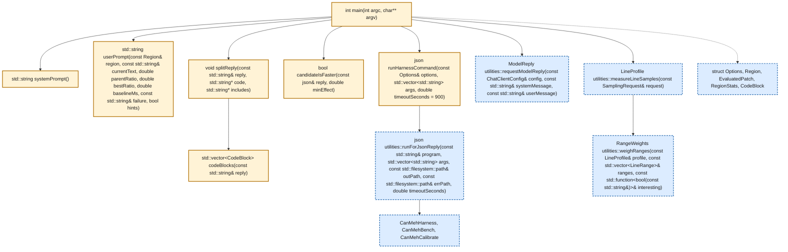
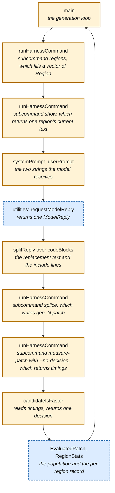

# CanMehEvolve — LLM-driven patch search over the Garmin FIT SDK

## Motivation

<!-- Point: Purpose: states the claim this project tests. -->
Before any mechanics, the question: which published claim this project tests,
and why that claim needs testing at all.

<!-- Point: Argument: published LLM-search speedups lack basic controls. -->
Some of the papers we have read this semester contain claims that an LLM inside
a search loop can discover systems code that outperforms what people and
compilers produce. Those claims rest on a handful of case studies with no shared
protocol, no non-LLM baseline and, in several papers, no comparison against
calling the model the same number of times with no feedback and no selection.
That last omission is the one that matters most: without it, a reported speedup
may be what repeated sampling produces on its own, and the selection and the
feedback a loop adds around the model may contribute nothing.

<!-- Point: States: this project supplies the omitted controls. -->
Your project tests that claim on one library, on the NUS cluster, with the
controls the papers omit.

## Target

<!-- Point: Purpose: says what you make faster, and what counts. -->
You cannot make something faster until you know what it is. What follows is
what the FIT SDK does, which part of it you measure and what separates a result
from a number.

<!-- Point: Defines: FIT, and why decode time matters. -->
FIT, for Flexible and Interoperable Data Transfer, is the binary format Garmin
devices write when they record an activity: a watch or a bike computer emits a
stream of messages holding heart rate, power, position, lap and session records,
and the SDK is the C++ library that reads such a file back into typed messages
and fields. Any service that ingests Garmin activity files runs this [decode](#decode) on
every upload, so the time it takes is work somebody really performs rather than
a benchmark we invented.

<!-- Point: Instruction: measure stock 21.201.0; ratios are over stock. -->
You measure the decoder in that SDK at tag 21.201.0, as Garmin released it, so
every [ratio](#ratio) you measure is a [ratio](#ratio) over stock.

<!-- Point: Argument: a diff makes the result applicable upstream. -->
Every candidate is a unified diff. That is deliberate: a result from this project
is a patch a person can apply, review and send upstream.

<!-- Point: Outlines: what each of the three phases produces. -->
The work comes in three phases, and every later reference to them means this.
In **Phase 0** you calibrate your [decision rule](#decision-rule) against an answer known by
construction. In **Phase 1** you run the search and produce the separation
between a real effect and no effect yourself. In **Phase 2** you report the
calibration and the separation together. Four controls follow Phase 2.

## Setup

<!-- Point: Purpose: gets you to a node with a work directory. -->
Before Phase 0 you need a cluster node and a directory you can measure in.
Getting both is what follows, and all of it has to work before Phase 0 starts.

<!-- Point: States: you work on the NUS cluster, on one node family. -->
You do this project on the NUS compute cluster. You reach it through a login
node, `xlogin`, and from there Slurm, the cluster's batch scheduler, allocates
you a compute node to run on. Two families of compute node exist here and you use one of them: the
24-core Xeon machines, whose Slurm feature names are `xcnc` and `xcnd`. The
same code takes different times on different processors, and every threshold in
this document was calibrated on that family, so a measurement from any other
machine cannot be compared with a classmate's. **Connecting**, **Transferring the
code**, **Model endpoint** and **Node family** get you onto such a node and get
your code and your key there.

<!-- Point: Lists: the build prerequisites CMake needs. -->
Needs CMake 3.20 or newer, a compiler for C++17, libcurl, network access while
configuring, and `jq`, which two shell snippets below read JSON with, one of
them inside an `sbatch` script where a missing `jq` ends the job. CMake fetches Google Benchmark, the C++ microbenchmark
library that times each repetition and chooses how many [decodes](#decode) to average into
it, together with nlohmann/json and CLI11 into `build/deps`, and the FIT SDK at
tag 21.201.0, so every build uses the versions CMake pinned whatever the
machine has installed.

<!-- Point: Instruction: build the tools, then create a work directory. -->
Two commands take you from a fresh checkout to a directory you can measure in.
`cmake --build` builds the five complete tools and writes the four activity
files they decode, and the login node is where you run it. `CanMehHarness
init` copies the SDK, compiles the copy once, links two libraries from that one
set of objects and divides one library's median decode time by the other's, and
a compute node you have reserved is where you run it, because that division is
a measurement:

```sh
cmake -S . -B build && cmake --build build -j --target CanMehHarness \
      CanMehCalibrate CanMehBench CanMehDecodeForSampler CanMehData
./build/CanMehHarness init --work build/work --repeat 10
```

<!-- Point: Warning: CanMehSearch is the sixth target and cannot link yet. -->
That command names five targets because `cmake --build build -j` on its own
builds all six, and the sixth is `CanMehSearch`, whose seven function bodies are
the assignment: until you have written them the link of `CanMehSearch` fails
with `main` reported as an undefined symbol. The linker names only `main`,
because the other six are declared inside an anonymous namespace and nothing
calls them yet. `CanMehData` is the target that runs `CanMehDataGenerator`.

<!-- Point: Instruction: read null_ok before trusting a work directory. -->
`init` prints `null_ok`. That field is true when two libraries built from
identical code measured the same to within two percent, which is the evidence
that a ratio measured in this directory comes from the two libraries rather than
from the machine. When `init` prints false, every number
from that directory is worthless, and the remedy is a quieter machine rather
than a second run. `--repeat 10` fixes how many processes every later
measurement in this directory uses, and `init` writes that number into
`meta.json`, where every later measurement reads it. **Measurement** says why
that number is 10 rather than the default 1.

### Connecting
<!-- Point: Purpose: reaches the login node through VPN and jump host. -->
Unfortunately, logging in to the cluster is not straightforward: two hops and a
virtual private network stand between you and a shell on the login node. This
section outlines how you do it, and how to authenticate once rather than at
every command.

<!-- Point: Instruction: connect through the VPN and jump host. -->
`xlogin`, the login node, answers only through a jump host and only from inside
the NUS network, so start the NUS VPN client or work from a machine on campus. A
direct connection to `xlogin.comp.nus.edu.sg:22` does not complete even with the
VPN running.

<!-- Point: Instruction: put this block in your ssh config. -->
So put the two hops in your `~/.ssh/config` as one host entry, which also keeps
one authenticated connection open for eight hours so that later commands reuse
it rather than authenticating again. Substitute your own NUS username for
`<user>` in both places:

```
Host xlogin
User <user>
HostName xlogin.comp.nus.edu.sg
ProxyJump <user>@stfjump.comp.nus.edu.sg
ControlMaster auto
ControlPath /tmp/ssh-%r@%h:%p
ControlPersist 8h
```

<!-- Point: States: ssh xlogin then reaches the login node. -->
With that entry in place, `ssh xlogin` reaches the login node.

<!-- Point: Instruction: authenticate once, reuse one shared connection. -->
`sshd` at each hop prompts for a password, so no program running unattended can
authenticate. Authenticate once, open a shared connection, and let later `ssh`
invocations reuse it:

```sh
ssh xlogin                                        # authenticate once, by hand
ssh -o BatchMode=yes xlogin 'squeue -u $USER'     # reuses that connection
```

<!-- Point: Warning: without BatchMode an unattended program hangs. -->
Pass `BatchMode=yes`: without it `ssh` prompts for a password once the shared
connection has died, and a program running unattended hangs on that prompt
instead of failing. The connection does die -- suspending a laptop or changing
networks ends it, and `ServerAliveInterval` does not keep it alive -- so re-run
`ssh xlogin`. A running job is unaffected, because `slurmd` runs it on a
compute node.

### Transferring the code
<!-- Point: Purpose: gets your code onto the cluster and back. -->
Getting your code on and off the cluster is also tricky, because the route you
would reach for first does not work here, so what follows is the route that
does.
<!-- Point: Warning: cloning over SSH fails on these nodes. -->
Login and compute nodes reach `github.com` only over HTTPS on port 443. A
connection to `github.com:22` or `ssh.github.com:443` does not complete.

<!-- Point: Instruction: clone over HTTPS into your home directory. -->
So clone over HTTPS instead, into your home directory on the login node:

```sh
git clone https://github.com/NUS-CS6219-2026/CanMehEvolve.git ~/Projects/CanMehEvolve
```

<!-- Point: Instruction: push to a bare cluster repository instead. -->
For a private repository, and for your own edits once you start writing the
search, push to a bare repository on the cluster over the shared connection.
Pushing to a bare repository stores no GitHub credential on a shared
filesystem, where a personal access token would be readable:

```sh
ssh xlogin 'git init --bare ~/Projects/canmeh.git'
git remote add cluster xlogin:Projects/canmeh.git
git push cluster master
```

<!-- Point: Warning: two builds in one checkout corrupt objects. -->
Then run that same `cmake` command on the login node, and create no work
directory there: `CanMehHarness init` ends with a measurement, so a work
directory created on the login node records a null run from a machine you will
never search on. Build once before you submit anything: several jobs may share
one checkout, because a job names its run and work directories after
`$SLURM_JOB_ID`, but two `cmake --build` processes in one checkout write the
same object files and corrupt each other's output.

### Model endpoint
<!-- Point: Purpose: reaches a language-model endpoint from the cluster. -->
As part of the loop you will need access to a large language model behind an
endpoint compatible with the OpenAI API. Luckily SoC provides one, through the
[SoC LLM portal](https://soclaas-portal.comp.nus.edu.sg), where the portal's
own instructions tell you how to obtain a key. You are, of
course, free to use something else, even a model served on your own machine, but
I have found the SoC endpoint the most convenient. Here is how you use it.

<!-- Point: Instruction: read the key from a file. -->
Put your API key in a file and pass `--llm-api-key-file` that path.
`CanMehSearch` reads the file itself, so the key never reaches a command line,
where `ps` shows it to every other user on the machine:

```sh
mkdir -p ~/.config/canmeh
printf '%s' 'clsk_...' > ~/.config/canmeh/api-key
chmod 600 ~/.config/canmeh/api-key
```

<!-- Point: Instruction: check the endpoint completes, not just lists. -->
`--llm-base-url` defaults to `https://soclaas-api.comp.nus.edu.sg/v1` and
`--llm-model` to `qwen3-coder-next`, so a run needs only your key. Before the
first one, check that the endpoint returns a completion rather than merely
listing models, because an id that appears in the model list does not always
answer:

```sh
curl -s --max-time 60 https://soclaas-api.comp.nus.edu.sg/v1/chat/completions \
  -H "Authorization: Bearer $(cat ~/.config/canmeh/api-key)" \
  -H 'Content-Type: application/json' \
  -d '{"model":"<model>","max_tokens":16,
       "messages":[{"role":"user","content":"reply with the single word ok"}]}' \
  | jq -r '.choices[0].message.content, .model'
```

<!-- Point: Instruction: report which model id actually answered. -->
Read the second line, which is the id of the model that answered. An id on this
endpoint may be an alias, in which case the endpoint serves a version other
than the one the id names. Measured on 2026-10-05: `qwen3-coder-next` answered
`ok` and reported `qwen3-coder-next`, `coder` reported `qwen3.8:27b` and
returned a null message content. `qwen3-coder-next` is the default for that
reason, and if SoC retires it you will find out here rather than at generation
one.
State in your report which id answered, which
the [Search](#search) group lists, because `utilities::requestModelReply` keeps
the reply's message text and its token counts, so the endpoint's `model` field
reaches no log.

<!-- Point: Warning: a fifth parallel search slows all five. -->
The endpoint operators state that it serves four concurrent requests at full
speed and queues any request beyond the fourth, releasing queued requests four
at a time. `CanMehSearch` makes one call at a time, so four parallel searches
use all four [slots](#slot) and a fifth only makes all five slower.

### Node family

<!-- Point: Purpose: reserves a Xeon and measures the pairs on it. -->
The cluster holds several kinds of machine, and every threshold in this document
was measured on the 24-core Xeons. `salloc` reserves one Xeon, and
`CanMehCalibrate` measures the twelve calibration pairs on it.

<!-- Point: Instruction: create your work directory on the compute node. -->
Run `CanMehHarness init` on the node you reserved as well, rather than on the
login node. `init` ends with a [null run](#null-run), which is a measurement, so
a work directory created on the login node records a null run from a machine you
will never search on, and every ratio measured in that directory is divided by a
reference time the wrong processor produced.

<!-- Point: Instruction: produce every reported number on a cluster node. -->
A timing describes the machine that produced it, so produce every number you
report on an `xcnc` or `xcnd` node. `salloc` reserves one whole Xeon node for
two hours and drops you into a shell on it, and `CanMehCalibrate` then measures
the twelve calibration pairs there, which is the measurement **Phase 0:
Calibration** asks you to report:

```sh
salloc --partition=long --constraint="xcnc|xcnd" --nodes=1 \
       --mem=0 --cpus-per-task=24 --time=2:00:00

# salloc opens a shell on the node it reserved, so type the next line in that
# shell rather than pasting both lines at once.
./build/CanMehCalibrate --repeat 10
```

<!-- Point: Instruction: size --time from CanMehCalibrate's printed duration. -->
`CanMehCalibrate` prints how long measuring every pair again takes at the
settings it used, and you size `--time` from that duration. Use the same
`--repeat` and `--repetitions` for the search as for the calibration pairs, and
do not match `--min-time`, for the reason **Phase 0: Calibration** gives.

### Sample data

<!-- Point: Purpose: says what writes the files every decode reads. -->
Every measurement in this project [decodes](#decode) the same four files. What
follows is what writes those files, and why a file written on your laptop and the
same file written on a cluster node hold identical bytes.

<!-- Point: States: CMake runs the generator during an ordinary build. -->
`CanMehDataGenerator` writes the four files, and CMake runs
`CanMehDataGenerator` as a build step, so `cmake --build build -j` leaves them in
`build/data` and compiles that path into `CanMehHarness` as the default for
`--data`. You invoke `CanMehDataGenerator` yourself only to write the files
somewhere else: it takes the output directory as its one argument and declares no
options, so it answers no `--help`.

<!-- Point: Defines: four synthetic files, written through the SDK's own encoder. -->
The four are `intervals.fit`, `long_run.fit`, `ride.fit` and `treadmill.fit`,
about 900 kB together, and they are synthetic rather than recorded: each file
holds a session of the records a watch or a bike computer writes, with heart
rate, power, speed, distance, altitude and position varying over a sine.
`CanMehDataGenerator` encodes each file by calling the SDK's own encoder, so a
candidate [decodes](#decode) bytes the SDK itself wrote. One [decode](#decode)
reads all four files.

<!-- Point: States: the four files hold identical bytes on both platforms. -->
An Apple laptop and an `xcnc` node write the same bytes, which we established by
comparing the MD5 sum and the byte count of each of the four files after a fresh
configure on each platform. Two measures hold that true, and the build already
applies both: `CanMehDataGenerator` rounds every value it derives from a sine
rather than truncating it, and `CMakeLists.txt` compiles `CanMehDataGenerator`
with `-ffp-contract=off`. A compiler that fuses a multiply and an add rounds once
where another compiler rounds twice, and that one difference moved one heart-rate
byte of `long_run.fit` between the two platforms until those two measures went
in. So your [ratio](#ratio) and a classmate's divide times measured over
identical input, and the checksum below is what establishes that.

<!-- Point: Instruction: read and report the data's four identifying numbers. -->
`CanMehBench` writes that data's checksum, byte count, message count and field
count to its stderr, which `CanMehHarness` leaves in `<work>/scratch/bench.err`,
once the load, data, correctness, profile-digest and processor-time checks have
all accepted. Read the four numbers there and report them with your results, as
the [Evidence](#evidence) group lists, because two sets of [timings](#timings)
are comparable only if the two [decodes](#decode) read the same bytes.

## Architecture

<!-- Point: Purpose: shows which programs exist and which you write. -->
This project has six programs and one of them is yours to write. Before writing
a line of it you need three things: which program does what, which functions in
yours arrive empty, and how your loop invokes the harness and reads what comes
back.

<!-- Point: Lists: the six programs CMake builds. -->
CMake builds six. You run three of them yourself: `CanMehCalibrate` measures the
calibration pairs, `CanMehHarness` copies the SDK, splices a patch into the copy
and times the decodes of the library it links from the patched tree, and times a
candidate, and `CanMehSearch` is the loop you write. The other three run only
when another program spawns them: `CanMehBench` opens two libraries and does the
timing, `CanMehDataGenerator` writes the four activity files, and
`CanMehDecodeForSampler` opens one library and decodes repeatedly while
`sample` or `perf` records which source lines the time went to.

<!-- Point: Instruction: fill in Search.cpp's empty function bodies. -->
You receive `src/Search.cpp` with every function body removed and every
declaration kept. Your work is to fill those bodies in. `src/Search.cpp` is the
only file you edit.

<!-- Point: States: described CanMehSearch behavior is yours to write. -->
So read every later sentence about what `CanMehSearch` does as a requirement on
the program you write rather than as behavior you inherit. The files under
`--out`, the [population](#population), the profiling pass before the first
[generation](#generation) and the `null_ok` check are all described in this
document because your implementation has to produce them. The other five
programs arrive complete, so a sentence about `CanMehHarness`, `CanMehBench`,
`CanMehCalibrate`, `CanMehDataGenerator` or `CanMehDecodeForSampler` describes
what you can rely on.

<!-- Point: Defines: the diagram colors, amber yours, blue provided. -->
In both diagrams below, **a solid amber box is code you write** and **a dashed
blue box arrives complete**. The arrows are calls. A Markdown reader that draws
Mermaid diagrams, such as GitHub, is where you see those two colors; reading
this file as text, you get the same split from the `class ... write` and
`class ... provided` lines at the end of each diagram, which name the
identifiers in each group. The first diagram shows the seven functions
`src/Search.cpp` declares and the four provided functions they call:



<!-- Point: States: structs arrive declared; functions do not. -->
The five structs are declared for you, so the fields your loop records are
already named. The seven functions arrive as empty bodies. `candidateIsFaster`
receives the JSON
object `measure-patch` returned and answers whether the library linked from that
candidate's patched tree decoded faster than the reference library by the margin
your rule requires. `CanMehSearch` computes the comparison with the
[parent patch](#parent-patch) separately, as [`improved_on_parent`](#improved_on_parent). Under `--no-decision` that object holds [`timings`](#timings)
and no statistic, so your version computes every number it reads.

<!-- Point: Introduces: the second diagram, ordered by calls. -->
The same functions in the order one [generation](#generation) calls them:



<!-- Point: Argument: the generation loop is the student's work. -->
Eight of those ten boxes are amber, which is the point: the [generation](#generation) loop is
yours, and each of the four `runHarnessCommand` calls spawns `CanMehHarness` to
do the compiling, patching and timing.

<!-- Point: Instruction: implement runHarnessCommand before anything else. -->
`runHarnessCommand` is the one function every step goes through, so implement
it first: it builds an argument vector, calls
`utilities::runForJsonReply`, and returns the one JSON object the subcommand
printed. `CanMehHarness` answers each invocation with exactly one JSON object
and keeps all of its state in the [work directory](#work-directory), so your loop can stop and
restart at any [generation](#generation).

<!-- Point: States: where a reason goes and where numbers go. -->
Output from `measure-patch` lands in two places, and a reader who looks in the
wrong one finds nothing. When `measure-patch` refuses a candidate it names the
`stage` that refused it in the JSON object `runHarnessCommand` returns. The
per-repetition numbers go to a Google Benchmark report at
`scratch/gb/proc-NN.json`, one per process. Read the JSON object for why a
candidate was refused, and that report for anything the
[`timings`](#timings) object leaves out.

<!-- Point: States: what --sample-seconds adds, and who wrote it. -->
`--sample-seconds` adds a second build and a fourth binary. `CanMehHarness
sampling-library` compiles the baseline tree into `obj-sampling/` with `-g`,
the compiler flag that makes the compiler emit debug line tables, which is what
lets a sampler name a source line rather than an address, and links
`libfit_sampling` from those objects. `CanMehDecodeForSampler` then opens that
one library and [decodes](#decode) repeatedly under Google Benchmark while
`utilities::measureLineSamples` runs the platform sampler over that process,
and `utilities::weighRanges` sums the per-line counts into region ranges.
`src/utilities/LineSamples.hpp` implements both of those functions already.
This whole path times `libfit_sampling` alone, and `CanMehSearch` finishes all
of it before the first [generation](#generation), because a sampler running beside a measurement widens
the spread of the per-repetition decode times.


## Measurement

<!-- Point: Purpose: describes what produces every number you report. -->
Every number you report comes out of `CanMehBench` and the `measure-patch` subcommand
that runs it. What follows is how `CanMehBench` times each library's decodes in
one process, what it refuses to measure, and what the [`timings`](#timings)
object your rule reads contains, field by field, and how many processes one measurement
runs and what verdict `CanMehHarness` would compute if you let it, which is the
verdict your rule computes instead.

<!-- Point: Explains: one process, two libraries, one clock. -->
`CanMehHarness init` compiles the SDK copy once and links those objects twice,
into two shared libraries that export the workload's C entry points, and
`CanMehBench` loads both libraries into one process with `RTLD_LOCAL`, so the two sets of `fit::` symbols and static
profile tables stay separate. Google Benchmark then interleaves the repetitions of
the two benchmark functions, so `CanMehBench` runs the reference and the candidate
against the same page cache, the same clock and the same machine conditions.

<!-- Point: States: three correctness checks precede any timing. -->
`CanMehBench` checks correctness before timing anything. The candidate must
fold every decoded field value to the same checksum as the reference, twice
over, must answer the profile lookups exactly as the reference answers them
across their whole input domain, and must not use threads.

<!-- Point: States: measure-patch's two tests and init's null check. -->
Which test `measure-patch` runs depends on `--repeat`, and both tests read the
per-repetition times Google Benchmark reported. At `--repeat 1` it
runs a [permutation test](#permutation-test) over the per-repetition
[timings](#timings) inside that one [process](#process). At `--repeat 2` or more
it runs a
[sign-flip test](#sign-flip-test) over the per-process log-ratios instead,
which is the path `--repeat 10` takes and therefore the path your results come
from.  `CanMehHarness
init` links a second library from the reference library's objects and divides
that second library's median decode time by the reference library's, which is
the null run, and reports `null_ok` false when that quotient differs from 1.000
by two percent or more, between two libraries built from
identical code. `CanMehHarness init` reads only that quotient and never p,
because under the null hypothesis of no difference p is uniform, so one run in
twenty reports p below 0.05 on the quietest node.

<!-- Point: Argument: why --repeat 10 rather than 1 or 8. -->
The number of processes decides which p-values `measure-patch` can reach at all. The
[sign-flip test](#sign-flip-test) cannot report a p-value below 2/2^N over N
processes, so at
`--repeat 5` the smallest attainable value is 0.0625, far above the 0.01 a
result needs, and no candidate can ever pass. The arithmetic admits N = 8,
where 2/2^8 is 0.0078, but 0.0078 is then the only attainable value below 0.01,
and `measure-patch` reports it only when all eight processes agree in direction, so one
process disagreeing fails the test however large the effect is. At N = 10 the
attainable values 2/1024, 4/1024, 6/1024, 8/1024 and 10/1024 all fall below
0.01, so a real effect survives up to three processes disagreeing. The
[`ratio_spread`](#ratio_spread) threshold `measure-patch` reads to set [`unstable`](#significant) was calibrated at 10
processes as well. Report the value you used either way.

<!-- Point: Argument: timings makes every statistic recomputable. -->
`measure-patch` and `measure-pair` both print a [`timings`](#timings) object
holding every per-repetition number Google Benchmark reported, together with the
facts `CanMehHarness` records about each process: its index, whether
`CanMehHarness` swapped the [slots](#slot), the path of the report `CanMehBench`
wrote under `scratch/gb`, the load averages Google Benchmark put in that
report's `context` and the per-repetition
`candidate_ns`, `reference_ns`, the two processor-time series and the two
iteration counts. Every statistic `measure-patch` prints is computable from that
object, which is what lets you check a statistic rather than trust it.

<!-- Point: Example: one complete timings object, over null. -->
Here is one complete [`timings`](#timings) object, which `measure-pair --no-decision` printed
over the `null` calibration pair at `--repeat 2 --repetitions 3`. The two
libraries of that pair perform the same number of [work units](#work-unit), so no number
below tells you anything about the SDK. Each `report` value is an absolute
path, abbreviated here:

```json
{
  "ok": true,
  "processes": 2,
  "repetitions": 3,
  "swapped_processes": 1,
  "timings": {
    "unit": "ns",
    "clock": "real_time",
    "min_time": "0.25s",
    "repetitions_requested": 3,
    "ragged": false,
    "process": [
      {
        "index": 0,
        "swapped": false,
        "report": ".../calibration/null/scratch/gb/proc-00.json",
        "load_avg": [9.75928, 7.66357, 5.21631],
        "candidate_ns": [6775919.918664822, 6870977.114886045, 6893490.194616949],
        "reference_ns": [6757401.961687149, 6803538.412878326, 6813479.587435722],
        "candidate_cpu_ns": [6772156.862745094, 6867176.470588243, 6888843.137254903],
        "reference_cpu_ns": [6752882.352941173, 6799450.980392158, 6810098.039215696],
        "candidate_iterations": [51, 51, 51],
        "reference_iterations": [51, 51, 51]
      },
      {
        "index": 1,
        "swapped": true,
        "report": ".../calibration/null/scratch/gb/proc-01.json",
        "load_avg": [9.75928, 7.66357, 5.21631],
        "candidate_ns": [6809955.061066384, 6856538.391872948, 6846240.192067389],
        "reference_ns": [6847183.317877352, 6873385.841026902, 6823513.321578503],
        "candidate_cpu_ns": [6806156.862745101, 6852509.803921567, 6841960.78431373],
        "reference_cpu_ns": [6843100.0, 6869000.000000005, 6819340.0],
        "candidate_iterations": [51, 51, 51],
        "reference_iterations": [50, 50, 50]
      }
    ]
  }
}
```

<!-- Point: Defines: both array lengths; three repetitions minimum. -->
`timings.process` holds one entry per process, so its length is the value you
passed to `--repeat`. Each series inside one entry holds one value per
repetition, so its length is the value you passed to `--repetitions`.
`CanMehHarness` requires at least three repetitions in each series. Below three
it prints a three-key object -- `"ok": false`, `"stage": "run"` and the error
`too few repetitions came back from the benchmark` -- so a parser has to read
`ok` before it reaches for [`timings`](#timings).

<!-- Point: Introduces: the five fields outside process. -->
The five fields outside `process`:

<!-- Point: Defines: unit, clock, min_time, repetitions_requested, ragged. -->
- `unit` is `ns`, so every number in every series is nanoseconds.
- `clock` is `real_time`, naming which of Google Benchmark's two clocks
  `candidate_ns` and `reference_ns` report.
- `min_time` is the `--benchmark_min_time` `CanMehBench` passed to Google
  Benchmark, which `CanMehHarness` reads from `meta.json` and defaults to
  `0.25s`.
- `repetitions_requested` is what you asked for, so your rule can detect a
  process that returned fewer.
- `ragged` is true when the series differ in length, either between processes
  or between the two series inside one process. A rule that
  pairs process 0's third repetition with process 1's third repetition has to
  read `ragged` before it does so.

<!-- Point: Introduces: the ten per-process fields. -->
The ten fields inside one `process` entry:

<!-- Point: Defines: index, swapped, report, load_avg and the series. -->
- `index` numbers the processes in the order `CanMehHarness` ran them.
- `swapped` is true when `CanMehHarness` placed the candidate library in the
  `--base` [slot](#slot), so that process loaded the candidate first. `CanMehHarness`
  alternates, and `swapped_processes` beside [`timings`](#timings) counts how many of the
  processes swapped.
- `report` names the Google Benchmark report `CanMehBench` wrote, so you can
  read that report directly for anything this object omits.
- `load_avg` holds the three load averages Google Benchmark recorded in its
  report's `context`, over one, five and fifteen minutes.
- `candidate_ns` and `reference_ns` hold Google Benchmark's `real_time` per
  repetition. **Each value is a mean over that repetition's [decodes](#decode), not one
  [decode](#decode).** A rule that ignores the iteration count mistakes Google
  Benchmark's averaging for a quiet machine.
- `candidate_cpu_ns` and `reference_cpu_ns` hold the matching `cpu_time`
  series. Dividing a candidate library's processor time by its wall-clock time is how
  you notice a candidate that started threads.
  <!-- Point: Warning: never divide by the iteration counts. -->
- `candidate_iterations` and `reference_iterations` hold the [decode](#decode) counts
  Google Benchmark chose. **Do not divide by these.** `candidate_ns` is already
  nanoseconds per [decode](#decode), not a repetition total: in the object printed above over the `null` pair, 51
  [decodes](#decode) of 6.8 ms fill the 0.25 s `min_time`, and [`score_ms`](#score_ms) is the median of
  `candidate_ns` with no division anywhere. What the counts tell you is how
  deeply Google Benchmark averaged each repetition, and **the two counts need
  not agree**: process 1 above decoded 51 times per candidate repetition and 50
  times per reference repetition, because Google Benchmark sizes each of the two
  benchmark functions separately. So the candidate series and the reference
  series are comparable as they stand, but one may be the quieter average of the
  two, and a rule that weights the two series equally assumes both averaged
  equally deeply.

<!-- Point: Defines: --no-decision, and what measure does. -->
`measure-patch --no-decision` and `measure-pair --no-decision` print exactly the
five keys the object above shows: `ok`, `processes`, `repetitions`,
`swapped_processes` and the [`timings`](#timings) object. Your loop runs
`measure-patch` that way, so your code computes every statistic in your result
from [`timings`](#timings). `measure-pair` times the two libraries
a [work directory](#work-directory) already holds, applying no patch and rebuilding nothing, which
is how `CanMehCalibrate` measures a calibration pair: a calibration pair has no
SDK tree for `measure-patch` to patch.

<!-- Point: States: this file records no reference numbers deliberately. -->
We deliberately record no reference numbers in this file: in Phase 0 you
produce the numbers this document refuses to give you.

<!-- Point: Points at: the data description and its four numbers. -->
Read **Sample data** for what the four activity files hold and for the four
numbers to report about them.

<!-- Point: States: each library opens the data files itself. -->
`CanMehBench` passes the data directory to each library's
`canmehLoadDataFiles`, and each library reads the four files itself, so each
library [decodes](#decode) the bytes that library loaded.

<!-- Point: Warning: rewriting the oracle makes a candidate lose. -->
`CanMehBench` compares the candidate's answers with the reference's, so a
candidate that rewrites the correctness [oracle](#oracle) disagrees with the reference and
loses.

## Assignment

<!-- Point: Purpose: holds the three phases you work through. -->
The three phases follow, in the order you work through them. **Phase 0**
produces the evidence about your rule, **Phase 1** runs the search with that
rule deciding, and **Phase 2** collects every requirement your report has to
meet.

### Phase 0: Calibration

<!-- Point: Purpose: produces three numbers about your rule. -->
In this phase you run your decision rule over pairs of libraries whose true
ratio is known by construction, rather than over the SDK decode, and produce three
numbers about that rule, against pairs of libraries whose true ratio is known by
construction: how often the rule is wrong, how small an effect it can see, and
how far the ratio it reports is from the truth.
The [Evidence](#evidence) group lists what to say about each.

<!-- Point: Argument: an inert patch tests only one point. -->
You write the rule that turns [timings](#timings) into a claim, so you have to establish
what that rule does before you spend a model budget on it. An [inert patch](#inert-patch) cannot
establish what that rule does: an [inert patch](#inert-patch) tests one point, a [true ratio](#true-ratio) of
exactly 1.000, and leaves unmeasured both the smallest effect your rule detects
and the distance between the number your rule reports and the [true ratio](#true-ratio).

<!-- Point: Defines: calibration pairs; dividing the counts is yours. -->
CMake builds **calibration pairs** so that you can. CMake compiles each pair
from one source file into two shared libraries that differ only in how many
**[work units](#work-unit)** each library performs, so the quotient of those two counts is the
[true ratio](#true-ratio). CMake writes every pair into its own directory under
`build/calibration`, and records the two work counts in each `meta.json` and
never their quotient: dividing them is your job. Each of those directories is a
[work directory](#work-directory) that `CanMehHarness measure-pair` accepts.

<!-- Point: Instruction: run CanMehCalibrate over all twelve pairs. -->
CMake builds twelve pairs under `build/calibration`, each in a [work directory](#work-directory)
`CanMehHarness measure-pair` accepts, and `./build/CanMehCalibrate` measures all
twelve and prints one table:

```sh
./build/CanMehCalibrate --repeat 10
```

The [true ratio](#true-ratio) is the candidate's work count divided by the reference's, so a
[ratio](#ratio) below 1.000 means the candidate library decoded faster:

| pair | candidate units | [true ratio](#true-ratio) | what it is for |
|---|---|---|---|
| `null` | 20000 | 1.0000 | the [false-positive rate](#false-positive-rate) |
| `faster-1-percent` | 19801 | 0.9901 | [detection threshold](#detection-threshold) |
| `faster-2-percent` | 19607 | 0.9804 | [detection threshold](#detection-threshold) |
| `faster-5-percent` | 19047 | 0.9524 | [detection threshold](#detection-threshold) |
| `faster-10-percent` | 18181 | 0.9091 | [detection threshold](#detection-threshold) |
| `slower-10-percent` | 22000 | 1.1000 | a one-sided rule must never call this a speedup |
| `sweep-105` | 21000 | 1.0500 | [bias](#bias) |
| `sweep-110` | 22000 | 1.1000 | [bias](#bias) |
| `sweep-200` | 40000 | 2.0000 | [bias](#bias), and required |
| `sweep-400` | 80000 | 4.0000 | [bias](#bias), and required |
| `broken-digest` | 18181 | — | `CanMehBench` refuses it at stage `correctness` |
| `shared-install-name` | 18181 | — | `CanMehBench` refuses it at stage `load` |

<!-- Point: States: ten pairs give nine distinct true ratios. -->
At the default 20,000 reference units the counts are what the table shows, and
they scale with `-DCANMEH_CALIBRATION_REFERENCE_UNITS`. Note that
`slower-10-percent` and `sweep-110` are the same pair twice: both compile 22,000
candidate units, so the ten measured pairs supply nine distinct [true ratios](#true-ratio). Measuring
both is still worth the time, because two pairs built from one configuration are
a free check that the rig repeats.

<!-- Point: Warning: measure the two pairs CanMehBench refuses. -->
The last two rows are not decoration. `CanMehBench` refuses the `broken-digest` pair
because the two libraries fold different checksums, and refuses the shared
install name because `dlopen` answers with one image twice. A loop that reports a
number when `CanMehBench` refused the pair has reported a number about nothing,
so measure both.

<!-- Point: States: the five rows CanMehCalibrate requires. -->
For the two pairs CMake built to be refused, `CanMehCalibrate` reports the stage
`CanMehBench` refused the pair at. For every other pair, `CanMehCalibrate`
reports the [true ratio](#true-ratio), the measured [ratio](#ratio), the error and [`ratio_spread`](#ratio_spread), and
requires five things of the twelve rows: `CanMehBench` must refuse
`broken-digest` at stage `correctness` and `shared-install-name` at stage
`load`, and the measured [ratio](#ratio) must land within two percent of 1.000 for
`null` and within three percent of the [true ratio](#true-ratio) for `sweep-200` and
`sweep-400`. A required row that misses ends the run with a non-zero exit
status. `CanMehCalibrate` prints the other seven rows for you to read, because
near the smallest effect `measure-patch` resolves, a miss is evidence about
`measure-patch` rather than about the calibration pairs.

<!-- Point: Instruction: report three numbers with every setting. -->
Report three numbers, each with the machine, the compiler, `--repeat`,
`--repetitions`, `--min-time` and how many trials you ran:

<!-- Point: Instruction: report false-positive rate, threshold and bias. -->
1. The **[false-positive rate](#false-positive-rate)** of your rule: how often your rule reports a
   speedup for the `null` pair, whose two libraries perform equal work, with a
   95 percent Clopper-Pearson interval, which is the exact binomial one. Use
   Clopper-Pearson or Wilson rather than a normal approximation, because the
   normal approximation gives an interval of zero width when your rule reports
   no speedup in any trial, and no speedup in any trial is the outcome to
   expect. Ten trials with no false positive give 0 to 0.31, which is why ten
   trials cannot distinguish one percent from fifteen, so say what your trial
   count supports.
2. The **[detection threshold](#detection-threshold)**: the smallest true effect your rule finds in at
   least nine trials out of ten. The four faster pairs give you four known
   effect sizes; report the rate at each one instead of one number,
   because a threshold with no curve behind it hides whether the rule
   degrades gradually or drops abruptly below some effect size.
3. The **[bias](#bias)** of the [ratio](#ratio) your rule reports: the reported [ratio](#ratio) minus
   the quotient of the compiled work counts, at each effect size.

<!-- Point: Instruction: repeat one measurement to produce trials. -->
A rate and a threshold both need many trials, and `CanMehCalibrate` measures
each pair once per invocation, so you produce trials by repeating one
measurement rather than by invoking `CanMehCalibrate` again. A shell loop around
`./build/CanMehHarness measure-pair --work build/calibration/null --no-decision`
gives one trial of your rule per iteration, and the same loop over
`build/calibration/faster-5-percent` and its three siblings gives the detection
trials. Record how many you ran, because the count is what decides which rate
you can claim.

<!-- Point: States: tuning thresholds on the pairs is allowed if you report it. -->
Choosing your rule's thresholds by looking at the pairs is allowed. Say which
numbers you chose that way and which pairs you chose them on, because a rate
measured on the same pairs that set a threshold describes those pairs rather
than your next measurement, and a reader who knows which is which reads your
[false-positive rate](#false-positive-rate) correctly. Calibration here means
fixing your rule and then measuring what the fixed rule does against an answer
known by construction, so nothing inside `CanMehHarness` is adjusted.

<!-- Point: Argument: the sweep rows show the intercept negligible. -->
`CanMehCalibrate` measures the four sweep pairs, whose candidates perform more work
than the reference in the same run and prints them in the same table, and you
read those four rows to check the calibration pairs rather than to check your
rule. For those four pairs `CanMehCalibrate` divides the measured
[ratio](#ratio) by the quotient of the counts CMake compiled in and reports how
far that quotient falls from 1.000. That comparison is there to
rule out one thing. Suppose one [decode](#decode) of `N` [work units](#work-unit) takes `a + b*N`. The
measured [ratio](#ratio) is then `(a + b*M) / (a + b*N)`, which equals `M/N` only when `a`
is negligible. A measured [ratio](#ratio) of 2.000 for the 2.00 pair therefore shows that
`a` is small enough for the quotient of the compiled counts to be the true
[ratio](#ratio). When `CanMehCalibrate` reports a required row outside its bound, raise
the work count rather than widening the bound. Raising it means reconfiguring
with a larger `-DCANMEH_CALIBRATION_REFERENCE_UNITS` and rebuilding, which
recompiles all twelve pairs:

```sh
cmake -S . -B build -DCANMEH_CALIBRATION_REFERENCE_UNITS=<units>
cmake --build build -j
```

<!-- Point: Instruction: report the work count you measured at. -->
Then report the settings you measured at, the work count included, because a
rate or a threshold holds only for the pairs it was measured on.

<!-- Point: Instruction: match --repeat and --repetitions, never --min-time. -->
Two rules for applying what Phase 0 established when you run Phase 1. Use the
same `--repeat` and `--repetitions` for the search as for the calibration
pairs, because a [false-positive rate](#false-positive-rate) you establish at one setting is not the
rate at another setting. **`--min-time` is the exception, and matching it would
be wrong.** `CanMehCalibrate` sizes `--min-time` per pair from a probe, at about
twice one [decode](#decode) of that pair, and records the value it used in each row of
`build/calibration/calibration.json`. The reason is in the opposite direction
from what you would guess: a `min_time` far above one [decode](#decode) makes Google
Benchmark average many [decodes](#decode) into each repetition, which hides the work
loop's variance and makes your rule look better on the pairs than it performs
on the SDK [decode](#decode). So leave `--min-time` alone in both phases, and when you run
`CanMehHarness measure-pair` over a pair by hand, pass that pair's recorded
`min_time` yourself, which `CanMehCalibrate` recorded in `calibration.json`,
because `measure-pair` otherwise falls back to the 0.25s default. And run your loop against `measure-patch --no-decision`, so
`CanMehHarness` hands you [timings](#timings) and your code decides. One warning about
running your loop against `measure-patch --no-decision`: a rule that reads
`result["ratio"]` without first checking that the field is present throws on
the first `--no-decision` run, and `ratio` is the field such a rule reaches for
first. If you know that, the diagnosis takes a
minute; if you do not, it takes an afternoon.

<!-- Point: Introduces: four limits of the calibration pairs. -->
What the calibration pairs cannot establish, and what to say about each in your
report:

<!-- Point: Warning: SDK repetitions may not be independent. -->
- **The calibration work loop's [timings](#timings) are stationary and the SDK decoder's are
  not.** Stationary here means the distribution each repetition's time is drawn
  from stays the same across the series. The SDK decoder allocates inside the
  timed region and branches on the data, so the SDK decoder's
  [timings](#timings) may have a heavier tail and may correlate from one
  repetition to the next, and nobody here has measured either. A rule that
  assumes independent repetitions can reach its nominal [false-positive rate](#false-positive-rate) on a
  calibration pair and exceed it on the SDK decoder. Report the lag-1 sample
  autocorrelation of each process's `candidate_ns` series: the sum of
  `(x[i] - mean) * (x[i+1] - mean)` over the adjacent pairs, divided by the sum
  of `(x[i] - mean)^2` over the whole series, taking that series' own mean. Nine
  repetitions give one such number a standard error near 1/sqrt(9), about 0.33,
  so report the median and the range of it across the processes of one
  measurement rather than one series' value, for the calibration work loop and
  for the SDK decoder, and state whether your rule assumes independent
  repetitions.
  <!-- Point: Lists: three further limits to report. -->
- **A calibration pair scales the whole workload uniformly.** A real patch
  usually changes the time of one part of a [decode](#decode) and leaves the rest
  unchanged, so a [detection threshold](#detection-threshold) you establish on a pair that scales the
  whole [decode](#decode) does not transfer to a patch that speeds up one part of it.
- **A pair bounds only the part of a [bias](#bias) that survives the division.** A
  constant difference between the two [slots](#slot), or an error in the clock's scale,
  divides out. Measuring the `null` pair bounds only the part that does not
  cancel, which is why we still require both the [inert patch](#inert-patch) on the
  SDK decoder and the null run from `CanMehHarness init`.
- **The twelve pairs reach three outcomes.** `CanMehCalibrate` calls
  `measure-pair`, which times two libraries CMake already built, so a pair
  reaches stage `load`, stage `correctness` or a measurement. Every calibration
  library decodes on one thread, so `CanMehBench`'s threading check accepts all
  twelve. Say which of your loop's failure branches a calibration pair reached.

### Phase 1: Search loop

<!-- Point: Purpose: runs the search with your own decision. -->
This phase is the search itself. You write the loop and the rule, run them
against the harness with every statistic withheld, and produce the separation
between a real effect and no effect yourself.

<!-- Point: States: you write the rule and the loop. -->
You write two programs: the rule that decides whether a candidate is faster,
and the search loop that spends a budget on candidates. `CanMehHarness`
compiles the tree, splices your replacement into one region and times the two
libraries' decodes, and `measure-patch --no-decision` hands you every timing and
withholds every statistic. In Phase 0 you calibrate the first program.

<!-- Point: Instruction: write your loop yourself; no Python. -->
The copy of `src/Search.cpp` you receive declares the five structs and the
seven functions, and `CanMehSearch` compiles only once you have written those
seven function bodies. **Defaults** at the end of this document gives
every flag's default value, and the four subcommands your loop calls appear in
this section, which together show the choices the declarations imply. We expect C++, so
that you can include the four headers in `src/utilities/`, and any other
language except Python works if you implement the chat-completions request
yourself.

<!-- Point: Instruction: pass the endpoint flags your loop needs. -->
The command that runs a finished loop names the work directory `init` created,
the output directory for the run's logs and patches, and the number of
generations. `--llm-base-url` and `--llm-model` already default to the SoC
endpoint and a model it serves, so the only flag you have to add is
`--llm-api-key-file`, which **Model endpoint** covers:

```sh
./build/CanMehSearch --work build/work --out runs/exp1 --generations 40
```

<!-- Point: States: the rule's shape is yours, if identifiable. -->
Your measurement rule has no prescribed shape. It reads the [`timings`](#timings) object
out of `measure-patch --no-decision` and emits one decision, and whether it is a
function inside your loop, a separate program or a shell pipeline is yours to
choose. What the marking scheme asks for is that the rule is identifiable, that
Phase 0 calibrated the rule you actually ran, and that a reader can see what it
computes.

<!-- Point: Summarizes: the steps of one generation. -->
Your loop asks `CanMehHarness regions` which regions your loop may edit, picks a
region, asks `show` for that region's current text under the [parent patch](#parent-patch), builds
a prompt, calls the model, writes the replacement text out of the reply to a
file and names that file to `splice`, then has `measure-patch --no-decision`
compile the patched tree and time its decodes, applies your own rule to the [timings](#timings), feeds compile errors
and correctness failures into the next prompt, and logs every candidate so anyone
can reconstruct the run.

<!-- Point: Instruction: pass --max-lines wherever an id resolves. -->
Those four subcommands, with real arguments. Every one of them takes `--work`,
and every one that resolves a region id takes `--max-lines`, because the id is
an index into the list at that setting and a different setting renumbers it:

```sh
H=./build/CanMehHarness
W=build/work
R=<one id that `CanMehHarness regions` prints>

# splice writes its patch with no check that the directory exists, and reports
# ok either way, so create the directory first or splice reports success and
# leaves no file. CanMehSearch creates it itself; you create it when you call
# splice by hand.
mkdir -p runs/exp1/patches

# Which regions exist. One JSON object holding `count`, `total` and a `regions`
# array of {id, file, label, lines, start, end, ordinal}. 5,514 at --max-lines 250.
# Two regions can share a label, so label plus ordinal identifies an overload.
$H regions --work $W --max-lines 250
$H regions --work $W --file <one SDK source file>   # filtered, ids unchanged

# The current text of one region, as it reads after a parent patch applies.
# Prints {ok, text, ...}; feed `text` to the model.
$H show --work $W --region $R --patch runs/exp1/patches/gen_7.patch

# Replace that region. --replacement is a FILE holding the new text, not the
# text itself, and --out is the patch file to write. --includes names a second
# file of #include lines, which splice merges into the file's include block.
$H splice --work $W --region $R \
          --patch runs/exp1/patches/gen_7.patch \
          --replacement /tmp/replacement.cpp \
          --includes /tmp/includes.txt \
          --out runs/exp1/patches/gen_8.patch

# Time it, and withhold every statistic so your rule decides.
$H measure-patch --work $W --patch runs/exp1/patches/gen_8.patch --no-decision
```

<!-- Point: Points at: region's definition; --max-lines renumbers every id. -->
A **region** is one function body, defined in the [Glossary](#region).
`CanMehHarness regions` indexes the 5,514 bodies of at most `--max-lines` lines,
and raising that bound renumbers every id, so an id from one listing means a
different function at another setting.

<!-- Point: Instruction: report any override of init's three settings. -->
Three options decide how a measurement runs, and `CanMehHarness init` writes all
three into `meta.json` so that every later `measure-patch` inherits them: `--repeat`, the
number of independent processes; `--repetitions`, the repetitions inside one
process; and `--min-time`, the seconds Google Benchmark spends per repetition.
Pass them to `measure-patch` only to override what `init` recorded, and if you do, say so
in your report, because Phase 0 calibrated the settings `init` stored.

<!-- Point: Introduces: three steps before spending a budget. -->
Three things to do before you give your loop a budget.

<!-- Point: Instruction: evaluate one patch by hand first. -->
Evaluate one patch by hand first. Use `show`, write a replacement in an editor,
`splice` that replacement and `measure-patch` the result, starting with a change you know
is inert, such as adding a comment, until `measure-patch` reports [`significant`](#significant)
false. Then try something you believe is real and compare the two p values. A
loop built before you have evaluated one patch by hand automates a measurement
you have never operated.

<!-- Point: Instruction: draw regions from a profile, not uniformly. -->
Choose regions from a measurement, not a guess. `CanMehHarness regions` indexes
more than five thousand editable regions, and in a measured [decode](#decode) a
few dozen of them take every profiler sample, with a handful of those taking
half of all samples. A loop that draws regions uniformly therefore spends almost
every [generation](#generation) on one of the generated message accessors outside
that few dozen. Pass `--sample-seconds` and `CanMehSearch` profiles one
[decode](#decode) first and then draws regions in proportion to the samples each
one took. `--uniform-share` sets how many draws ignore
that profile, because a one-line accessor the compiler inlined has no samples of
its own and rewriting that accessor can still make the [decode](#decode) faster.

### Phase 2: Reporting

<!-- Point: Purpose: reports the measurement, not just the result. -->
A result is only as good as the evidence that the measurement behind it works.
This phase is the write-up of that evidence, and every requirement the report
has to meet is collected below.

<!-- Point: Lists: everything the report must contain, grouped. -->
Everything the report must contain is listed here, in four groups. Every other
section that states a requirement links back to the group it goes in, so that a
requirement added in one place and not the other shows up as a link with no
matching entry.

#### Evidence

- The [null run](#null-run) from `CanMehHarness init`, and which node it ran on.
- Phase 0's three numbers: the [false-positive rate](#false-positive-rate) with
  a confidence interval, the [detection threshold](#detection-threshold) with a
  rate at each effect size, and the [bias](#bias). Give the trial count, and the
  `--repeat`, `--repetitions`, `--min-time` and work count each was produced at.
- The rule itself: what your code reads out of [`timings`](#timings), what it
  computes and the threshold at which it calls a candidate faster.
- An [inert patch](#inert-patch) spliced into the SDK and evaluated by hand.
- The data's four identifying numbers: the checksum, the byte count, the message
  count and the field count that `CanMehBench` wrote to `scratch/bench.err`.

#### Search

- All four controls, C1 through C4.
- Which model id answered, which is not always the id you asked for.
- The tokens you spent, from `credits.csv`, beside the speedup you claim.

#### Run

- The machine, the compiler version, the model and its version string, the
  seeds, the number of API calls and the wall-clock time.
- The runs you abandoned, and why you abandoned them.
- Which node every baseline came from, because a baseline in milliseconds
  describes one node only.

#### Document

- At most four pages, with one figure.
- A negative result stated plainly, in the abstract rather than buried.
- A result worded as what your modification changed, for the reason
  **Licensing** gives.

<!-- Point: Warning: speedups below your inert-patch figure are meaningless. -->
If your report contains a speedup no larger than the one your rule reports for
an [inert patch](#inert-patch), that speedup is not evidence of anything, and the four controls
below are what show whether something other than your search produced the number
you are quoting.

<!-- Point: States: this design is one answer, not required. -->
The design **Measurement** describes, which loads both libraries into one
process and decides from a permutation test or a sign-flip test over the
per-repetition times, is one answer, and in Phase 1 you write the decision.
What we require is evidence of how often your rule reports a speedup where the
[true ratio](#true-ratio) is 1.000, which is two things: the [false-positive rate](#false-positive-rate) on the `null` pair from
Phase 0, and an [inert patch](#inert-patch) spliced into the SDK and evaluated by hand.

## Controls

<!-- Point: Purpose: separates your search's gain from other causes. -->
A speedup on its own says nothing about how it was achieved. These four controls
are what separate your search's contribution from the compiler's, from an hour
of your own attention and from plain repeated sampling, and your report needs
all four, which the [Search](#search) group lists.

<!-- Point: Instruction: report baselines at three compiler settings. -->
**C1 — The compiler control.** Report the baseline at `-O2`, at `-O3` and with
`-march=native`. Say how much of your
search's gain a single compiler flag reproduces, deterministically, and note
that a compiler preserves the program's observable behavior by construction,
while your search can change that behavior.

<!-- Point: Instruction: rebuild with --opt for control C1. -->
**For control C1 you need to rebuild the SDK at other optimization settings.**
`CanMehHarness` takes `--opt` and `--cxxstd` before the subcommand, and compiles
every translation unit of every build in that run with them, so
`--opt -O3` or `--opt "-O3 -march=native"` gives you a baseline at that setting:

```sh
./build/CanMehHarness --opt -O3 init --work build/work-O3 --repeat 10
```

<!-- Point: Instruction: one work directory per compiler setting. -->
Each setting needs its own [work directory](#work-directory), because `init` records the compiler in
`meta.json`, and the compiler has to compile every patched translation unit with
the flags that built the reference library.

<!-- Point: Instruction: hand-optimize for one timed hour first. -->
**C2 — The human control.** Spend one hour hand-optimizing the SDK decoder
yourself, and time yourself, before you look at any search output. Report the
patch and the wall-clock time. If an hour of your attention beats forty
[generations](#generation) of search, that is the most interesting number in your report.

<!-- Point: Instruction: run best-of-N at an equal call budget. -->
**C3 — The no-search control.** Run best-of-N: the same model, the same prompt,
the same total number of API calls, but every call starts from the unmodified
baseline with no feedback, no [population](#population) and no memory. Take the best result. If
your evolutionary search does not beat best-of-N at an equal call budget, the
selection and the feedback in your loop contributed nothing, and what you have
is a sampling result.

<!-- Point: Instruction: omit --patch to build best-of-N. -->
The mechanism is one flag you leave out. `show` and `splice` both take
`--patch` optionally: given it, `CanMehHarness` reads and rewrites the region
as the [parent patch](#parent-patch) left it, and left out, `CanMehHarness` reads and rewrites
the region as the unmodified baseline holds it. So a best-of-N run leaves
`--patch` off every `show` and `splice` call and sends the same prompt every
time, which is C3 as stated above. Count calls
rather than [generations](#generation) when you compare the two runs, because a [generation](#generation) of
your search may make more than one call.

<!-- Point: Instruction: five seeds, report median and range. -->
**C4 — The variance control.** Run every configuration with at least five seeds.
Report the median and the full range of the speedups those runs produced. A
single best run is not a result.

## Cluster

<!-- Point: Purpose: runs a search on a node and reads it back. -->
You reached a Xeon node while following **Setup**. **Submitting a search**
runs one unattended with `sbatch`, **Monitoring a run** reads `results.jsonl`,
`credits.csv` and `regions_tried.json` out of the run's output directory, and
**Traps** records what has already ruined a measurement on this cluster.

### Submitting a search

<!-- Point: Purpose: submits a whole search as one batch job. -->
One `sbatch` command runs a whole search unattended. It reserves a Xeon node for
two hours and forty-five minutes, creates a work directory and an output
directory named after the job id, runs `CanMehHarness init` and stops if
`null_ok` came back false, then runs `CanMehSearch` for 40 generations with its
console output captured:

```sh
mkdir -p runs
sbatch --partition=long --constraint="xcnc|xcnd" \
       --nodes=1 --ntasks=1 --cpus-per-task=24 --mem=0 \
       --time=2:45:00 --job-name=canmeh --output=runs/slurm-%j.log \
       --mail-type=FAIL,TIME_LIMIT --mail-user=<you>@u.nus.edu \
       --wrap='set -e
  W=$PWD/build/work-$SLURM_JOB_ID
  OUT=runs/exp-$SLURM_JOB_ID
  mkdir -p "$OUT"
  ./build/CanMehHarness init --work "$W" --repeat 10 > "$OUT/init.json"
  test "$(jq -r .null_ok "$OUT/init.json")" = true || { echo "null run dirty"; exit 1; }
  ./build/CanMehSearch --work "$W" --out "$OUT" --generations 40 \
    --sample-seconds 20 \
    --llm-model qwen3-coder-next --llm-api-key-file ~/.config/canmeh/api-key \
    > "$OUT/console.log" 2>&1'
```

<!-- Point: Explains: why each sbatch flag is there. -->
Why each `sbatch` flag in that submission is there. With `--constraint="xcnc|xcnd"` Slurm runs the job only
on the node family you calibrated on, and the shell must not see the `|`
unquoted. `--mem=0 --cpus-per-task=24` takes a whole `xcnc` node, which is what
`--exclusive` would do on a cluster that allowed it. Naming `$W` and `$OUT`
after `$SLURM_JOB_ID` keeps concurrent jobs apart, because two `measure-patch` processes
sharing a [work directory](#work-directory) overwrite each other's scratch directory and object
tree. `--sample-seconds 20` rather than `--region-files` is what narrows the
search to a measured profile, for the reason **Phase 1** gives.

<!-- Point: States: perf works, but unattributed share stays large. -->
`--sample-seconds` works on these nodes. `CanMehSearch` runs `perf record -F
997` there and `sample` on macOS, and we confirmed on an `xcnc` node that
`perf` resolves source lines in the work tree: 316 distinct lines of
`tree/src`, and `CanMehDecodeForSampler` decoded to the same checksum under
the sampler that `CanMehBench` reports without one. `perf` warns there that a
restricted `kptr_restrict` stops it resolving kernel addresses, and you can
ignore that warning, because `weighRanges` counts only lines in the work tree
toward a region's share.
Expect a sizable unattributed share here, and note that more than half of what
we measured named `tree/src/SdkDecode.cpp` or
`tree/src/utilities/Portability.hpp`, two files that fall outside the region
index, so a larger `--max-lines` leaves that part of the share where it is.

<!-- Point: Instruction: test null_ok yourself; CanMehSearch does not. -->
The `null_ok` test is yours to make. `CanMehSearch` prints the null run's
p-value and starts searching whatever that p-value is, and p is the wrong thing
to judge a null run by: under the null hypothesis of no difference p is
uniform, so p below 0.05 comes up one run in twenty however quiet the node is. `CanMehHarness init` decides
`null_ok` from effect size instead, and a [work directory](#work-directory) where `CanMehHarness
init` reported `null_ok` false makes every later number from that directory
worthless.

<!-- Point: States: a 40-generation run took 107 minutes. -->
One [generation](#generation) is one model call, then one measurement, then a second
measurement of anything that passed. Measured on an `xcnc` node at
`--repeat 10`: 40 [generations](#generation) took 1 hour 47 minutes and spent 57,090 tokens,
about 160 seconds and 1,430 tokens per [generation](#generation). Size `--time` from that. An allocation submitted with `--partition=long` has
been coming back in the `normal` partition, which Slurm limits to 3:00:00, so
read the partition trap below before you rely on more than three hours. For
more runs, submit that `sbatch` command again with a different `--seed` on the
`CanMehSearch` line, or use
`--array` and pass `--seed $SLURM_ARRAY_TASK_ID`. Submit at most four, because
the endpoint serves four at full speed.

### Monitoring a run

<!-- Point: Purpose: says which files report a run's progress. -->
Slurm reports that a job exists, and `CanMehSearch` reports the search in the
files it writes. What follows is which file holds what.

<!-- Point: Instruction: read the run's files for the search itself. -->
`squeue` and `scontrol` report the job's state, and the files `CanMehSearch`
wrote under `--out` report the search itself, one [generation](#generation) at a
time.

```sh
squeue -u $USER -o '%.10i %.13j %.2t %.9M %.10L %.6D %R'
scontrol show job <jobid>     # detail, including a job that has just ended
tail -f runs/exp-<jobid>/console.log
```

<!-- Point: Warning: sacct and seff fail; use scontrol. -->
**`sacct` does not work on this cluster.** `sacct` fails with `No space left on
device` from the accounting database, and the same full database makes `seff`
fail too. Use `scontrol show job` while `slurmctld` still holds the job record;
afterwards only the run's own files remain.

<!-- Point: Introduces: the four files CanMehSearch writes. -->
`CanMehSearch` writes these files into the directory `--out` names:

<!-- Point: Defines: results.jsonl fields, stages and decision columns. -->
- **`results.jsonl`**, one record per candidate: [`generation`](#generation), `id`, `parent`,
  `region`, `file`, `label`, `ok`, [`score_ms`](#score_ms), [`significant`](#significant),
  [`significant_at_min_effect`](#significant), `min_effect`, [`improved_on_parent`](#improved_on_parent), `p_value`,
  [`confirmed_p`](#confirmed_p), [`unstable`](#significant), [`ratio`](#ratio), `speedup`, [`ratio_spread`](#ratio_spread),
  [`candidate_cv`](#candidate_cv), `swapped_processes`, `stage` and `note`. **Not every record
  holds every field.** When the model call returns nothing, or when the reply
  contains no code block with a brace in it, `CanMehSearch` writes a record of
  seven keys only -- [`generation`](#generation), `region`, `file`, `label`, `ok`, `stage` and
  `error` -- and `error` appears only in such a record. A parser that assumes the full list throws
  partway through a run's log. An empty `stage` means
  `CanMehBench` timed both libraries' decodes and rejected nothing. Otherwise
  `stage` names the step that
  rejected it. `CanMehHarness` reports `patch` when the diff does not apply,
  `compile`, `link`, and `crash` naming the signal that killed
  the benchmark process. `CanMehBench` reports `data` when it cannot read the
  activity directory, `baseline` when the reference library fails to [decode](#decode) at
  all, `load` for both a missing symbol (usually a changed signature) and two
  libraries that resolved to one image, `correctness` for the decoded-value
  checksum, `profile` for the sweep over the lookup domain, and `threading` when
  processor time over one [decode](#decode) exceeds 1.15 times wall-clock time.
  `CanMehSearch` reports `llm` for a reply it could not use at all. Handle an
  unknown value too: `CanMehHarness` also emits `args`, `init`, `build`,
  `region`, `run` and [`oracle`](#oracle) for its own failures, and a loop that switches on
  this field should treat anything it does not recognize as a rejection rather
  than as a measurement. One column needs a warning:
  [`significant`](#significant) here is not `measure-patch`'s field of that name, because
  `CanMehSearch` overwrites it with the conjunction of two `measure-patch` calls, so the
  column means both calls reported the [ratio](#ratio) below 1.0 at p below 0.01.
  Of the three decision columns, count [`improved_on_parent`](#improved_on_parent): the
  [Glossary](#lineage) entry for [lineage](#lineage) says why the other two credit
  a whole lineage for one discovery.
  <!-- Point: Defines: credits.csv; the two speedup columns differ. -->
- **`credits.csv`**, one row per [generation](#generation):
  `generation,calls,prompt_tokens,completion_tokens,total_tokens,`
  `best_confirmed_speedup,best_retained_speedup,elapsed_s`. Plot the two
  speedup columns against `total_tokens`. They disagree when the best [ratio](#ratio)
  among the candidates `CanMehSearch` [retained](#retained) comes from one that did not
  clear `--min-effect` twice: `best_confirmed_speedup` counts only candidates
  that did, and `best_retained_speedup` counts every candidate kept.
  <!-- Point: Defines: regions_tried.json and the saved patch files. -->
- **`regions_tried.json`**, how many candidates `CanMehSearch` produced for
  each region, how many of them it accepted, and the largest improvement any
  rewrite of that region made over its parent. This is the file that separates
  a real discovery from its descendants.
- **`best.patch`** and `patches/gen_N.patch`, the unified diffs, plus
  `patches/gen_N.repl` holding what the model actually returned.
  `CanMehSearch` writes `best.patch` at the end of a run.

### Traps

<!-- Point: Purpose: lists what has already ruined a measurement. -->
Every entry below has already ruined somebody's run on this cluster. Read them
before your first long job rather than after it. Two of them produce numbers
your report has to qualify, which the [Run](#run) group lists.

<!-- Point: Warning: a Slurm kill destroys best.patch. -->
**Size `--time` from a measured [generation](#generation), and add headroom.** Slurm kills
the job at the limit with no warning the search can act on, and `CanMehSearch`
writes `best.patch` only after its last [generation](#generation), so a run Slurm kills loses
`best.patch` entirely. What survives is `results.jsonl` and
`patches/gen_N.patch`, which `CanMehSearch` writes as it goes, so you can
recover the best patch by reading the [ratio](#ratio) column of `results.jsonl` and
taking the matching `gen_N.patch`. Time one [generation](#generation) first, multiply by
`--generations`, add the sampling pass and the build, then add a margin:
`--repeat 10` means ten benchmark processes per `measure-patch`, and `CanMehSearch`
runs a second `measure-patch` over every candidate the first one called [significant](#significant) or
[unstable](#significant), so a [generation](#generation) that reaches a measurement takes roughly twice as
long as one that fails to compile. Pass `--mail-type=FAIL,TIME_LIMIT` so Slurm
tells you which of the two ended the job.

<!-- Point: Warning: EPYC nodes drift two percent; use Xeons. -->
**Pin the node family.** This cluster contains both 24-core Xeon E5-2620 v3
machines and 80-, 128- and 512-core AMD EPYC machines, and we calibrated the
measurement only on the Xeons. On an EPYC node, `measure-patch` reported a difference of
more than two percent between two libraries linked from identical object files,
which is larger than the difference many real patches make. On an `xcnc` node
`measure-patch` reports well under one percent instead. We measured that on one EPYC node
and did not establish the cause, so run on the Xeons.

<!-- Point: Warning: quote the constraint or sbatch loses it. -->
The administrators configured a Slurm feature named after each node family, so
`--constraint="xcnc|xcnd"` selects the Xeons. **Quote the constraint.**
Unquoted in an `#SBATCH` line the shell reads the `|` as a pipe, so `sbatch`
never receives the constraint and Slurm places the job on a Xeon only by
availability. `scontrol show job` printing `Features=xcnc|xcnd` confirms Slurm
received it.

<!-- Point: Instruction: request --mem=0 --cpus-per-task=24 instead of --exclusive. -->
**This cluster refuses `--exclusive`**, and `--exclusive=user` too, both with
`salloc: error: Exclusive node access is not permited.` Request
`--mem=0 --cpus-per-task=24` instead, which allocates all 63,000 MB and all 24
CPUs of an `xcnc` node, so `slurmctld` leaves no room for a second job.
Measured on xcnc1: `--mem=0` alone reports `NumCPUs=8`, so the job gets 8 of
the node's 24 CPUs, although a second job pinned to that node stayed
`PENDING (Resources)` because `DefMemPerCPU=3072` means every job requests
memory and none fits beside one holding all of it. `--cpus-per-task=24` without
`--mem=0` is refused with `Requested node configuration is not available`,
because 3,072 MB per CPU times 24 asks for 73,728 MB on a 63,000 MB node.

<!-- Point: Warning: read Partition= before trusting a long limit. -->
**`--partition=long` may not give you the `long` partition.** Every allocation
submitted with `--partition=long` on 2026-10-05 and 2026-10-06 came back with
`Partition=normal` in both `scontrol show job` and `squeue`. Both partitions
contain `xcnc` and `xcnd` nodes, `normal` limits a job to 3:00:00 and `long` to
3-00:00:00, and nobody has established what reroutes these submissions. Read
`Partition=` out of `scontrol show job` before you rely on more than three
hours of `--time`.

<!-- Point: Warning: --repeat 2 to 7 cannot reach significance. -->
**`--repeat` between 2 and 7 makes a result unreachable.** At `--repeat 2` or
more, `measure-patch` decides by a [sign-flip test](#sign-flip-test) over N
per-process log-ratios, whose smallest attainable p-value is 2/2^N: 0.0625 at
`--repeat 5`, against the 0.01 `measure-patch` requires. At ten processes five
attainable values fall below 0.01, so a real effect reaches it with up to three
of the ten disagreeing in direction, and **Measurement** works that arithmetic
out. `CanMehHarness init --repeat` fixes the count in `meta.json` and every
later `measure-patch` inherits it.

<!-- Point: Warning: anything else on the node enlarges variance. -->
**Nothing else should run on an allocated node.** A profiler, a quick timing
check or a second search all enlarge the variance inside each benchmark
process, and `measure-patch` then calls nothing [significant](#significant), while the job still uses
the whole allocation. Nobody has measured whether a busy node also biases the
[ratio](#ratio). For the same reason, do not run `measure-patch` by hand against a [work directory](#work-directory)
a job is using, and do not rebuild a checkout while its jobs run:
`CanMehSearch` spawns `./build/CanMehHarness` three or four times in every
[generation](#generation), and three more times before the first one, so
replacing that binary mid-run splits the results across two builds.

<!-- Point: Warning: a baseline and a ratio each describe one node family. -->
**A baseline in milliseconds describes one node.** A [ratio](#ratio) measured
inside one process on one node divides out that node's absolute speed, which is
why you report a [ratio](#ratio) rather than milliseconds. A [ratio](#ratio)
still depends on the node family: read **Pin the node family** above, where
`measure-patch` reported more than two percent between two libraries linked from
identical object files on one node family and well under one percent on the
other. So read your own baseline from `CanMehHarness init` and report which node
you measured it on rather than quoting a figure from another machine.

<!-- Point: Instruction: copy run logs out of runs/. -->
**`.gitignore` lists `runs/`.** `git clone` does not copy a run directory, so
copy `results.jsonl`, `credits.csv`, `regions_tried.json` and the patches out
yourself before you need them.

<!-- Point: Warning: the /tmp quota once broke a build. -->
**A clean build once ran the login node out of `/tmp`.** The account has a
10,240 KB quota there, where gcc writes its assembler temporaries, and a clean
`-j 8` build exhausted it and died naming a file you did not touch.
`CMakeLists.txt` passes `-pipe`, so gcc streams between its stages and writes
no `.s` file at all, and a clean build now leaves `/tmp` at its 60 KB baseline.
If you ever see `Disk quota exceeded` from the compiler, `quota -s` reports the
limit and `df -h /tmp` the free space, so check both before concluding that the
failure is in the code.

## Deliverables

<!-- Point: Purpose: lists what you hand in. -->
Four things, and we mark these four only. What goes inside the report itself is
listed in the [Document](#document) group and the three beside it. We announce
each deadline's calendar date and how to submit in class, so this document
prints no date that could go stale.

<!-- Point: Lists: the four required deliverables. -->
1. A repository with your measurement rule, your search loop and every run log,
   building from a clean checkout. It must not contain the FIT SDK.
2. A patch series: your best patches, each one applying cleanly in order, each
   with a commit message in which you state what the patch changes and why the
   patched code is faster.
3. A report of at most four pages plus references. Structure it like a workshop
   paper: what you built, what you measured, what each control measured when you
   ran it, what you believe and what you do not.
4. A five-minute demonstration in the final session, with one figure.

## Marking

<!-- Point: Purpose: says where the marks are and why. -->
How the 100 marks are allotted, and what earns the bonus. Read this before
Phase 0 rather than after Phase 2, because the weights say plainly which part of
the work the course is about.

| component | marks |
|---|---|
| Experimental design and execution of the controls | 35 |
| Analysis, and whether each claim in the report matches the evidence behind it | 35 |
| Measurement: the calibration pairs, the three numbers you produced from them, what your loop does with a rejected candidate, reproducibility | 30 |

<!-- Point: Defines: what the 35 analysis marks read. -->
Those 35 marks read one thing: whether every number in your report is claimed
at the strength your own evidence supports. A speedup reported beside the
[false-positive rate](#false-positive-rate) you measured earns them, and the
same speedup stated flat does not. So does a negative result stated plainly, so
does naming a control you did not run, and so does saying which of your numbers
your trial count cannot support.

<!-- Point: States: calibration evidence dominates those thirty marks. -->
The calibration evidence is the larger part of those 30 marks. Phase 0 is what
produces the evidence behind a measurement rule.

<!-- Point: States: speedup adds bonus marks only. -->
**The speedup earns up to 10 bonus marks on top of the 100.**
Those 100 marks above are reachable with a search that found nothing, as long as
you measured carefully and reported what your measurement supports. On top of them we award up to 10 marks on
this quotient, read from the last row of your `credits.csv`:

    (best_confirmed_speedup - 1.0) / total_tokens

<!-- Point: States: the ranking on that quotient awards bonuses. -->
We rank the submissions on that quotient and award the bonus on the ranking. A
submission with no confirmed speedup scores zero bonus marks and keeps all 100
of the marks above.

<!-- Point: Argument: why the denominator is tokens spent. -->
Two reasons the denominator is tokens rather than nothing at all. A speedup
found in 400 model calls and one found in 15 are not the same result, and the
quotient says so. And a rule that admits a false positive early records a [ratio](#ratio)
no later candidate beats, so that run spends every remaining token chasing a
number that is not there; the quotient reports that run as inefficient without
us having to find the false positive ourselves.

<!-- Point: Instruction: track token spending from the first run. -->
`CanMehSearch` writes
`prompt_tokens`, `completion_tokens` and `total_tokens` into `credits.csv`
every [generation](#generation), and the bonus quotient above divides your confirmed speedup by
those tokens, so measure your own spending from that file from the first run
rather than at the end.

<!-- Point: Argument: knowing what a number means earns marks. -->
We keep the speedup out of the 100 on purpose. Anyone can get a number. The
skill we are teaching is knowing what a number means, and a student who
measures carefully and finds no speedup has done the assignment.

## Measurement discipline

<!-- Point: Purpose: states what makes a reported number checkable. -->
Every number in your report is a claim about a run that happened. What makes
such a claim checkable by somebody else follows, and
the [Run](#run) group lists the facts a reader needs to check one.
**Use of AI** states where the line to academic misconduct falls.

<!-- Point: Instruction: trace every figure to a logged run. -->
You must be able to trace every figure to a logged run. Report the machine, the
compiler version, the model and its version string, the seeds, the number of API
calls and the wall-clock time of each run. Report the failed runs too, including
the ones you abandoned.

<!-- Point: Instruction: state a negative result in the abstract. -->
If your search underperforms a control, say so plainly in the abstract. We award
full marks for analysis to a clear negative result with the four controls run
and reported. We award none to a positive result that a control you did not run
would have explained.

## Use of AI

<!-- Point: Purpose: states what using coding agents requires. -->
Agentic coding is the subject of the course, so nobody is going to ask you to
avoid it. What using it still requires of you is below.

<!-- Point: Instruction: explain every line; fabricate no number. -->
Two conditions. You must be able to explain every line you submit, and we will
ask you to at the demonstration. And every number in your report must come from
a run that happened on your machine. A fabricated measurement is academic
misconduct here as anywhere, and it is especially damaging in a course about a
literature with a measurement problem.

## Licensing

<!-- Point: Purpose: states what the SDK's license requires. -->
The FIT SDK is not ours to pass on. What that means for your repository, and
for the way you word a result, follows below, and
the [Document](#document) group lists that wording as a requirement.

<!-- Point: Instruction: never commit the SDK; frame results carefully. -->
The FIT SDK is licensed, not open source. Do not commit it, do not redistribute
it, and fetch it yourself under its terms. We are modifying it to explore what
LLM-driven patch search can do, and a good patch is one we would offer back to
Garmin. Write your report in those terms: what your modification changed and how
much faster the [decode](#decode) became, not a comparison against a vendor product.

## Defaults

<!-- Point: Purpose: lists every flag's default, for lookup. -->
Reference material rather than reading material. Every flag's default value in
one place, so that a run you describe later can be compared with what the tools
would have done untouched.

<!-- Point: Lists: CanMehHarness defaults, including --repeat 1. -->
Of `CanMehHarness`, where the first one matters most. **`--repeat` is 1**, so
leaving it off runs one benchmark process, and `measure-patch` then decides from a
permutation test inside that one process, which calls an
[inert patch](#inert-patch) [significant](#significant) about two times in
five. `--repetitions` is 9, `--null-repetitions` is 9, `--min-time` is 0.25s,
`--max-lines` is 250, which fixes which 5,514 regions exist and what each id
means, `--opt` is `-O2` and `--cxxstd` is `-std=c++17`. `--min-effect` is 0.02,
and only `measure-patch` and `measure-pair` declare it, so a loop running
`measure-patch --no-decision` judges at whatever floor its own
`candidateIsFaster` applies, and 0.02 is the value we expect you to apply.

<!-- Point: Lists: CanMehSearch defaults, and the empty region list. -->
Of `CanMehSearch`: `--generations` 40, `--population` 6, `--uniform-share` 0.1,
`--sample-seconds` 0, so `CanMehSearch` draws regions uniformly,
`--prompt-hints` off, which when on adds three sentences to the prompt naming
kinds of code worth rewriting, `--seed` 1,
and `--region-files` empty, which leaves every indexed region reachable and
which takes one comma-separated string, as in
`--region-files fit_mesg.cpp,fit_field.cpp`. You must pass `--llm-api-key-file`, and
**Model endpoint** says what to put in the file it names. `--help` on any tool or subcommand prints every flag, generated from
the option definitions rather than maintained by hand.

## Design rationale

<!-- Point: Purpose: says why the measurement is not simpler. -->
The measurement design **Measurement** describes looks more elaborate than it
needs to be, and the obvious simplifications have all been tried. What each one
got wrong follows, so that you do not reach for them.

<!-- Point: Argument: simpler designs all reported inert patches faster. -->
We tried every simpler design, and each one reported a speedup for an
[inert patch](#inert-patch):

<!-- Point: Lists: the four rejected measurement designs. -->
- timing one process per build and taking the minimum of the repeats
- reading the first evaluation of a session, before the machine has settled
- running the reference before the candidate every time, which turns drift over
  the session into an apparent gain
- interleaving paired runs and taking a median of the per-pair [ratios](#ratio), which
  lowered the speedup those designs reported for an inert patch without bringing
  it to 1.000

<!-- Point: Argument: only the permutation test rejected all four. -->
Only a permutation test on the per-repetition [timings](#timings) rejected the
[inert patch](#inert-patch) all four of those designs called faster. At the
speedups those four designs reported for an [inert patch](#inert-patch), a loop built on any of
them would admit a false positive inside ten [generations](#generation), and no real
improvement displaces that false positive afterward.

<!-- Point: Explains: why CanMehSearch re-measures every passing candidate. -->
One problem remains even with the permutation test. At p < 0.01, one test per
[generation](#generation) produces a false positive roughly every hundred [generations](#generation), so
`CanMehSearch` re-measures any candidate that passes and requires the second
measurement to agree.

## Glossary

<!-- Point: Purpose: defines every term, once, for lookup. -->
Every term this document relies on, defined once. This is the one place to look
a word up and the only section the document asks you to read ahead to:
everything else you need at a given point is at that point. Nearly every
occurrence of a defined term elsewhere links to its entry here.

<!-- Point: Defines: decision rule, the first program you write. -->
### decision rule

the first of the two programs you write: the code that reads the
[`timings`](#timings) object `measure-patch --no-decision` printed and answers
whether that candidate decoded faster. Its shape is yours to choose, whether a
function inside your loop, a separate program or a shell pipeline, and Phase 0
is where you establish what it does before you spend a model budget on it.

<!-- Point: Defines: work directory, and its fixed denominator. -->
### work directory

the directory `--work` names. `CanMehHarness init`
creates it, and every later subcommand reads it. `init` writes `meta.json`,
which records the compiler, the paths and the `--repeat` and `min_time`
settings every later `measure-patch` inherits; copies the SDK into `baseline/` and
again into `tree/`; compiles `tree/` into `obj/`; and links `libfit_ref` from
those objects. `measure-patch` splices a patch into `tree/`, recompiles only the
objects the patch made stale, relinks `libfit_cand` and runs `CanMehBench`
over the two libraries, writing the Google Benchmark reports and each child
process's output into `scratch/`. `CanMehHarness sampling-library` adds
`obj-sampling/` and a third library, `libfit_sampling`, compiled with debug
line tables. `CanMehHarness` links `libfit_ref` once, during `init`. Every later
`measure-patch` in that work directory divides the candidate's median decode
time by the median of that one library, so the denominator is one fixed
quantity for the whole run. One work directory holds one
tree and one pair of libraries, so two searches running at the same time
need two work directories.

<!-- Point: Defines: splice, which writes the patch. -->
### splice

the step that turns your replacement for one [region](#region) into a patch.
`CanMehHarness splice` reads that region's current text, puts your replacement
where it was, and writes a unified diff of the whole tree to the file `--out`
names. Given `--patch` it splices onto that patch rather than onto the
unmodified baseline, which is why a child's diff contains every rewrite above
it. `splice` ignores an `#include` written inside the replacement text, so
include lines go in the file `--includes` names instead.

<!-- Point: Defines: region, and why ids renumber. -->
### region

ONE function body that `CanMehHarness regions` found by matching braces,
identified by an `id` that indexes the full list. `file` and `label` are
reported beside the id so that a log is readable, and so that you can re-find a
region after a patch moved its line numbers, but `show` and `splice` resolve the
id alone. `--max-lines` bounds how long a region may be, and changing it
renumbers every id, because the id is a position in that list rather than a
field stored in the region.

<!-- Point: Defines: decode, the unit CanMehBench times. -->
### decode

one call to `canmehDecode`, and the unit `CanMehBench` times
in. `canmehDecode` runs the SDK's decoder over every activity file
`canmehLoadDataFiles` read, in that one call, and folds every field value it
reads into a 64-bit digest. So one decode reads the whole corpus, roughly 900 kB
across four files, rather than one file or one message. Google Benchmark reports
the mean duration of one decode as `real_time`, Google Benchmark reads
`--benchmark_min_time` to choose how many decodes it averages into each
repetition, and `CanMehHarness init` reports how long one decode takes on your
machine. `canmehDecode` returning zero means the SDK decoder failed to read a
file, and `CanMehBench` refuses the pair at stage `baseline`.

<!-- Point: Defines: slot, which fixes load order. -->
### slot

one of the two libraries `CanMehBench` opens, named by `--base` and
`--cand` on its command line. `CanMehBench` opens the `--base` slot first, which
fixes the address placement and which image's static data the allocator hands out
first. With `--swap`, `CanMehBench` treats the `--base` slot as the candidate.

<!-- Point: Defines: role, the label each series keeps. -->
### role

reference or candidate. `CanMehBench` names each timing series after
the role and runs each oracle over the answers of the library that role names.
`CanMehHarness` alternates the slot from one process to the next while each role
keeps its label, so a difference between the two slots biases half the processes
each way instead of biasing every process the same way.

<!-- Point: Defines: stage, the step that rejected a candidate. -->
### stage

the step that rejected a candidate, which `measure-patch` names in the JSON object it
returns and `CanMehSearch` copies into `results.jsonl`. An empty `stage` means
`CanMehBench` timed both libraries' decodes and rejected nothing. **Monitoring a run**
enumerates all seventeen values and says which program emits each one, and a
loop that switches on this field should treat a value it does not recognize as a
rejection rather than as a measurement.

<!-- Point: Defines: oracle, and the four rejection checks. -->
### oracle

a check that decides whether a candidate is acceptable at all,
and that `CanMehBench` runs before it times anything. `CanMehBench` runs three
checks on what the two libraries answer, and before all three it rejects a
candidate at stage `load` as soon as `dlsym` fails to return any one of the six
entry points,
which a changed signature causes.
At the decoded-value check `CanMehBench` requires both libraries to fold the
four activity files to the same 64-bit digest, twice each. The profile digest
folds what the three profile lookups answer for every message number from 0 to
65535, and for every field number from 0 to 255 of each message number the
profile answers, so `CanMehBench` rejects a lookup table that is correct for the
message numbers the data happens to contain and wrong above them. The threading
check rejects a candidate whose processor time over one decode exceeds 1.15
times the wall-clock time, because `std::clock` counts the processor time of
every thread in the process.

<!-- Point: Defines: null run, and what null_ok reads. -->
### null run

the measurement `CanMehHarness init` takes last: the reference library against a
second library linked from the same object files, so whatever the null run
reports is what the machine contributes by itself. `init` reports `null_ok` false when that difference reaches two percent,
when the within-process coefficient of variation reaches 0.25, or when
[`ratio_spread`](#ratio_spread) exceeds 0.25, and every number from a work
directory whose `null_ok` came back false is worthless.

<!-- Point: Defines: inert patch, the negative control. -->
### inert patch

a patch that changes no instruction, usually by adding only
a comment. The compiler emits a byte-identical object file, so the true speedup
is exactly 1.000. A rule that reports a speedup for an inert patch is wrong, which makes
the inert patch the negative control for `CanMehHarness` itself.

<!-- Point: Defines: ratio and speedup. -->
### ratio

the candidate's median time divided by the reference's median
time. Below 1.0 means the candidate decoded faster. `measure-patch` also prints
`speedup`, which is 1 divided by the ratio. Both numbers are what
`CanMehHarness` computes for its own null check, not your decision. You divide
the two medians in [`timings`](#timings) yourself.

<!-- Point: Defines: ratio_spread, which measures process disagreement. -->
### ratio_spread

the largest per-process ratio minus the smallest, across
the processes `--repeat` asked for. `ratio_spread` reports how far the processes
disagree, which takes a statistic computed across processes. `CanMehHarness`
computes `ratio_spread` for the null check `init` runs.

<!-- Point: Defines: process, one CanMehBench invocation. -->
### process

one invocation of `CanMehBench`, in the sense the operating system uses the
word. `--repeat N` makes `measure-patch` spawn N of them one after another, and
each one opens both libraries, times both their [decodes](#decode) and writes
one Google Benchmark report under `scratch/gb`, so N processes produce N
[ratios](#ratio) from one measurement. Everywhere this document says process it
means this.

<!-- Point: Defines: permutation test, which measure-patch runs at --repeat 1. -->
### permutation test

the test `measure-patch` runs at `--repeat 1`. It pools the candidate's and the
reference's per-repetition times from that one process, reshuffles which label
each time was recorded under many times over, and counts how often a reshuffle
separates the two labels at least as far as the real labelling did. That
fraction is the p-value.

<!-- Point: Defines: sign-flip test, which reads direction only. -->
### sign-flip test

the test `measure-patch` runs whenever `--repeat` is greater than 1. `--repeat N`
makes `measure-patch` spawn N [processes](#process), and each one produces its
own [ratio](#ratio), so N ratios come back from one measurement. The test takes
the natural logarithm of each, which makes a process where the candidate decoded
faster a negative number and one where it decoded slower a positive one. If the
two libraries decode at the same speed, each of those N signs is equally likely
either way, so `measure-patch` enumerates all 2^N assignments of signs and
counts how many give a total at least as far from zero as the observed one. That count divided by 2^N
is the p-value, which is why the smallest value the test can report is 2/2^N,
and why the test reads only the direction each process went.

<!-- Point: Defines: generation, one pass of your loop. -->
### generation

one pass of your loop. One generation of `CanMehSearch`
picks a parent patch, picks a region, asks the model to rewrite that region,
writes the replacement text out of the reply to a file, has
`CanMehHarness splice` put that text where the region was and write a diff on
top of the parent's, and then times the decodes of the library linked from the
patched tree, which produces one candidate and one `results.jsonl` record. `--generations N` runs
N of them, so a generation counts model calls rather than elapsed time.

<!-- Point: Defines: population; membership means measured, not accepted. -->
### population

the patches `CanMehSearch` keeps between generations, at
most `--population` of them, sorted by ratio with the lowest first.
`CanMehSearch` adds every candidate `measure-patch` measured, then discards the worst
member whenever the population grows past `--population`, so membership means
the candidate compiled and ran rather than that any check accepted it.
`CanMehSearch` picks the next parent by a tournament of two: it draws two
members at random and uses the one with the lower ratio.

<!-- Point: Defines: parent patch, which the child inherits. -->
### parent patch

the patch one generation rewrites. The model receives the
parent's text of one region, and `CanMehHarness splice` applies the child's
replacement on top of the parent's diff, so a child's patch contains every
rewrite above it.

<!-- Point: Defines: lineage; improved_on_parent separates discovery from inheritors. -->
### lineage

the chain of parents from one candidate back to the unpatched
baseline. A candidate inherits every rewrite in its lineage, which is why a
run can report `significant_at_min_effect` for thirty generations from one
discovery and twenty-nine inheritors. [`improved_on_parent`](#improved_on_parent) is the field that
separates the discovery from the inheritors.

<!-- Point: Defines: improved_on_parent, accepted and faster than its parent. -->
### improved_on_parent

true when your [decision rule](#decision-rule) accepted the candidate and the
candidate's [ratio](#ratio) came out below the [parent patch](#parent-patch)'s
ratio. A candidate inherits every rewrite in its [lineage](#lineage), so its
ratio measures the accumulated patch, and this field is what reports whether
this one [generation](#generation)'s own rewrite moved the number.
`CanMehSearch` credits a region's largest improvement and counts a region's
acceptances on this field rather than on [`significant`](#significant), because
crediting a region for a ratio that moved by run-to-run variance alone would
send every later draw to that region.

<!-- Point: Defines: retained, measured rather than accepted. -->
### retained

kept in the population at the end of a generation. `CanMehSearch`
retains every candidate `measure-patch` measured, whatever your rule decided, so
`best_retained_speedup` in `credits.csv` can exceed `best_confirmed_speedup`.

<!-- Point: Defines: score_ms, a median over process medians. -->
### score_ms

the candidate's decode time in milliseconds. At `--repeat 1`
`CanMehHarness` reports the median of that one process's `candidate_ns`; above
`--repeat 1` it reports the median over processes of each process's own
median. `reference_ms` is the same number for the reference library.
`--no-decision` withholds both.

<!-- Point: Defines: candidate_cv, the noisiest process's variation. -->
### candidate_cv

the coefficient of variation of one process's
`candidate_ns` repetitions, meaning that series' standard deviation divided by
its mean, and above `--repeat 1` the largest such value
among the processes rather than an average of them. A single noisy process
therefore moves `candidate_cv` however quiet the others were, which is why
`CanMehHarness` reads `ratio_spread` instead of `candidate_cv` above
`--repeat 1`.

<!-- Point: Defines: confirmed_p, the second measure-patch call's p-value. -->
### confirmed_p

the p-value of the second `measure-patch` `CanMehSearch` runs over
a candidate. `CanMehSearch` runs that second `measure-patch` whenever the first one
reported `significant` or `unstable`, and keeps whichever of the two
measurements reported the higher ratio, so a confirmed candidate records the
less flattering of two measurements. `confirmed_p` is -1 in two cases: the second
`measure-patch` failed, or the first measurement reported `significant` false
and `unstable` false, so `CanMehSearch` stopped after one measurement.

<!-- Point: Defines: significant and unstable, with both thresholds. -->
### significant

`significant`, `significant_at_min_effect` and `unstable` are the three
fields in which
`CanMehHarness` states its own verdict. `measure-patch` sets `significant` when the ratio
is below 1.0 and the p-value is below 0.01, so the direction comes from the
ratio and the p-value comes from a two-sided test, which is how a one-sided
claim is assembled here rather than by halving a p-value. `measure-patch` sets
`unstable` when the
measurement is too noisy to decide either way: at `--repeat 1` when the
within-process coefficient of variation passes 0.04, and above `--repeat 1` when
`ratio_spread` passes 0.25, because we calibrated 0.04 against a single process,
and the worst coefficient of variation among several processes is a different
quantity. So `unstable` describes the measurement rather than the candidate, and
`CanMehSearch` measures such a candidate a second time.

<!-- Point: Argument: the p-value says nothing about magnitude. -->
`measure-patch` sets `significant_at_min_effect` when `significant` holds and the
improvement reaches `--min-effect`, which defaults to 0.02, and reports
`min_effect` beside it so a result records the floor it was judged against. The
two fields differ because above `--repeat 1` `measure-patch` computes p by
flipping the signs of the per-process log-ratios, a test that reads only the
direction each process went. Ten processes that agree give the same p for a 0.3 percent difference
as for a 10 percent one, and two search candidates have been called
`significant` at 0.32 and 0.34 percent, with two inert-patch measurements at
0.86 and 1.3 percent. `CanMehHarness init` decides its own null
check from effect size for the same reason.

<!-- Point: States: those three fields serve init's null check. -->
All three fields exist for the null check `CanMehHarness init`
runs, and `--no-decision` withholds all three.

<!-- Point: Instruction: never present CanMehHarness's verdict as yours. -->
Read them freely to understand what a run did; the prohibition is narrower
than that. What you may not do is present one of them as your result. A
report whose claim rests on `significant` has skipped Phase 0, because
reading a verdict somebody else wrote is not writing a measurement.

<!-- Point: Defines: timings; your rule reads nothing else. -->
### timings

the object `measure-patch` and `measure-pair` print whatever else they
withhold: every number Google Benchmark reported, per process and per
repetition. Your rule reads `timings` and nothing else.

<!-- Point: Defines: work unit, 256 scattered read-modify-writes. -->
### work unit

the unit of work a calibration library performs, 256 dependent
scattered read-modify-writes over a 16 MiB buffer, larger than the level-two
cache of the machine we measured on.
CMake compiles a work count into each library of a pair, and `canmehMessageCount`
reports that count, so you can see at a glance which pair `CanMehBench` opened.

<!-- Point: Defines: true ratio, known by construction. -->
### true ratio

for a calibration pair, the candidate's work count
divided by the reference's. The quotient is the answer your rule is
estimating, known by construction rather than measured, which is what makes
a calibration pair a calibration rather than another measurement.

<!-- Point: Defines: false-positive rate on the null pair. -->
### false-positive rate

how often your rule reports a speedup for a
pair whose two work counts are equal. The true ratio there is 1.000, so every
such report is wrong. Report the rate with a confidence interval and the trial count.

<!-- Point: Defines: detection threshold, nine trials of ten. -->
### detection threshold

the smallest true ratio below 1.000 for which
your rule reports a speedup in at least nine trials out of ten. The four faster pairs give four
known effect sizes; report the rate at each one rather than a single number.
Report the threshold itself as a ratio, such as 0.98.

<!-- Point: Defines: bias, reported ratio minus true ratio. -->
### bias

the ratio your rule reports minus the true ratio, at a known
effect size. A rule can have a low false-positive rate and still report a
number two percent away from the true ratio, and a report that quotes a speedup
is quoting that number.
