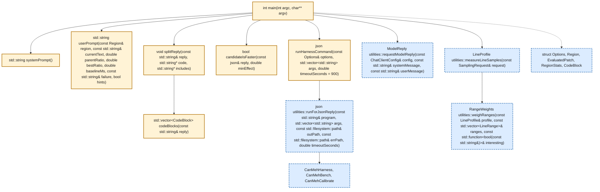
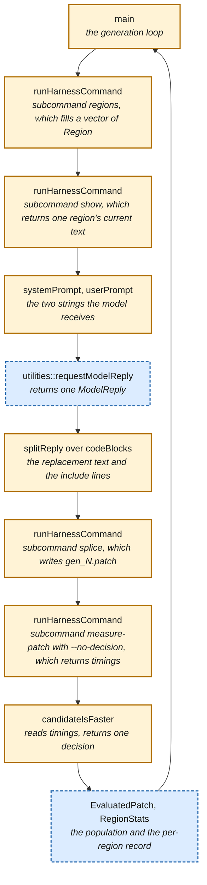

# CanMehEvolve — 面向 Garmin FIT SDK 的 LLM 驱动 patch 搜索

> 本文档为 README.md 的中文译本，术语与代码保留英文原文；如有歧义，以英文原版为准。

## 动机

<!-- Point: Purpose: states the claim this project tests. -->
在讨论任何具体机制之前，先明确问题：本项目要检验哪一项已发表的主张，以及为什么这项主张需要检验。

<!-- Point: Argument: published LLM-search speedups lack basic controls. -->
我们本学期读过的一些论文声称，在搜索循环中使用 LLM 可以发现优于人类和编译器所生成代码的系统代码。这些主张仅基于少数案例研究，没有共同的实验规程，也没有非 LLM 基线；其中几篇论文甚至没有将结果与无反馈、无选择地调用模型相同次数所得的结果进行比较。最后一项遗漏最为关键：缺少这种对照，所报告的加速可能只是重复采样本身产生的结果，而循环在模型外围加入的选择和反馈可能毫无贡献。

<!-- Point: States: this project supplies the omitted controls. -->
你的项目将在 NUS 集群上针对一个库检验这一主张，并采用这些论文遗漏的对照。

## 目标

<!-- Point: Purpose: says what you make faster, and what counts. -->
在弄清楚某个对象是什么之前，你无法让它变得更快。下面将说明 FIT SDK 的作用、你要测量其中的哪一部分，以及是什么让结果不只是一个数字。

<!-- Point: Defines: FIT, and why decode time matters. -->
FIT 是 Flexible and Interoperable Data Transfer 的缩写，是 Garmin 设备记录活动时写入的二进制格式：手表或自行车码表会输出一个消息流，其中包含心率、功率、位置、单圈和会话记录；SDK 则是将这种文件读回带类型消息和字段的 C++ 库。任何接收 Garmin 活动文件的服务都会在每次上传时执行这一 [decode](#decode)，因此它耗费的时间对应真实业务中确实要完成的工作，而不是我们凭空设计的基准测试。

<!-- Point: Instruction: measure stock 21.201.0; ratios are over stock. -->
你要测量该 SDK 在 tag 21.201.0 下的 decoder，也就是 Garmin 发布的原始版本，因此你测得的每个 [ratio](#ratio) 都是相对于 stock 的 [ratio](#ratio)。

<!-- Point: Argument: a diff makes the result applicable upstream. -->
每个候选项都是一个 unified diff。这是有意为之：本项目的成果是一个人们可以应用、审查并提交到上游的 patch。

<!-- Point: Outlines: what each of the three phases produces. -->
这项工作分为三个阶段，后文对这些阶段的所有指称均以这里的说明为准。在 **Phase 0** 中，你要依据一个通过构造确知的答案校准你的 [decision rule](#decision-rule)。在 **Phase 1** 中，你要运行搜索，并亲自将真实效应与无效应区分开来。在 **Phase 2** 中，你要将校准和这种区分一并报告。Phase 2 之后还有四项对照。

## 设置

<!-- Point: Purpose: gets you to a node with a work directory. -->
在 Phase 0 之前，你需要一个集群节点和一个可以进行测量的目录。下面将介绍如何获得这两者；在 Phase 0 开始前，所有这些环节都必须正常工作。

<!-- Point: States: you work on the NUS cluster, on one node family. -->
你要在 NUS 计算集群上完成这个项目。通过登录节点 `xlogin` 进入集群，在那里，集群的批处理调度器 Slurm 会为你分配一个计算节点供你运行。这里有两类计算节点，你使用其中一类：24 核 Xeon 机器，其 Slurm feature 名称为 `xcnc` 和 `xcnd`。相同的代码在不同处理器上的耗时不同，而本文档中的每个阈值都是在这类机器上校准的，因此在任何其他机器上得到的测量结果都无法与同学的结果比较。**连接**、**传输代码**、**模型端点**和**节点系列**这几节会帮助你连接到这样的节点，并将代码和密钥放到那里。

<!-- Point: Lists: the build prerequisites CMake needs. -->
需要 CMake 3.20 或更高版本、支持 C++17 的编译器、libcurl、配置期间的网络访问，以及 `jq`，下面的两个 shell 片段用它读取 JSON，其中一个位于 `sbatch` 脚本中，缺少 `jq` 会终止作业。CMake 会将 Google Benchmark、nlohmann/json 和 CLI11 一并下载到 `build/deps`，并下载 tag 21.201.0 的 FIT SDK；其中，Google Benchmark 是一个 C++ 微基准测试库，负责对每次重复计时，并决定将多少次 [decodes](#decode) 的结果平均到该次重复中。因此，无论机器上安装了什么，每次构建都会使用 CMake 锁定的版本。

<!-- Point: Instruction: build the tools, then create a work directory. -->
从刚检出的代码开始，两条命令就能得到一个可用于测量的目录。`cmake --build` 会构建五个完整的工具，并写出供它们 decode 的四个活动文件；你应在登录节点上运行它。`CanMehHarness init` 会复制 SDK，将副本编译一次，从同一组目标文件链接出两个库，再用一个库的 decode 时间中位数除以另一个库的 decode 时间中位数；你应在已预留的计算节点上运行它，因为这次相除本身就是一次测量：

```sh
cmake -S . -B build && cmake --build build -j --target CanMehHarness \
      CanMehCalibrate CanMehBench CanMehDecodeForSampler CanMehData
./build/CanMehHarness init --work build/work --repeat 10
```

<!-- Point: Warning: CanMehSearch is the sixth target and cannot link yet. -->
这条命令之所以指定五个 target，是因为单独运行 `cmake --build build -j` 会构建全部六个，而第六个是 `CanMehSearch`；它的七个函数体正是本作业要完成的内容：在你写好这些函数体之前，链接 `CanMehSearch` 会失败，并报告 `main` 是未定义符号。链接器只报告 `main`，因为另外六个函数声明在匿名命名空间中，而且目前没有任何代码调用它们。`CanMehData` 是运行 `CanMehDataGenerator` 的 target。

<!-- Point: Instruction: read null_ok before trusting a work directory. -->
`init` 会打印 `null_ok`。当由相同代码构建的两个库的测量结果相差不超过 2% 时，该字段为 true；这就是证据，说明在此目录中测得的 ratio 来自两个库，而不是来自机器。当 `init` 打印 false 时，该目录产生的每个数字都毫无价值，补救方法是换一台噪声更小的机器，而不是再运行一次。`--repeat 10` 固定了此目录中后续每次测量使用的进程数，`init` 会将该数字写入 `meta.json`，后续每次测量都会从那里读取它。**测量**一节解释了为什么这个数字是 10，而不是默认值 1。

### 连接
<!-- Point: Purpose: reaches the login node through VPN and jump host. -->
遗憾的是，登录集群并不简单：你与登录节点上的 shell 之间隔着两跳和一个
虚拟专用网络。本节概述如何完成连接，以及如何只认证一次，而不必在
每条命令执行时都认证。

<!-- Point: Instruction: connect through the VPN and jump host. -->
登录节点 `xlogin` 只能通过跳板主机访问，而且只能从 NUS 网络内部访问，
因此请启动 NUS VPN 客户端，或在校园内的机器上操作。即使 VPN 正在运行，
直接连接 `xlogin.comp.nus.edu.sg:22` 也无法建立。

<!-- Point: Instruction: put this block in your ssh config. -->
因此，请在 `~/.ssh/config` 中将这两跳配置为一个主机条目；该条目还会让
一条已认证的连接保持打开 8 小时，使后续命令可以复用它，而不必再次认证。
请将两处的 `<user>` 都替换为你自己的 NUS 用户名：

```
Host xlogin
User <user>
HostName xlogin.comp.nus.edu.sg
ProxyJump <user>@stfjump.comp.nus.edu.sg
ControlMaster auto
ControlPath /tmp/ssh-%r@%h:%p
ControlPersist 8h
```

<!-- Point: States: ssh xlogin then reaches the login node. -->
配置好该条目后，`ssh xlogin` 即可连接到登录节点。

<!-- Point: Instruction: authenticate once, reuse one shared connection. -->
每一跳的 `sshd` 都会提示输入密码，因此无人值守运行的程序无法完成认证。
请认证一次，打开一条共享连接，并让后续 `ssh` 调用复用它：

```sh
ssh xlogin                                        # authenticate once, by hand
ssh -o BatchMode=yes xlogin 'squeue -u $USER'     # reuses that connection
```

<!-- Point: Warning: without BatchMode an unattended program hangs. -->
请传入 `BatchMode=yes`：否则，共享连接一旦断开，`ssh` 就会提示输入密码，
无人值守运行的程序会卡在这个提示上，而不是失败退出。连接确实会断开——
让笔记本电脑休眠或切换网络都会使其终止，而 `ServerAliveInterval` 也无法
让它保持存活——因此需要重新运行 `ssh xlogin`。正在运行的作业不受影响，
因为它由计算节点上的 `slurmd` 运行。

### 传输代码
<!-- Point: Purpose: gets your code onto the cluster and back. -->
将代码传到集群以及从集群取回也同样有些棘手，因为你首先会想到的路径
在这里行不通，所以下面介绍可行的路径。
<!-- Point: Warning: cloning over SSH fails on these nodes. -->
登录节点和计算节点只能通过 443 端口上的 HTTPS 访问 `github.com`。
连接 `github.com:22` 或 `ssh.github.com:443` 均无法建立。

<!-- Point: Instruction: clone over HTTPS into your home directory. -->
因此，请改用 HTTPS 克隆到登录节点上的主目录中：

```sh
git clone https://github.com/NUS-CS6219-2026/CanMehEvolve.git ~/Projects/CanMehEvolve
```

<!-- Point: Instruction: push to a bare cluster repository instead. -->
对于私有仓库，以及你开始编写搜索后所做的修改，请通过共享连接将它们
推送到集群上的裸仓库。推送到裸仓库不会在共享文件系统上存储 GitHub
凭据，而在共享文件系统中，个人访问令牌可能会被读取：

```sh
ssh xlogin 'git init --bare ~/Projects/canmeh.git'
git remote add cluster xlogin:Projects/canmeh.git
git push cluster master
```

<!-- Point: Warning: two builds in one checkout corrupt objects. -->
然后，在登录节点上运行同一条 `cmake` 命令，但不要在那里创建 work
directory：`CanMehHarness init` 最后会执行一次测量，因此在登录节点上创建的
work directory 会记录来自一台你永远不会用于搜索的机器的 null run。
在提交任何内容之前，先执行一次构建：多个作业可以共享同一个 checkout，
因为每个作业都会按 `$SLURM_JOB_ID` 命名自己的 run 目录和 work directory；
但在同一个 checkout 中运行的两个 `cmake --build` 进程会写入相同的目标文件，
并破坏彼此的输出。

### 模型端点
<!-- Point: Purpose: reaches a language-model endpoint from the cluster. -->
在循环流程中，你需要通过一个兼容 OpenAI API 的端点访问大语言模型。
幸运的是，SoC 通过 [SoC LLM portal](https://soclaas-portal.comp.nus.edu.sg)
提供了一个这样的端点，该门户自己的说明会告诉你如何获取密钥。当然，
你可以自由使用其他方案，甚至是在自己机器上提供服务的模型，但我发现
SoC 端点最方便。下面介绍如何使用它。

<!-- Point: Instruction: read the key from a file. -->
请将 API 密钥放入一个文件，并将该文件的路径传给 `--llm-api-key-file`。
`CanMehSearch` 会自行读取该文件，因此密钥永远不会出现在命令行中；
在命令行中，`ps` 会把它显示给机器上的所有其他用户：

```sh
mkdir -p ~/.config/canmeh
printf '%s' 'clsk_...' > ~/.config/canmeh/api-key
chmod 600 ~/.config/canmeh/api-key
```

<!-- Point: Instruction: check the endpoint completes, not just lists. -->
`--llm-base-url` 默认为 `https://soclaas-api.comp.nus.edu.sg/v1`，
`--llm-model` 默认为 `qwen3-coder-next`，因此一次运行只需要你的密钥。
在首次运行前，请检查端点是否能返回补全结果，而不只是列出模型，
因为出现在模型列表中的 id 并不总能作出响应：

```sh
curl -s --max-time 60 https://soclaas-api.comp.nus.edu.sg/v1/chat/completions \
  -H "Authorization: Bearer $(cat ~/.config/canmeh/api-key)" \
  -H 'Content-Type: application/json' \
  -d '{"model":"<model>","max_tokens":16,
       "messages":[{"role":"user","content":"reply with the single word ok"}]}' \
  | jq -r '.choices[0].message.content, .model'
```

<!-- Point: Instruction: report which model id actually answered. -->
请读取第二行，它是实际作出响应的模型的 id。此端点上的 id 可能是别名，
此时端点实际提供的是该 id 所指名称之外的其他版本。2026-10-05 的实测结果：
`qwen3-coder-next` 回答了 `ok` 并报告为 `qwen3-coder-next`，`coder` 报告为
`qwen3.8:27b`，且返回的消息内容为 null。正因如此，默认模型是
`qwen3-coder-next`；如果 SoC 停用它，你会在这里发现，而不是等到第 1 代时
才发现。请在报告中说明实际响应的是哪个 id，[Search](#search) 组也列出了
这一要求，因为 `utilities::requestModelReply` 会保留回复的消息文本及其
token 计数，所以端点的 `model` 字段不会进入任何日志。

<!-- Point: Warning: a fifth parallel search slows all five. -->
端点运营方说明，它可以全速处理 4 个并发请求，第 4 个之后的请求都会排队，
并每批放行 4 个排队请求。`CanMehSearch` 每次只发起一个调用，因此 4 个
并行搜索会占满全部 4 个 [slots](#slot)，第 5 个只会让这 5 个搜索都变慢。

### 节点类型

<!-- Point: Purpose: reserves a Xeon and measures the pairs on it. -->
集群中有几种不同类型的机器，本文档中的每个阈值都是在 24 核 Xeon 上测得的。
`salloc` 会预留一个 Xeon 节点，`CanMehCalibrate` 则在其上测量 12 个校准对。

<!-- Point: Instruction: create your work directory on the compute node. -->
也要在你预留的节点上运行 `CanMehHarness init`，而不是在登录节点上运行。
`init` 最后会执行一次 [null run](#null-run)，它是一次测量；因此，在登录节点上
创建的 work directory 会记录来自一台你永远不会用于搜索的机器的 null run，
而且该目录中得到的每个 ratio 都会除以一个由错误处理器产生的参考时间。

<!-- Point: Instruction: produce every reported number on a cluster node. -->
计时结果反映的是产生它的机器，因此，你报告的每个数字都应在 `xcnc` 或
`xcnd` 节点上产生。`salloc` 会预留一个完整的 Xeon 节点，为期 2 小时，
并在该节点上为你打开一个 shell；随后 `CanMehCalibrate` 会在那里测量
12 个校准对，这就是 **Phase 0: Calibration** 要求你报告的测量结果：

```sh
salloc --partition=long --constraint="xcnc|xcnd" --nodes=1 \
       --mem=0 --cpus-per-task=24 --time=2:00:00

# salloc opens a shell on the node it reserved, so type the next line in that
# shell rather than pasting both lines at once.
./build/CanMehCalibrate --repeat 10
```

<!-- Point: Instruction: size --time from CanMehCalibrate's printed duration. -->
`CanMehCalibrate` 会打印按照它所用的设置再次测量每一对所需的时间，
你应根据这个时长设置 `--time`。搜索时使用的 `--repeat` 和 `--repetitions`
应与测量校准对时相同，但不要让 `--min-time` 也与校准对保持一致，
原因见 **Phase 0: Calibration**。

### 示例数据

<!-- Point: Purpose: says what writes the files every decode reads. -->
本项目中的每次测量都会 [decodes](#decode) 相同的四个文件。下面介绍这些
文件由什么生成，以及为什么在你的笔记本电脑上写入的文件与在集群节点上
写入的同一文件包含完全相同的字节。

<!-- Point: States: CMake runs the generator during an ordinary build. -->
`CanMehDataGenerator` 负责写入这四个文件，而 CMake 会将运行
`CanMehDataGenerator` 作为构建步骤，因此 `cmake --build build -j` 会将它们
生成到 `build/data`，并将该路径编译进 `CanMehHarness`，作为 `--data` 的
默认值。只有需要将文件写到其他位置时，你才需要自己调用
`CanMehDataGenerator`：它将输出目录作为唯一参数，不声明任何选项，
因此也不会响应 `--help`。

<!-- Point: Defines: four synthetic files, written through the SDK's own encoder. -->
这四个文件是 `intervals.fit`、`long_run.fit`、`ride.fit` 和 `treadmill.fit`，
合计约 900 kB；它们是合成的，而非实际记录的：每个文件都保存手表或
自行车码表在一次会话中写入的记录，其中心率、功率、速度、距离、海拔和
位置均按正弦曲线变化。`CanMehDataGenerator` 通过调用 SDK 自带的编码器
对每个文件进行编码，因此候选项 [decodes](#decode) 的是 SDK 自己写入的字节。
一次 [decode](#decode) 会读取全部四个文件。

<!-- Point: States: the four files hold identical bytes on both platforms. -->
Apple 笔记本电脑与 `xcnc` 节点写入的字节完全相同；我们在每个平台上
从头配置后，通过比较这四个文件各自的 MD5 校验和及字节数，确认了这一点。
有两项措施保证这一点，构建过程已经同时采用了它们：`CanMehDataGenerator`
会对每个由正弦函数推导出的值进行舍入而不是截断，而 `CMakeLists.txt` 会使用
`-ffp-contract=off` 编译 `CanMehDataGenerator`。将乘法和加法融合起来的
编译器只舍入一次，而另一个编译器会舍入两次；仅这一差异就曾使
`long_run.fit` 中的一个心率字节在两个平台上不同，直到采取了这两项措施。
因此，你的 [ratio](#ratio) 和同学的 ratio 都是用基于相同输入测得的时间
相除得到的，下面的校验和正是用来确认这一点的。

<!-- Point: Instruction: read and report the data's four identifying numbers. -->
在 load、data、correctness、profile-digest 和 processor-time 检查全部通过后，
`CanMehBench` 会将这份数据的校验和、字节数、消息数和字段数写入其 stderr，
这些输出会由 `CanMehHarness` 保留在 `<work>/scratch/bench.err` 中。
请从该文件中读取这四个数字，并按照 [Evidence](#evidence) 组列出的要求，
将它们与结果一起报告，因为只有当两次 [decodes](#decode) 读取相同字节时，
两组 [timings](#timings) 才具有可比性。

## 架构

<!-- Point: Purpose: shows which programs exist and which you write. -->
本项目包含六个程序，其中一个需要由你编写。在开始编写第一行代码之前，你需要弄清楚三件事：每个程序分别负责什么、你负责的程序中哪些函数初始为空，以及你的循环如何调用 harness 并读取其返回内容。

<!-- Point: Lists: the six programs CMake builds. -->
CMake 会构建这六个程序。其中三个由你直接运行：`CanMehCalibrate` 测量 calibration pair，`CanMehHarness` 复制 SDK，将 patch splice 到副本中，对从 patched tree 链接出的库进行解码计时，并对 candidate 计时，而 `CanMehSearch` 则是你要编写的循环。另外三个只在其他程序启动它们时运行：`CanMehBench` 打开两个库并执行计时，`CanMehDataGenerator` 写入四个 activity 文件，`CanMehDecodeForSampler` 打开一个库并反复解码，同时由 `sample` 或 `perf` 记录时间消耗在哪些源代码行上。

<!-- Point: Instruction: fill in Search.cpp's empty function bodies. -->
你拿到的 `src/Search.cpp` 已移除所有函数体，但保留了所有声明。你的任务就是把这些函数体补充完整。你只能编辑 `src/Search.cpp` 这一个文件。

<!-- Point: States: described CanMehSearch behavior is yours to write. -->
因此，后文每一句关于 `CanMehSearch` 会做什么的描述，都应理解为对你所编写程序的要求，而不是你直接继承的既有行为。本文之所以描述 `--out` 下的文件、[population](#population)、第一个 [generation](#generation) 之前的 profiling pass 以及 `null_ok` 检查，是因为你的实现必须提供这些内容。其余五个程序已完整提供，因此，凡涉及 `CanMehHarness`、`CanMehBench`、`CanMehCalibrate`、`CanMehDataGenerator` 或 `CanMehDecodeForSampler` 的句子，描述的都是你可以依赖的既有功能。

<!-- Point: Defines: the diagram colors, amber yours, blue provided. -->
在下面两张图中，**琥珀色实线框表示由你编写的代码**，**蓝色虚线框表示已完整提供的代码**。箭头表示调用。在 GitHub 这类能够绘制 Mermaid 图的 Markdown 阅读器中，可以看到这两种颜色；如果以纯文本方式阅读本文件，则可以从每张图末尾的 `class ... write` 和 `class ... provided` 行得到同样的分组，这些行列出了各组中的标识符。第一张图展示了 `src/Search.cpp` 声明的七个函数，以及它们调用的四个已提供函数：



<!-- Point: States: structs arrive declared; functions do not. -->
这五个 struct 已为你声明，因此你的循环需要记录的字段都已有名称。七个函数则以空函数体的形式提供。`candidateIsFaster` 接收 `measure-patch` 返回的 JSON 对象，并判断从该 candidate 的 patched tree 链接出的库，其解码速度相对参考库的领先幅度是否达到你的规则要求。`CanMehSearch` 还会单独计算与 [parent patch](#parent-patch) 的比较结果，记为 [`improved_on_parent`](#improved_on_parent)。在 `--no-decision` 下，该对象包含 [`timings`](#timings)，但不包含统计量，因此你编写的版本必须自行计算它读取的每个数值。

<!-- Point: Introduces: the second diagram, ordered by calls. -->
在一个 [generation](#generation) 中，这些函数的调用顺序如下：



<!-- Point: Argument: the generation loop is the student's work. -->
这十个框中有八个是琥珀色的，这正是关键所在：[generation](#generation) 循环由你编写，而四次 `runHarnessCommand` 调用中的每一次都会启动 `CanMehHarness`，由它完成编译、应用 patch 和计时。

<!-- Point: Instruction: implement runHarnessCommand before anything else. -->
`runHarnessCommand` 是每个步骤都要经过的函数，因此应首先实现它：它构建参数 vector，调用 `utilities::runForJsonReply`，并返回该子命令输出的 JSON 对象。`CanMehHarness` 每次调用都只返回一个 JSON 对象，并将所有状态保存在 [work directory](#work-directory) 中，因此你的循环可以在任意 [generation](#generation) 处停止并重新启动。

<!-- Point: States: where a reason goes and where numbers go. -->
`measure-patch` 的输出会写入两个位置，如果查错位置，就什么也找不到。当 `measure-patch` 拒绝某个 candidate 时，它会在 `runHarnessCommand` 返回的 JSON 对象中指明拒绝该 candidate 的 `stage`。每次重复测量的数值会写入位于 `scratch/gb/proc-NN.json` 的 Google Benchmark 报告，每个进程一份。要了解 candidate 被拒绝的原因，请读取 JSON 对象；要查看 [`timings`](#timings) 对象未包含的任何信息，请读取该报告。

<!-- Point: States: what --sample-seconds adds, and who wrote it. -->
`--sample-seconds` 会增加一次构建和第四个二进制文件。`CanMehHarness
sampling-library` 使用编译选项 `-g` 将 baseline tree 编译到 `obj-sampling/`，该选项让编译器生成调试行号表，使 sampler 能标识源代码行而不是地址；该命令还从这些目标文件链接生成 `libfit_sampling`。`CanMehDecodeForSampler` 随后打开这个库，并在 Google Benchmark 中反复 [decodes](#decode)，同时 `utilities::measureLineSamples` 使用平台 sampler 对该进程进行采样，而 `utilities::weighRanges` 将逐行计数汇总到各个 region 范围中。`src/utilities/LineSamples.hpp` 已经实现了这两个函数。这整条路径只对 `libfit_sampling` 计时，并且 `CanMehSearch` 会在第一个 [generation](#generation) 之前完成整个流程，因为在测量过程中同时运行 sampler 会增大各次重复测量中解码时间的离散程度。

## 测量

<!-- Point: Purpose: describes what produces every number you report. -->
你报告的每一个数字都来自 `CanMehBench` 以及运行它的 `measure-patch` 子命令。下面说明 `CanMehBench` 如何在一个 process 中对每个库的解码操作计时、它拒绝测量什么、你的规则读取的 [`timings`](#timings) 对象逐字段包含哪些内容，以及一次测量会运行多少个 process；还会说明如果你让 `CanMehHarness` 自行计算，它会给出什么判定，而这个判定实际上由你的规则来计算。

<!-- Point: Explains: one process, two libraries, one clock. -->
`CanMehHarness init` 只编译一次 SDK 副本，并将这些目标文件链接两次，生成两个导出工作负载 C 入口点的共享库；`CanMehBench` 使用 `RTLD_LOCAL` 将这两个库加载到同一个 process 中，使两组 `fit::` 符号和静态 profile 表保持分离。随后，Google Benchmark 交错执行两个基准测试函数的 repetitions，因此 `CanMehBench` 会让参考库和候选库在相同的页缓存、相同的时钟和相同的机器条件下运行。

<!-- Point: States: three correctness checks precede any timing. -->
`CanMehBench` 在进行任何计时之前检查正确性。候选库必须对每个解码后的字段值进行折叠计算，两遍都得到与参考库相同的校验和；必须在整个输入域内，对 profile 查询给出与参考库完全相同的答案；并且不得使用线程。

<!-- Point: States: measure-patch's two tests and init's null check. -->
`measure-patch` 运行哪种检验取决于 `--repeat`，两种检验都会读取 Google Benchmark 报告的逐 repetition 耗时。`--repeat 1` 时，它在这一个 [process](#process) 内，对逐 repetition 的 [timings](#timings) 运行 [permutation test](#permutation-test)。`--repeat 2` 或更大时，它改为对各 process 的 log-ratios 运行 [sign-flip test](#sign-flip-test)；`--repeat 10` 走的就是这条路径，因此你的结果也来自这条路径。`CanMehHarness init` 使用参考库的目标文件再链接一个库，将这个第二库的中位解码时间除以参考库的中位解码时间，这就是 null run；如果两个由完全相同代码构建的库所得商与 1.000 相差 2% 或更多，就报告 `null_ok` 为 false。`CanMehHarness init` 只读取这个商，从不读取 p，因为在无差异的原假设下 p 呈均匀分布，所以即使在最安静的节点上，每二十次运行也有一次会报告 p 低于 0.05。

<!-- Point: Argument: why --repeat 10 rather than 1 or 8. -->
process 的数量决定了 `measure-patch` 究竟能达到哪些 p 值。[sign-flip test](#sign-flip-test) 在 N 个 process 上无法报告低于 2/2^N 的 p 值，因此在 `--repeat 5` 时，最小可达值是 0.0625，远高于结果要求达到的 0.01，任何候选实现都不可能通过。从算术上看，N = 8 可行，此时 2/2^8 为 0.0078，但 0.0078 是唯一低于 0.01 的可达值，而且只有当全部八个 process 的方向一致时，`measure-patch` 才会报告它，所以只要有一个 process 方向不一致，无论效应多大，检验都会失败。N = 10 时，可达值 2/1024、4/1024、6/1024、8/1024 和 10/1024 都低于 0.01，因此即使最多三个 process 方向不一致，真实效应仍可通过检验。`measure-patch` 为设置 [`unstable`](#significant) 而读取的 [`ratio_spread`](#ratio_spread) 阈值，也是按 10 个 process 校准的。无论采用哪种方案，都要报告你使用的值。

<!-- Point: Argument: timings makes every statistic recomputable. -->
`measure-patch` 和 `measure-pair` 都会打印一个 [`timings`](#timings) 对象，其中保存 Google Benchmark 报告的每一个逐 repetition 数值，以及 `CanMehHarness` 记录的关于每个 process 的事实：其索引、`CanMehHarness` 是否交换了 [slots](#slot)、`CanMehBench` 写在 `scratch/gb` 下的报告路径、Google Benchmark 写入该报告 `context` 的负载平均值，以及逐 repetition 的 `candidate_ns`、`reference_ns`、两个处理器时间序列和两个迭代计数。`measure-patch` 打印的每个统计量都可以根据该对象计算出来，因此你可以核验统计量，而不必盲目相信它。

<!-- Point: Example: one complete timings object, over null. -->
下面是一个完整的 [`timings`](#timings) 对象，由 `measure-pair --no-decision` 在 `--repeat 2 --repetitions 3` 下针对 `null` 校准对打印。该对中的两个库执行相同数量的 [work units](#work-unit)，所以下面的任何数字都不能说明 SDK 的任何情况。每个 `report` 值都是绝对路径，此处作了缩写：

```json
{
  "ok": true,
  "processes": 2,
  "repetitions": 3,
  "swapped_processes": 1,
  "timings": {
    "unit": "ns",
    "clock": "real_time",
    "min_time": "0.25s",
    "repetitions_requested": 3,
    "ragged": false,
    "process": [
      {
        "index": 0,
        "swapped": false,
        "report": ".../calibration/null/scratch/gb/proc-00.json",
        "load_avg": [9.75928, 7.66357, 5.21631],
        "candidate_ns": [6775919.918664822, 6870977.114886045, 6893490.194616949],
        "reference_ns": [6757401.961687149, 6803538.412878326, 6813479.587435722],
        "candidate_cpu_ns": [6772156.862745094, 6867176.470588243, 6888843.137254903],
        "reference_cpu_ns": [6752882.352941173, 6799450.980392158, 6810098.039215696],
        "candidate_iterations": [51, 51, 51],
        "reference_iterations": [51, 51, 51]
      },
      {
        "index": 1,
        "swapped": true,
        "report": ".../calibration/null/scratch/gb/proc-01.json",
        "load_avg": [9.75928, 7.66357, 5.21631],
        "candidate_ns": [6809955.061066384, 6856538.391872948, 6846240.192067389],
        "reference_ns": [6847183.317877352, 6873385.841026902, 6823513.321578503],
        "candidate_cpu_ns": [6806156.862745101, 6852509.803921567, 6841960.78431373],
        "reference_cpu_ns": [6843100.0, 6869000.000000005, 6819340.0],
        "candidate_iterations": [51, 51, 51],
        "reference_iterations": [50, 50, 50]
      }
    ]
  }
}
```

<!-- Point: Defines: both array lengths; three repetitions minimum. -->
`timings.process` 中每个 process 对应一个条目，所以其长度就是你传给 `--repeat` 的值。每个条目中的每个序列，每次 repetition 对应一个值，所以其长度就是你传给 `--repetitions` 的值。`CanMehHarness` 要求每个序列至少包含三个 repetitions。少于三个时，它打印一个包含三个键的对象——`"ok": false`、`"stage": "run"` 和错误信息 `too few repetitions came back from the benchmark`——因此解析器必须先读取 `ok`，再读取 [`timings`](#timings)。

<!-- Point: Introduces: the five fields outside process. -->
`process` 外部的五个字段：

<!-- Point: Defines: unit, clock, min_time, repetitions_requested, ragged. -->
- `unit` 为 `ns`，因此每个序列中的每个数字都以纳秒为单位。
- `clock` 为 `real_time`，指明 `candidate_ns` 和 `reference_ns` 报告的是 Google Benchmark 两个时钟中的哪一个。
- `min_time` 是 `CanMehBench` 传给 Google Benchmark 的 `--benchmark_min_time` 值；`CanMehHarness` 从 `meta.json` 读取该值，默认值为 `0.25s`。
- `repetitions_requested` 是你请求的数量，因此你的规则可以检测返回数量较少的 process。
- `ragged` 在序列长度不一致时为 true，无论是不同 process 之间，还是同一 process 内的两个序列之间。将 process 0 的第三个 repetition 与 process 1 的第三个 repetition 配对的规则，在这样做之前必须读取 `ragged`。

<!-- Point: Introduces: the ten per-process fields. -->
一个 `process` 条目中的十个字段：

<!-- Point: Defines: index, swapped, report, load_avg and the series. -->
- `index` 按 `CanMehHarness` 运行 process 的顺序为其编号。
- `swapped` 在 `CanMehHarness` 将候选库放入 `--base` [slot](#slot) 时为 true，因此该 process 会首先加载候选库。`CanMehHarness` 会交替安排，[`timings`](#timings) 旁边的 `swapped_processes` 记录了多少个 process 发生了交换。
- `report` 指明 `CanMehBench` 写入的 Google Benchmark 报告，因此你可以直接读取该报告，获取此对象省略的任何内容。
- `load_avg` 保存 Google Benchmark 在其报告 `context` 中记录的三个负载平均值，时间窗口分别为 1、5 和 15 分钟。
- `candidate_ns` 和 `reference_ns` 保存 Google Benchmark 每次 repetition 的 `real_time`。**每个值都是该次 repetition 中多次 [decodes](#decode) 的平均值，而不是一次 [decode](#decode) 的耗时。** 忽略迭代计数的规则会把 Google Benchmark 取平均带来的效果误认为是机器噪声很低。
- `candidate_cpu_ns` 和 `reference_cpu_ns` 保存对应的 `cpu_time` 序列。用候选库的处理器时间除以其挂钟时间，就能发现候选库是否启动了线程。
  <!-- Point: Warning: never divide by the iteration counts. -->
- `candidate_iterations` 和 `reference_iterations` 保存 Google Benchmark 选择的 [decode](#decode) 次数。**不要除以这些计数。** `candidate_ns` 已经是每次 [decode](#decode) 的纳秒数，而不是整个 repetition 的总耗时：在上面针对 `null` 对打印的对象中，51 个耗时 6.8 ms 的 [decodes](#decode) 填满了 0.25 s 的 `min_time`，而 [`score_ms`](#score_ms) 是 `candidate_ns` 的中位数，中间不做任何除法。这些计数告诉你的是 Google Benchmark 对每次 repetition 取平均的深度，而且**两个计数不必一致**：上面的 process 1 在候选库的每次 repetition 中解码 51 次，在参考库的每次 repetition 中解码 50 次，因为 Google Benchmark 分别确定两个基准测试函数的规模。因此，候选序列和参考序列可以直接比较，但其中一方的平均值可能噪声更低；等权处理这两个序列的规则，会假定两者的平均深度相同。

<!-- Point: Defines: --no-decision, and what measure does. -->
`measure-patch --no-decision` 和 `measure-pair --no-decision` 恰好打印上面对象显示的五个键：`ok`、`processes`、`repetitions`、`swapped_processes` 和 [`timings`](#timings) 对象。你的循环以这种方式运行 `measure-patch`，因此你的代码会根据 [`timings`](#timings) 计算结果中的每个统计量。`measure-pair` 对一个 [work directory](#work-directory) 中已有的两个库进行计时，不应用任何补丁，也不重新构建任何内容；`CanMehCalibrate` 就是这样测量校准对的：校准对没有可供 `measure-patch` 修改的 SDK 目录树。

<!-- Point: States: this file records no reference numbers deliberately. -->
我们刻意不在本文件中记录任何参考数值：在 Phase 0 中，你要亲自算出本文拒绝提供的这些数字。

<!-- Point: Points at: the data description and its four numbers. -->
请阅读 **Sample data**，了解四个活动数据文件的内容，以及需要报告的四个相关数值。

<!-- Point: States: each library opens the data files itself. -->
`CanMehBench` 将数据目录传给每个库的 `canmehLoadDataFiles`，每个库自行读取这四个文件，因此，每个库执行 [decodes](#decode) 时，处理的都是自己加载的字节。

<!-- Point: Warning: rewriting the oracle makes a candidate lose. -->
`CanMehBench` 将候选库的答案与参考库的答案进行比较，因此，重写正确性 [oracle](#oracle) 的候选库会与参考库不一致，从而判负。

## 作业

<!-- Point: Purpose: holds the three phases you work through. -->
下面按你实际执行的顺序介绍三个阶段。**阶段 0**
生成关于你的规则的证据，**阶段 1** 运行搜索并由该规则作出判定，
**阶段 2** 汇总你的报告必须满足的所有要求。

### 阶段 0：校准

<!-- Point: Purpose: produces three numbers about your rule. -->
在本阶段中，你要在 true ratio 通过构造而确定的库对上运行决策规则，
而不是在 SDK decode 上运行，并基于这些 true ratio 通过构造而确定的库对，
给出关于该规则的三个数值：规则出错的频率、它能察觉的最小效应有多小，
以及它报告的 ratio 与真实值相差多远。
[Evidence](#evidence) 组列出了每一项需要说明的内容。

<!-- Point: Argument: an inert patch tests only one point. -->
你要编写将 [timings](#timings) 转化为结论的规则，因此在为此花费模型预算之前，
必须先确定该规则的实际表现。[inert patch](#inert-patch) 无法确定该规则的实际表现：
[inert patch](#inert-patch) 只测试一个点，即 [true ratio](#true-ratio) 恰好为 1.000 的情况；
你的规则能检测到的最小效应，以及规则报告的数值与 [true ratio](#true-ratio) 之间的距离，
都没有得到测量。

<!-- Point: Defines: calibration pairs; dividing the counts is yours. -->
CMake 会构建 **calibration pairs**，让你能够做到这一点。CMake 将每一对
从同一个源文件编译为两个共享库，两者的唯一区别在于每个库执行的
**[work units](#work-unit)** 数量，因此这两个计数的商就是
[true ratio](#true-ratio)。CMake 将每一对写入 `build/calibration` 下各自的目录，
并在每个 `meta.json` 中记录两个工作量计数，而不记录它们的商：
计算除法是你的任务。这些目录中的每一个都是 `CanMehHarness measure-pair`
可接受的 [work directory](#work-directory)。

<!-- Point: Instruction: run CanMehCalibrate over all twelve pairs. -->
CMake 在 `build/calibration` 下构建十二对，每一对都位于
`CanMehHarness measure-pair` 可接受的 [work directory](#work-directory) 中；
`./build/CanMehCalibrate` 会测量全部十二对并打印一张表：

```sh
./build/CanMehCalibrate --repeat 10
```

[true ratio](#true-ratio) 是候选库的工作量计数除以参考库的工作量计数，因此
[ratio](#ratio) 低于 1.000 表示候选库的解码速度更快：

| 库对 | 候选库单元数 | [true ratio](#true-ratio) | 用途 |
|---|---|---|---|
| `null` | 20000 | 1.0000 | [false-positive rate](#false-positive-rate) |
| `faster-1-percent` | 19801 | 0.9901 | [detection threshold](#detection-threshold) |
| `faster-2-percent` | 19607 | 0.9804 | [detection threshold](#detection-threshold) |
| `faster-5-percent` | 19047 | 0.9524 | [detection threshold](#detection-threshold) |
| `faster-10-percent` | 18181 | 0.9091 | [detection threshold](#detection-threshold) |
| `slower-10-percent` | 22000 | 1.1000 | 单侧规则绝不能将其判为加速 |
| `sweep-105` | 21000 | 1.0500 | [bias](#bias) |
| `sweep-110` | 22000 | 1.1000 | [bias](#bias) |
| `sweep-200` | 40000 | 2.0000 | [bias](#bias)，且为必需项 |
| `sweep-400` | 80000 | 4.0000 | [bias](#bias)，且为必需项 |
| `broken-digest` | 18181 | — | `CanMehBench` 在 `correctness` 阶段拒绝它 |
| `shared-install-name` | 18181 | — | `CanMehBench` 在 `load` 阶段拒绝它 |

<!-- Point: States: ten pairs give nine distinct true ratios. -->
在默认的 20,000 个参考单元下，计数如表所示，并且会随
`-DCANMEH_CALIBRATION_REFERENCE_UNITS` 缩放。注意，
`slower-10-percent` 和 `sweep-110` 实际上是同一对出现了两次：两者都编译出
22,000 个候选单元，因此十个被测量的库对只提供九个不同的
[true ratios](#true-ratio)。仍然值得同时测量二者，因为由同一配置构建的两个库对
可以零成本检查测试平台的结果是否可重复。

<!-- Point: Warning: measure the two pairs CanMehBench refuses. -->
最后两行并非摆设。`CanMehBench` 拒绝 `broken-digest` 库对，
是因为两个库产生的校验和不同；而拒绝共享 install name 的库对，
是因为 `dlopen` 两次返回的是同一个镜像。如果 `CanMehBench` 已拒绝某个库对，
而循环仍报告一个数值，那么这个数值便没有对应的测量对象，因此两种情况都要测量。

<!-- Point: States: the five rows CanMehCalibrate requires. -->
对于 CMake 专门构建为会被拒绝的两个库对，`CanMehCalibrate` 会报告
`CanMehBench` 拒绝该库对时所处的阶段。对于其他每个库对，`CanMehCalibrate`
会报告 [true ratio](#true-ratio)、实测 [ratio](#ratio)、误差和
[`ratio_spread`](#ratio_spread)，并对十二行中的五行设有要求：
`CanMehBench` 必须在 `correctness` 阶段拒绝 `broken-digest`，
在 `load` 阶段拒绝 `shared-install-name`；`null` 的实测 [ratio](#ratio)
必须落在 1.000 的 ±2% 范围内，`sweep-200` 和 `sweep-400` 的实测值
必须落在 [true ratio](#true-ratio) 的 ±3% 范围内。任何一个必需行若未满足要求，
本次运行都会以非零退出状态结束。`CanMehCalibrate` 会打印其余七行供你查看，
因为在接近 `measure-patch` 可分辨的最小效应时，未达到预期所提供的是关于
`measure-patch` 的证据，而不是关于 calibration pairs 的证据。

<!-- Point: Instruction: report three numbers with every setting. -->
报告三个数值，每个数值都要附上机器、编译器、`--repeat`、
`--repetitions`、`--min-time` 以及你运行的试验次数：

<!-- Point: Instruction: report false-positive rate, threshold and bias. -->
1. 你的规则的 **[false-positive rate](#false-positive-rate)**：对于两个库执行相同工作量的
   `null` 库对，你的规则报告加速的频率，并给出 95% Clopper-Pearson 区间，
   即精确二项区间。请使用 Clopper-Pearson 或 Wilson，而不要使用正态近似，
   因为当你的规则在所有试验中都未报告加速时，正态近似会给出宽度为零的区间，
   而所有试验均未报告加速正是预期结果。十次试验且没有假阳性，
   得到的区间是 0 到 0.31；这就是为什么十次试验无法区分 1% 和 15%，
   因此要说明你的试验次数能够支持什么结论。
2. **[detection threshold](#detection-threshold)**：你的规则在十次试验中至少九次
   能够发现的最小真实效应。四个加速库对给出了四个已知的效应大小；
   请分别报告每个效应大小下的检出率，而不是只报告一个数值，
   因为背后没有曲线的 detection threshold，会掩盖规则的性能究竟是逐渐退化，
   还是在效应大小低于某个值后突然骤降。
3. 你的规则所报告 [ratio](#ratio) 的 **[bias](#bias)**：在每种效应大小下，
   报告的 [ratio](#ratio) 减去已编译工作量计数的商。

<!-- Point: Instruction: repeat one measurement to produce trials. -->
rate 和 detection threshold 都需要大量试验，而 `CanMehCalibrate`
每次调用只测量每个库对一次，因此你要通过重复进行单项测量来产生试验，
而不是再次调用 `CanMehCalibrate`。围绕
`./build/CanMehHarness measure-pair --work build/calibration/null --no-decision`
编写 shell 循环，每次迭代就产生你的规则的一次试验；对
`build/calibration/faster-5-percent` 及其三个同类库对运行同样的循环，
即可产生检测试验。记录你运行的次数，因为该次数决定了你可以声称怎样的 rate。

<!-- Point: States: tuning thresholds on the pairs is allowed if you report it. -->
允许通过观察这些库对来选择规则的阈值。请说明你以这种方式选择了哪些数值，
以及基于哪些库对进行选择，因为在用于设定阈值的同一批库对上测得的 rate，
描述的是这些库对，而不是你的下一次测量；读者只有弄清两者的区别，
才能正确理解你的 [false-positive rate](#false-positive-rate)。这里的校准是指
先固定你的规则，再以通过构造已知的答案为基准，测量这套固定规则的表现，
因此不会调整 `CanMehHarness` 内部的任何内容。

<!-- Point: Argument: the sweep rows show the intercept negligible. -->
`CanMehCalibrate` 测量四个 sweep 库对，这些库对的候选库在同一次运行中
执行的工作多于参考库；测量结果打印在同一张表中。你阅读这四行是为了检查
calibration pairs，而不是检查你的规则。对于这四对，`CanMehCalibrate`
将实测 [ratio](#ratio) 除以 CMake 编译进去的计数之商，
并报告所得商与 1.000 相差多远。这项比较旨在排除一种可能性。
假设一次对 `N` 个 [work units](#work-unit) 的 [decode](#decode) 耗时为 `a + b*N`。
此时实测 [ratio](#ratio) 为 `(a + b*M) / (a + b*N)`，只有在 `a`
可忽略不计时，它才等于 `M/N`。因此，对于 2.00 库对，实测 [ratio](#ratio)
为 2.000 就表明 `a` 足够小，使得已编译计数的商可以作为真实
[ratio](#ratio)。当 `CanMehCalibrate` 报告某个必需行超出其界限时，
应增加工作量计数，而不是放宽界限。增加工作量计数意味着使用更大的
`-DCANMEH_CALIBRATION_REFERENCE_UNITS` 重新配置并重新构建，
这会重新编译全部十二个库对：

```sh
cmake -S . -B build -DCANMEH_CALIBRATION_REFERENCE_UNITS=<units>
cmake --build build -j
```

<!-- Point: Instruction: report the work count you measured at. -->
然后报告你测量时使用的设置，包括工作量计数，因为 rate 或 detection threshold
只对测量时所用的库对成立。

<!-- Point: Instruction: match --repeat and --repetitions, never --min-time. -->
运行阶段 1 时，应用阶段 0 所得结果要遵守两条规则。搜索时使用与
calibration pairs 相同的 `--repeat` 和 `--repetitions`，因为你在一种设置下确定的
[false-positive rate](#false-positive-rate) 并不是另一种设置下的 rate。
**`--min-time` 是例外，保持一致反而是错误的。** `CanMehCalibrate`
根据探测结果为每个库对设置 `--min-time`，约为该库对执行一次 [decode](#decode)
所需时间的两倍，并将所用值记录在 `build/calibration/calibration.json` 的每一行中。
原因与你的直觉可能正好相反：`min_time` 远高于一次 [decode](#decode) 的耗时，
会让 Google Benchmark 在每次重复中对多个 [decodes](#decode) 取平均，
这会掩盖工作循环的方差，使你的规则在库对上的表现看起来比在 SDK
[decode](#decode) 上的实际表现更好。因此，在两个阶段都不要改动 `--min-time`；
当你手动对某个库对运行 `CanMehHarness measure-pair` 时，要自行传入该库对记录的
`min_time`，即 `CanMehCalibrate` 记录在 `calibration.json` 中的值，
因为否则 `measure-pair` 会回退到 0.25s 的默认值。并且，让你的循环针对
`measure-patch --no-decision` 运行，这样 `CanMehHarness` 会把 [timings](#timings)
交给你，由你的代码作出判定。关于针对 `measure-patch --no-decision` 运行循环，
还有一点警告：如果规则在未先检查字段是否存在的情况下读取 `result["ratio"]`，
它会在第一次 `--no-decision` 运行时抛出异常，而 `ratio` 正是这种规则会首先读取的字段。
如果你知道这一点，诊断只需一分钟；否则就要花一个下午。

<!-- Point: Introduces: four limits of the calibration pairs. -->
calibration pairs 无法确定的事项，以及报告中应分别如何说明：

<!-- Point: Warning: SDK repetitions may not be independent. -->
- **校准工作循环的 [timings](#timings) 是平稳的，而 SDK 解码器的不是。**
  这里的平稳是指，每次重复耗时所服从的分布在序列中保持不变。
  SDK 解码器在计时区域内进行内存分配，并根据数据进行分支，因此 SDK 解码器的
  [timings](#timings) 可能具有更重的尾部，而且各次重复之间可能存在相关性；
  目前尚无人测量过这两者。假设各次重复相互独立的规则，
  在 calibration pair 上可能达到其名义 [false-positive rate](#false-positive-rate)，
  但在 SDK 解码器上可能超过该值。报告每个进程的 `candidate_ns` 序列的
  lag-1 样本自相关：对相邻数据对求
  `(x[i] - mean) * (x[i+1] - mean)` 之和，再除以整个序列的
  `(x[i] - mean)^2` 之和，并采用该序列自身的均值。九次重复时，
  该数值的标准误接近 1/sqrt(9)，约为 0.33，因此，对于校准工作循环和
  SDK 解码器，都应报告一次测量中跨进程统计的该数值的中位数和范围，
  而不是只报告单个序列的值；同时说明你的规则是否假设各次重复相互独立。
  <!-- Point: Lists: three further limits to report. -->
- **calibration pair 会均匀缩放整个工作负载。** 真实的补丁通常只改变一次
  [decode](#decode) 中某一部分的耗时，其余部分保持不变，因此，在会缩放整个
  [decode](#decode) 的库对上确定的 [detection threshold](#detection-threshold)，
  并不适用于只加速其中某一部分的补丁。
- **库对只能约束 [bias](#bias) 中在除法后仍然存在的部分。** 两个
  [slots](#slot) 之间的恒定差异，或时钟刻度的误差，都会在除法中抵消。
  测量 `null` 库对只能约束无法抵消的部分，这就是为什么我们仍然同时要求
  SDK 解码器上的 [inert patch](#inert-patch)，以及来自 `CanMehHarness init` 的
  null 运行。
- **十二个库对会有三种结果。** `CanMehCalibrate` 调用 `measure-pair`，
  后者会对 CMake 已构建的两个库计时，因此库对会到达 `load` 阶段、
  `correctness` 阶段或得到一次测量。每个校准库都在一个线程上解码，
  因此 `CanMehBench` 的线程检查会接受全部十二个库对。
  请说明 calibration pair 会进入你的循环中的哪个失败分支。

### 阶段 1：搜索循环

<!-- Point: Purpose: runs the search with your own decision. -->
这一阶段就是搜索本身。你需要编写循环和规则，在不返回任何统计量的情况下针对 harness 运行它们，并自行区分真实效应与无效应。

<!-- Point: States: you write the rule and the loop. -->
你需要编写两个程序：一个用于判定候选方案是否更快的规则，以及一个将预算花费在候选方案上的搜索循环。`CanMehHarness` 会编译代码树，将你的替换内容 splice 到一个 region 中，并对两个库的 decode 进行计时；`measure-patch --no-decision` 会向你提供每一项计时结果，但不返回任何统计量。在第 0 阶段，你需要校准第一个程序。

<!-- Point: Instruction: write your loop yourself; no Python. -->
你收到的 `src/Search.cpp` 副本声明了五个结构体和七个函数，只有在你写完这七个函数体之后，`CanMehSearch` 才能编译通过。本文档末尾的 **Defaults** 一节列出了每个命令行选项的默认值，本节则介绍了你的循环会调用的四个子命令；两者共同展示了这些声明所隐含的选择。我们希望你使用 C++，这样便可包含 `src/utilities/` 中的四个头文件；如果你自行实现 chat-completions 请求，也可以使用除 Python 之外的任何其他语言。

<!-- Point: Instruction: pass the endpoint flags your loop needs. -->
运行已完成循环的命令需要指定 `init` 创建的工作目录、用于存放本次运行日志和 patch 的输出目录，以及 generation 数量。`--llm-base-url` 和 `--llm-model` 已分别默认指向 SoC 端点及其提供的一个模型，因此你唯一需要添加的命令行选项是 `--llm-api-key-file`，**Model endpoint** 一节对此有说明：

```sh
./build/CanMehSearch --work build/work --out runs/exp1 --generations 40
```

<!-- Point: States: the rule's shape is yours, if identifiable. -->
你的测量规则没有规定的形式。它从 `measure-patch --no-decision` 中读取 [`timings`](#timings) 对象并输出一个判定结果；无论它是循环内部的一个函数、独立程序还是 shell 管道，都由你自行选择。评分标准的要求是：规则必须可辨识，第 0 阶段校准的必须是你实际运行的规则，并且读者能够看清它计算的内容。

<!-- Point: Summarizes: the steps of one generation. -->
你的循环通过 `CanMehHarness regions` 查询可以编辑哪些 region，选择一个 region，通过 `show` 获取该 region 在 [parent patch](#parent-patch) 下的当前文本，构建 prompt，调用模型，将回复中的替换文本写入文件并把该文件名传给 `splice`；随后让 `measure-patch --no-decision` 编译应用 patch 后的代码树并对其 decode 计时，将你自己的规则应用于 [timings](#timings)，把编译错误和正确性失败加入下一个 prompt，并记录每个候选方案的日志，以便任何人都能复现本次运行。

<!-- Point: Instruction: pass --max-lines wherever an id resolves. -->
以下是使用真实参数的这四个子命令。它们都接受 `--work`；凡是要解析 region id 的子命令也都接受 `--max-lines`，因为 id 是在该设置下对列表的索引，设置不同就会重新编号：

```sh
H=./build/CanMehHarness
W=build/work
R=<one id that `CanMehHarness regions` prints>

# splice writes its patch with no check that the directory exists, and reports
# ok either way, so create the directory first or splice reports success and
# leaves no file. CanMehSearch creates it itself; you create it when you call
# splice by hand.
mkdir -p runs/exp1/patches

# Which regions exist. One JSON object holding `count`, `total` and a `regions`
# array of {id, file, label, lines, start, end, ordinal}. 5,514 at --max-lines 250.
# Two regions can share a label, so label plus ordinal identifies an overload.
$H regions --work $W --max-lines 250
$H regions --work $W --file <one SDK source file>   # filtered, ids unchanged

# The current text of one region, as it reads after a parent patch applies.
# Prints {ok, text, ...}; feed `text` to the model.
$H show --work $W --region $R --patch runs/exp1/patches/gen_7.patch

# Replace that region. --replacement is a FILE holding the new text, not the
# text itself, and --out is the patch file to write. --includes names a second
# file of #include lines, which splice merges into the file's include block.
$H splice --work $W --region $R \
          --patch runs/exp1/patches/gen_7.patch \
          --replacement /tmp/replacement.cpp \
          --includes /tmp/includes.txt \
          --out runs/exp1/patches/gen_8.patch

# Time it, and withhold every statistic so your rule decides.
$H measure-patch --work $W --patch runs/exp1/patches/gen_8.patch --no-decision
```

<!-- Point: Points at: region's definition; --max-lines renumbers every id. -->
**region** 是一个函数体，其定义见 [Glossary](#region)。`CanMehHarness regions` 为 5,514 个行数不超过 `--max-lines` 的函数体建立索引；提高这一上限会对每个 id 重新编号，因此，一次列表输出中的 id 在另一种设置下会对应不同的函数。

<!-- Point: Instruction: report any override of init's three settings. -->
三个选项决定测量的运行方式，`CanMehHarness init` 会将这三个选项全部写入 `meta.json`，使之后的每次 `measure-patch` 都继承这些设置：`--repeat` 表示独立进程的数量；`--repetitions` 表示单个进程内的重复次数；`--min-time` 表示 Google Benchmark 每次重复所花费的秒数。只有在需要覆盖 `init` 记录的设置时，才将它们传给 `measure-patch`；如果这样做，请在报告中说明，因为第 0 阶段校准的是 `init` 保存的设置。

<!-- Point: Introduces: three steps before spending a budget. -->
在为循环分配预算之前，有三件事要做。

<!-- Point: Instruction: evaluate one patch by hand first. -->
先手动评估一个 patch。使用 `show`，在编辑器中编写替换内容，对该替换内容执行 `splice`，再对结果执行 `measure-patch`；从已知不会产生影响的改动开始，例如添加一条注释，直到 `measure-patch` 报告 [`significant`](#significant) 为 false。然后尝试一个你认为确有实际效果的改动，并比较两个 p 值。如果在手动评估过一个 patch 之前就构建循环，那么你自动化的是一项自己从未操作过的测量。

<!-- Point: Instruction: draw regions from a profile, not uniformly. -->
应根据测量结果选择 region，而不是靠猜测。`CanMehHarness regions` 为五千多个可编辑的 region 建立索引；在一次实测的 [decode](#decode) 中，所有 profiler 样本都集中在其中几十个 region 上，而这几十个中的少数几个又占了所有样本的一半。因此，均匀抽取 region 的循环几乎会把每个 [generation](#generation) 都花在那几十个之外某个生成的消息访问器上。传入 `--sample-seconds` 后，`CanMehSearch` 会先对一次 [decode](#decode) 进行性能分析，再按照每个 region 的样本占比抽取 region。`--uniform-share` 设置有多少次抽取会忽略该性能分析结果，因为被编译器内联的单行访问器本身没有样本，但重写该访问器仍可能让 [decode](#decode) 更快。

### 阶段 2：报告

<!-- Point: Purpose: reports the measurement, not just the result. -->
一个结果的价值，取决于其背后的测量确实有效这一证据有多充分。
本阶段就是撰写这份证据，报告必须满足的所有要求都汇总如下。

<!-- Point: Lists: everything the report must contain, grouped. -->
报告必须包含的所有内容都列在这里，分为四组。其他每节在提出要求时，
都会链接回该要求所属的组，这样，如果某项要求只添加到一处而遗漏了另一处，
就会显现为一个没有对应条目的链接。

#### 证据

- 来自 `CanMehHarness init` 的 [null run](#null-run)，以及它运行在哪个节点上。
- 阶段 0 的三个数值：带置信区间的 [false-positive rate](#false-positive-rate)、
  [detection threshold](#detection-threshold) 及每个效应量下的检出率，以及 [bias](#bias)。
  给出试验次数，以及得出各项数值时所用的 `--repeat`、`--repetitions`、`--min-time` 和 work 数量。
- 规则本身：你的代码从 [`timings`](#timings) 中读取什么、计算什么，
  以及以什么阈值判定候选方案更快。
- 一个拼接到 SDK 中并手动评估的 [inert patch](#inert-patch)。
- 用于标识数据的四个数值：`CanMehBench` 写入 `scratch/bench.err` 的校验和、
  字节数、消息数和字段数。

#### 搜索

- 全部四项对照，即 C1 至 C4。
- 实际响应的模型 ID，它不一定是你请求的 ID。
- 在你声称的加速比旁边，列出你所消耗的 tokens，数据来自 `credits.csv`。

#### 运行

- 机器、编译器版本、模型及其版本字符串、seeds、API 调用次数和 wall-clock time。
- 你放弃的运行，以及放弃它们的原因。
- 每条基线来自哪个节点，因为以毫秒表示的基线只描述一个节点。

#### 文档

- 最多四页，包含一张图。
- 明确陈述负面结果，将其写在摘要中，而不是埋藏在不显眼的位置。
- 结果的措辞应说明你的修改改变了什么，原因见 **Licensing** 一节。

<!-- Point: Warning: speedups below your inert-patch figure are meaningless. -->
如果报告中的某个加速比不大于你的规则对 [inert patch](#inert-patch) 所报告的加速比，
那么这个加速比根本不能作为证据；下面的四项对照可以检验，
你引用的数值是否由搜索之外的因素产生。

<!-- Point: States: this design is one answer, not required. -->
**Measurement** 一节描述的设计将两个库加载到同一进程中，并根据对各次重复运行时间
进行的置换检验或符号翻转检验作出判定；这是一种方案，而你要在阶段 1 中编写判定逻辑。
我们要求的是这样的证据：当 [true ratio](#true-ratio) 为 1.000 时，你的规则报告加速的频率。
具体包括两项：阶段 0 中 `null` 配对的 [false-positive rate](#false-positive-rate)，
以及一个拼接到 SDK 中并手动评估的 [inert patch](#inert-patch)。

## 对照

<!-- Point: Purpose: separates your search's gain from other causes. -->
单凭加速比无法说明它是如何实现的。这四项对照用于将搜索的贡献与编译器的贡献、
你投入一小时人工优化的贡献以及单纯重复采样的贡献区分开来；报告必须包含全部四项，
它们已列在 [Search](#search) 组中。

<!-- Point: Instruction: report baselines at three compiler settings. -->
**C1 — 编译器对照。** 分别报告使用 `-O2`、使用 `-O3` 以及使用
`-march=native` 时的基线。说明单个编译器选项能够以确定性方式复现多少搜索收益，
并指出编译器在设计上会保持程序的可观察行为，而你的搜索可能改变该行为。

<!-- Point: Instruction: rebuild with --opt for control C1. -->
**对于对照 C1，你需要在其他优化设置下重新构建 SDK。**
`CanMehHarness` 在子命令之前接受 `--opt` 和 `--cxxstd`，并用它们编译该次运行中
每次构建的每个翻译单元，因此 `--opt -O3` 或 `--opt "-O3 -march=native"`
可为你提供该设置下的基线：

```sh
./build/CanMehHarness --opt -O3 init --work build/work-O3 --repeat 10
```

<!-- Point: Instruction: one work directory per compiler setting. -->
每种设置都需要自己的 [work directory](#work-directory)，因为 `init` 会将编译器记录在
`meta.json` 中，而编译器必须使用构建参考库时所用的选项来编译每个应用补丁后的翻译单元。

<!-- Point: Instruction: hand-optimize for one timed hour first. -->
**C2 — 人工对照。** 在查看任何搜索输出之前，先亲自花一小时手动优化 SDK 解码器，
并为自己计时。报告补丁和 wall-clock time。如果你一小时的人工投入胜过四十个
[generations](#generation) 的搜索，那将是报告中最有趣的数字。

<!-- Point: Instruction: run best-of-N at an equal call budget. -->
**C3 — 无搜索对照。** 运行 best-of-N：使用相同的模型、相同的提示词和相同的 API 调用总次数，
但每次调用都从未经修改的基线开始，没有反馈、没有 [population](#population)，也没有记忆。
取最佳结果。如果在相同调用预算下，你的进化搜索不能胜过 best-of-N，
那么循环中的选择和反馈没有带来任何贡献，你得到的只是一个采样结果。

<!-- Point: Instruction: omit --patch to build best-of-N. -->
其机制只是省略一个选项。`show` 和 `splice` 都可以选择性地接受 `--patch`：
提供该选项时，`CanMehHarness` 会按 [parent patch](#parent-patch) 留下的状态读取并重写该区域；
省略该选项时，`CanMehHarness` 会按未修改基线中的状态读取并重写该区域。
因此，best-of-N 运行要在每次 `show` 和 `splice` 调用中省略 `--patch`，
并每次都发送相同的提示词，这就是上述 C3。比较这两次运行时，
应统计调用次数而不是 [generations](#generation)，因为你的搜索在一个
[generation](#generation) 中可能会发起多次调用。

<!-- Point: Instruction: five seeds, report median and range. -->
**C4 — 方差对照。** 每种配置都至少使用五个 seeds 运行。
报告这些运行所得加速比的中位数和完整范围。单次最佳运行不能算作结果。

## 集群

<!-- Point: Purpose: runs a search on a node and reads it back. -->
按照 **Setup** 操作后，你已经进入了一个 Xeon 节点。**提交搜索** 会通过 `sbatch` 以无人值守方式运行一次搜索，**监控运行** 会从该次运行的输出目录中读取 `results.jsonl`、`credits.csv` 和 `regions_tried.json`，而 **陷阱** 则记录了此前已经在这套集群上毁掉测量结果的各种问题。

### 提交搜索

<!-- Point: Purpose: submits a whole search as one batch job. -->
一条 `sbatch` 命令即可以无人值守方式运行整个搜索。它会预留一个 Xeon 节点 2 小时 45 分钟，创建以作业 ID 命名的 work directory 和输出目录，运行 `CanMehHarness init`，如果返回的 `null_ok` 为 false 则停止；随后运行 `CanMehSearch` 40 个 generation，并捕获其控制台输出：

```sh
mkdir -p runs
sbatch --partition=long --constraint="xcnc|xcnd" \
       --nodes=1 --ntasks=1 --cpus-per-task=24 --mem=0 \
       --time=2:45:00 --job-name=canmeh --output=runs/slurm-%j.log \
       --mail-type=FAIL,TIME_LIMIT --mail-user=<you>@u.nus.edu \
       --wrap='set -e
  W=$PWD/build/work-$SLURM_JOB_ID
  OUT=runs/exp-$SLURM_JOB_ID
  mkdir -p "$OUT"
  ./build/CanMehHarness init --work "$W" --repeat 10 > "$OUT/init.json"
  test "$(jq -r .null_ok "$OUT/init.json")" = true || { echo "null run dirty"; exit 1; }
  ./build/CanMehSearch --work "$W" --out "$OUT" --generations 40 \
    --sample-seconds 20 \
    --llm-model qwen3-coder-next --llm-api-key-file ~/.config/canmeh/api-key \
    > "$OUT/console.log" 2>&1'
```

<!-- Point: Explains: why each sbatch flag is there. -->
下面说明那次提交中每个 `sbatch` 选项的用途。使用 `--constraint="xcnc|xcnd"` 时，Slurm 只会在你用于校准的节点系列上运行作业，而且 shell 绝不能看到未加引号的 `|`。`--mem=0 --cpus-per-task=24` 会占用整个 `xcnc` 节点，相当于在允许使用 `--exclusive` 的集群上采用该选项的效果。用 `$SLURM_JOB_ID` 为 `$W` 和 `$OUT` 命名可以避免并发作业相互冲突，因为共享一个 [work directory](#work-directory) 的两个 `measure-patch` 进程会覆盖彼此的 scratch directory 和 object tree。将搜索缩小到实测 profile 范围的是 `--sample-seconds 20`，而不是 `--region-files`，原因见 **Phase 1**。

<!-- Point: States: perf works, but unattributed share stays large. -->
`--sample-seconds` 在这些节点上可用。`CanMehSearch` 在这些节点上运行 `perf record -F 997`，在 macOS 上则运行 `sample`；我们已在 `xcnc` 节点上确认，`perf` 能解析 work tree 中的源代码行：它识别出 `tree/src` 中 316 个不同的代码行，而且在启用 sampler 时，`CanMehDecodeForSampler` 解码得到的 checksum 与 `CanMehBench` 在未启用 sampler 时报告的结果相同。`perf` 会警告受限的 `kptr_restrict` 使其无法解析内核地址，但这个警告可以忽略，因为 `weighRanges` 在计算 region 的占比时，只统计 work tree 中的代码行。这里应预期有相当大的未归因占比；还要注意，我们测得的内容中，超过一半指向 `tree/src/SdkDecode.cpp` 或 `tree/src/utilities/Portability.hpp`，这两个文件都在 region index 之外，因此即使增大 `--max-lines`，这部分占比也仍然不会归入任何 region。

<!-- Point: Instruction: test null_ok yourself; CanMehSearch does not. -->
`null_ok` 需要由你自己检查。`CanMehSearch` 会打印 null run 的 p-value，然后无论该 p-value 是多少都会开始搜索；而用 p 值判断 null run 并不合适：在无差异的原假设下，p 值呈均匀分布，因此无论节点多么安静，每 20 次运行中就会有一次出现 p 值低于 0.05 的情况。`CanMehHarness init` 则根据 effect size 决定 `null_ok`；如果 [work directory](#work-directory) 中的 `CanMehHarness init` 报告 `null_ok` 为 false，那么此后从该目录得到的所有数值都毫无价值。

<!-- Point: States: a 40-generation run took 107 minutes. -->
一个 [generation](#generation) 包括一次模型调用、一次测量，随后对通过该次测量的对象再测一次。在 `xcnc` 节点上使用 `--repeat 10` 实测：40 个 [generations](#generation) 耗时 1 小时 47 分钟，消耗 57,090 个 token，平均每个 [generation](#generation) 约 160 秒、1,430 个 token。请据此设置 `--time`。使用 `--partition=long` 提交的 allocation 实际一直落在 `normal` partition，而 Slurm 将该 partition 的时限限制为 3:00:00，因此在依赖超过 3 小时的运行时间之前，请先阅读下文有关 partition 的陷阱。要进行更多次运行，可以再次提交该 `sbatch` 命令，并在 `CanMehSearch` 所在行使用不同的 `--seed`；也可以使用 `--array` 并传入 `--seed $SLURM_ARRAY_TASK_ID`。最多提交 4 个作业，因为 endpoint 只能让 4 个作业全速运行。

### 监控运行

<!-- Point: Purpose: says which files report a run's progress. -->
Slurm 报告作业是否存在，`CanMehSearch` 则通过其写入的文件报告搜索进展。下面说明哪个文件包含哪些内容。

<!-- Point: Instruction: read the run's files for the search itself. -->
`squeue` 和 `scontrol` 报告作业状态，而 `CanMehSearch` 写在 `--out` 目录下的文件则逐 [generation](#generation) 报告搜索本身的情况。

```sh
squeue -u $USER -o '%.10i %.13j %.2t %.9M %.10L %.6D %R'
scontrol show job <jobid>     # detail, including a job that has just ended
tail -f runs/exp-<jobid>/console.log
```

<!-- Point: Warning: sacct and seff fail; use scontrol. -->
**`sacct` 在这套集群上无法使用。** `sacct` 会因 accounting database 报出 `No space left on device` 而失败，同一个已满的数据库也会导致 `seff` 失败。请在 `slurmctld` 仍保留作业记录时使用 `scontrol show job`；之后只会剩下该次运行自己生成的文件。

<!-- Point: Introduces: the four files CanMehSearch writes. -->
`CanMehSearch` 会将以下文件写入 `--out` 指定的目录：

<!-- Point: Defines: results.jsonl fields, stages and decision columns. -->
- **`results.jsonl`**，每个候选一条记录：[`generation`](#generation), `id`, `parent`,
  `region`, `file`, `label`, `ok`, [`score_ms`](#score_ms), [`significant`](#significant),
  [`significant_at_min_effect`](#significant), `min_effect`, [`improved_on_parent`](#improved_on_parent), `p_value`,
  [`confirmed_p`](#confirmed_p), [`unstable`](#significant), [`ratio`](#ratio), `speedup`, [`ratio_spread`](#ratio_spread),
  [`candidate_cv`](#candidate_cv), `swapped_processes`, `stage` 和 `note`。**并非每条记录都包含所有字段。** 当模型调用没有返回任何内容，或回复中没有任何包含花括号的代码块时，`CanMehSearch` 只会写入包含 7 个键的记录——[`generation`](#generation)、`region`、`file`、`label`、`ok`、`stage` 和 `error`——而 `error` 只会出现在这种记录中。如果解析器假定每条记录都包含完整字段列表，它会在解析运行日志的中途抛出异常。空的 `stage` 表示 `CanMehBench` 已对两个库的 decode 分别计时，且未拒绝任何候选。否则，`stage` 会指明拒绝该候选的步骤。`CanMehHarness` 在 diff 无法应用时报告 `patch`，还会报告 `compile`、`link` 和 `crash`，其中 `crash` 会标明终止 benchmark 进程的信号。`CanMehBench` 无法读取 activity 目录时报告 `data`；参考库完全无法 [decode](#decode) 时报告 `baseline`；缺少符号（通常是签名发生变化）或两个库被解析为同一映像时，两种情况均报告 `load`；解码值 checksum 对应 `correctness`；对 lookup domain 的 sweep 对应 `profile`；一次 [decode](#decode) 的 processor time 超过 wall-clock time 的 1.15 倍时报告 `threading`。对于完全无法使用的回复，`CanMehSearch` 报告 `llm`。还要处理未知值：`CanMehHarness` 自身的失败还会产生 `args`、`init`、`build`、`region`、`run` 和 [`oracle`](#oracle)；因此，根据此字段进行分支的循环应将所有无法识别的值视为拒绝，而不是测量结果。有一列需要特别注意：这里的 [`significant`](#significant) 并不是 `measure-patch` 的同名字段，因为 `CanMehSearch` 会用两次 `measure-patch` 调用结果的逻辑与覆盖它。因此，该列表示两次调用都报告 [ratio](#ratio) 低于 1.0，且 p 值低于 0.01。在三个决策列中，统计时应采用 [`improved_on_parent`](#improved_on_parent)：[Glossary](#lineage) 中关于 [lineage](#lineage) 的条目解释了为什么另外两列会将一次发现归功于整个 lineage。
  <!-- Point: Defines: credits.csv; the two speedup columns differ. -->
- **`credits.csv`**，每个 [generation](#generation) 一行：
  `generation,calls,prompt_tokens,completion_tokens,total_tokens,`
  `best_confirmed_speedup,best_retained_speedup,elapsed_s`。以 `total_tokens` 为横轴，绘制两个 speedup 列。当 `CanMehSearch` [retained](#retained) 的候选中，最佳 [ratio](#ratio) 来自一个未能两次通过 `--min-effect` 的候选时，两列就会不一致：`best_confirmed_speedup` 只统计两次都通过的候选，而 `best_retained_speedup` 统计所有保留下来的候选。
  <!-- Point: Defines: regions_tried.json and the saved patch files. -->
- **`regions_tried.json`**，记录 `CanMehSearch` 为每个 region 产生了多少候选、其中多少被接受，以及任何针对该 region 的重写相对于其 parent 所取得的最大改进。这个文件用于将真正的发现与其后代区分开来。
- **`best.patch`** 和 `patches/gen_N.patch`，即 unified diff，另有 `patches/gen_N.repl`，其中保存模型实际返回的内容。`CanMehSearch` 在运行结束时写入 `best.patch`。

### 陷阱

<!-- Point: Purpose: lists what has already ruined a measurement. -->
下面每一条都曾在这套集群上毁掉某人的运行。请在第一次长作业之前而不是之后阅读。其中两项会产生报告中必须注明限制条件的数值，[Run](#run) 组列出了这两项。

<!-- Point: Warning: a Slurm kill destroys best.patch. -->
**根据实测的 [generation](#generation) 设置 `--time`，并留出余量。** Slurm 到达时限时会直接终止作业，不会给搜索任何可据以采取行动的警告；而 `CanMehSearch` 只在最后一个 [generation](#generation) 之后写入 `best.patch`，因此被 Slurm 终止的运行会完全丢失 `best.patch`。保留下来的有 `results.jsonl` 和 `patches/gen_N.patch`，它们由 `CanMehSearch` 在运行过程中逐步写入，所以你可以读取 `results.jsonl` 的 [ratio](#ratio) 列，并取出对应的 `gen_N.patch`，以此恢复最佳补丁。先测量一个 [generation](#generation) 的耗时，乘以 `--generations`，加上 sampling pass 和 build 的时间，然后再留出余量：`--repeat 10` 意味着每次 `measure-patch` 有 10 个 benchmark 进程，而 `CanMehSearch` 会对第一个 `measure-patch` 判定为 [significant](#significant) 或 [unstable](#significant) 的每个候选再运行一次 `measure-patch`，因此，进入测量阶段的 [generation](#generation)，耗时大约是编译失败者的两倍。传入 `--mail-type=FAIL,TIME_LIMIT`，让 Slurm 告诉你作业是因这两种情况中的哪一种而结束。

<!-- Point: Warning: EPYC nodes drift two percent; use Xeons. -->
**固定节点系列。** 这套集群同时包含 24 核 Xeon E5-2620 v3 机器和 80 核、128 核及 512 核 AMD EPYC 机器，而我们只在 Xeon 上校准了测量。在 EPYC 节点上，`measure-patch` 报告两个由完全相同的目标文件链接而成的库之间存在超过 2% 的差异，这比许多真实补丁造成的差异还大。在 `xcnc` 节点上，`measure-patch` 报告的差异则远低于 1%。这一现象仅在一个 EPYC 节点上测得，且未确定原因，因此请在 Xeon 上运行。

<!-- Point: Warning: quote the constraint or sbatch loses it. -->
管理员为每个节点系列配置了一个以其命名的 Slurm feature，因此 `--constraint="xcnc|xcnd"` 会选择 Xeon。**务必给 constraint 加上引号。** 在 `#SBATCH` 行中如果不加引号，shell 会把 `|` 当作管道，因此 `sbatch` 根本收不到该 constraint，Slurm 是否会将作业放到 Xeon 上只取决于可用性。`scontrol show job` 输出 `Features=xcnc|xcnd` 即可确认 Slurm 已收到该约束。

<!-- Point: Instruction: request --mem=0 --cpus-per-task=24 instead of --exclusive. -->
**这套集群拒绝 `--exclusive`**，`--exclusive=user` 也一样，两者都会报 `salloc: error: Exclusive node access is not permited.`。请改为请求 `--mem=0 --cpus-per-task=24`，这会分配 `xcnc` 节点的全部 63,000 MB 内存和全部 24 个 CPU，使 `slurmctld` 没有余量再安排第二个作业。在 xcnc1 上实测：仅使用 `--mem=0` 时会报告 `NumCPUs=8`，所以作业只得到节点 24 个 CPU 中的 8 个；不过，固定到该节点的第二个作业仍处于 `PENDING (Resources)`，因为 `DefMemPerCPU=3072` 意味着每个作业都会请求内存，而在一个作业已占用全部内存后，另一个作业就再也装不下了。只使用 `--cpus-per-task=24` 而不加 `--mem=0` 会被拒绝，并报告 `Requested node configuration is not available`，因为每个 CPU 3,072 MB 乘以 24 等于请求 73,728 MB，而节点只有 63,000 MB。

<!-- Point: Warning: read Partition= before trusting a long limit. -->
**`--partition=long` 不一定会为你分配 `long` partition。** 在 2026-10-05 和 2026-10-06 使用 `--partition=long` 提交的每个 allocation，在 `scontrol show job` 和 `squeue` 中都显示 `Partition=normal`。两个 partition 都包含 `xcnc` 和 `xcnd` 节点；`normal` 将作业时限限制为 3:00:00，`long` 则为 3-00:00:00。尚未查明是什么导致这些提交被重新路由。在依赖超过 3 小时的 `--time` 之前，请先从 `scontrol show job` 中查看 `Partition=`。

<!-- Point: Warning: --repeat 2 to 7 cannot reach significance. -->
**将 `--repeat` 设为 2 到 7 会使结果无法达到显著性。** 当 `--repeat 2` 或更大时，`measure-patch` 使用基于 N 个逐进程 log-ratio 的 [sign-flip test](#sign-flip-test) 作出判断，其可达到的最小 p-value 为 2/2^N：在 `--repeat 5` 时为 0.0625，而 `measure-patch` 要求 0.01。10 个进程时，有 5 个可达到的 p-value 低于 0.01，所以即使 10 个进程中最多有 3 个的方向不一致，真实 effect 也能达到该阈值；**Measurement** 中给出了这笔计算的详细过程。`CanMehHarness init --repeat` 会将该次数固定写入 `meta.json`，之后每次 `measure-patch` 都继承这一设置。

<!-- Point: Warning: anything else on the node enlarges variance. -->
**已分配的节点上不应运行任何其他任务。** profiler、一次快速的计时检查或第二个搜索都会增大每个 benchmark 进程内部的方差，随后 `measure-patch` 不会把任何结果判为 [significant](#significant)，而作业仍会占用整个 allocation。没有人测量过繁忙节点是否也会使 [ratio](#ratio) 产生偏差。出于同样的原因，不要手动对某个作业正在使用的 [work directory](#work-directory) 运行 `measure-patch`，也不要在 checkout 的作业仍在运行时重新构建它：`CanMehSearch` 在每个 [generation](#generation) 中都会启动 `./build/CanMehHarness` 3 或 4 次，在第一个 generation 之前还会再启动 3 次，因此在运行中途替换该二进制文件会使结果分别来自两个 build。

<!-- Point: Warning: a baseline and a ratio each describe one node family. -->
**以毫秒表示的 baseline 只描述一个节点。** 在单个节点上的单个进程内测得的 [ratio](#ratio)，会约去该节点的绝对速度，这就是为什么应报告 [ratio](#ratio) 而不是毫秒数。[ratio](#ratio) 仍然取决于节点系列：请阅读上文的 **固定节点系列**，其中 `measure-patch` 对两个由完全相同的目标文件链接而成的库，在一个节点系列上报告了超过 2% 的差异，在另一个系列上则远低于 1%。因此，请从你自己的 `CanMehHarness init` 中读取 baseline，并报告测量时所用的节点，而不要引用另一台机器上的数值。

<!-- Point: Instruction: copy run logs out of runs/. -->
**`.gitignore` 中包含 `runs/`。** `git clone` 不会复制 run 目录，因此在需要这些文件之前，请自行将 `results.jsonl`、`credits.csv`、`regions_tried.json` 和补丁文件复制出来。

<!-- Point: Warning: the /tmp quota once broke a build. -->
**一次 clean build 曾耗尽登录节点的 `/tmp`。** 该账户在那里有 10,240 KB 配额，gcc 会在那里写入汇编器临时文件；一次使用 `-j 8` 的 clean build 耗尽了配额并失败，报错提到的文件却不是你碰过的。`CMakeLists.txt` 传入了 `-pipe`，因此 gcc 在各阶段之间通过管道流传输数据，完全不会写入 `.s` 文件；现在 clean build 完成后，`/tmp` 的占用仍维持在 60 KB 的 baseline。如果编译器报出 `Disk quota exceeded`，`quota -s` 会显示限额，`df -h /tmp` 会显示可用空间，因此在断定故障出在代码中之前，请两项都检查。

## 交付物

<!-- Point: Purpose: lists what you hand in. -->
共四项，而且我们只对这四项评分。报告本身应包含的内容列在
[Document](#document) 组及其旁边的三个组中。我们会在课堂上公布
每个截止日期的具体日期和提交方式，因此本文档不标注任何可能过期的日期。

<!-- Point: Lists: the four required deliverables. -->
1. 一个包含你的测量规则、搜索循环和每次运行日志的仓库，能够
   从干净检出的代码构建。其中不得包含 FIT SDK。
2. 一个 patch 系列：你最好的 patch，每个都能按顺序顺利应用，并附有
   一条 commit message，说明该 patch 更改了什么，以及为什么修改后的
   代码更快。
3. 一份最多四页、另附参考文献的报告。按照研讨会论文的结构组织：
   你构建了什么、测量了什么、运行每个对照时它测出了什么，以及你
   相信什么、不相信什么。
4. 在最后一次课上进行五分钟演示，并展示一张图。

## 评分

<!-- Point: Purpose: says where the marks are and why. -->
100 分的分配方式，以及如何获得加分。请在 Phase 0 之前而不是 Phase 2
之后阅读本节，因为这些权重明确说明了课程的重点是哪部分工作。

| 评分项 | 分数 |
|---|---|
| 实验设计及对照的执行 | 35 |
| 分析，以及报告中的每项论断是否与其背后的证据相符 | 35 |
| 测量：校准对、由校准对得出的三个数值、你的循环对被拒绝候选的处理、可复现性 | 30 |

<!-- Point: Defines: what the 35 analysis marks read. -->
这 35 分只考查一点：报告中每个数字的论断强度，是否都有你自己的
证据支持。报告 speedup 时，同时列出你测得的
[false-positive rate](#false-positive-rate)，就能拿到这些分数；不加限定地
直接给出同一个 speedup 则不能。明确陈述负面结果可以得分，指明一个
你没有运行的对照也可以得分，说明你的试验次数无法支持哪些数字同样
可以得分。

<!-- Point: States: calibration evidence dominates those thirty marks. -->
校准证据在这 30 分中占较大比重。Phase 0 产生的正是测量规则背后的证据。

<!-- Point: States: speedup adds bonus marks only. -->
**speedup 最多可在 100 分之外带来 10 分加分。**
即使搜索一无所获，只要你认真测量，并报告测量结果能够支持的内容，
仍然可以拿到上述 100 分。除此之外，我们还会根据以下商值给出最多
10 分，该商值从你的 `credits.csv` 最后一行读取：

    (best_confirmed_speedup - 1.0) / total_tokens

<!-- Point: States: the ranking on that quotient awards bonuses. -->
我们按该商值对提交作品排名，并根据排名授予加分。没有经确认的
speedup 的提交，加分为零，但仍保留上述全部 100 分。

<!-- Point: Argument: why the denominator is tokens spent. -->
分母使用 tokens 而不是什么都不放，有两个原因。通过 400 次模型调用
找到的 speedup，与通过 15 次找到的 speedup 并不是同样的结果，而商值
正体现了这一点。而且，如果一条规则很早就接受了一个 false positive，
它记录下的 [ratio](#ratio) 将没有任何后续候选能够超越，于是这次运行会把
剩余的所有 token 都用来追逐一个并不存在的数字；商值就会显示这次运行
效率低下，而无需我们亲自找出那个 false positive。

<!-- Point: Instruction: track token spending from the first run. -->
`CanMehSearch` 会在每个 [generation](#generation) 将
`prompt_tokens`、`completion_tokens` 和 `total_tokens` 写入 `credits.csv`；
上述加分商值会用你经确认的 speedup 除以这些 tokens，因此应从第一次
运行开始就根据该文件统计自己的消耗，而不是等到最后。

<!-- Point: Argument: knowing what a number means earns marks. -->
我们故意不把 speedup 纳入这 100 分。任何人都能得到一个数字。我们要
传授的技能是理解一个数字的含义；认真测量但没有找到 speedup 的学生，
也已经完成了作业要求。

## 测量规范

<!-- Point: Purpose: states what makes a reported number checkable. -->
报告中的每个数字，都是对一次实际运行的论断。下面说明如何让他人
核查这种论断，[Run](#run) 组则列出了读者核查这种论断所需的事实信息。
**Use of AI** 说明了学术不端行为的界限。

<!-- Point: Instruction: trace every figure to a logged run. -->
你必须能把每个数字追溯到一条已记录的运行。报告所用机器、编译器
版本、模型及其版本字符串、随机种子、API 调用次数以及每次运行的
实际耗时。失败的运行也要报告，包括你中途放弃的那些。

<!-- Point: Instruction: state a negative result in the abstract. -->
如果你的搜索表现不如某个对照，请在摘要中直说。对于运行并报告了
四个对照、且清楚陈述负面结果的工作，我们给予分析部分满分。如果
正面结果本可由一个你未运行的对照解释，则分析部分不给分。

## AI 的使用

<!-- Point: Purpose: states what using coding agents requires. -->
智能体编程是本课程的主题，因此没有人会要求你避开它。使用它仍需
满足的要求如下。

<!-- Point: Instruction: explain every line; fabricate no number. -->
有两个条件。你必须能够解释自己提交的每一行，演示时我们会要求你
这样做。报告中的每个数字也都必须来自你机器上实际执行过的一次运行。
伪造测量结果在这里和任何其他地方一样，都是学术不端；而在这门课程中，
其危害尤其严重，因为相关研究文献本身就存在测量问题。

## 许可

<!-- Point: Purpose: states what the SDK's license requires. -->
我们无权转交 FIT SDK。下面说明这对你的仓库以及结果表述方式意味着
什么，[Document](#document) 组也将这种表述列为一项要求。

<!-- Point: Instruction: never commit the SDK; frame results carefully. -->
FIT SDK 采用许可授权，并非开源。不要把它提交到仓库，不要再分发它，
请按照其许可条款自行获取。我们修改它是为了探索 LLM 驱动的 patch
搜索能做到什么，而一个好的 patch，应当是我们愿意回馈给 Garmin 的
patch。报告应从这个角度撰写：说明你的修改改变了什么，以及
[decode](#decode) 快了多少，而不是与厂商产品作比较。

## 默认值

<!-- Point: Purpose: lists every flag's default, for lookup. -->
这是供查阅的参考资料，而不是通读材料。这里集中列出每个选项的
默认值，以便你之后描述一次运行时，能将其与工具未经改动时的行为
进行比较。

<!-- Point: Lists: CanMehHarness defaults, including --repeat 1. -->
`CanMehHarness` 的默认值如下，其中第一项最重要。**`--repeat` 为 1**，
因此不指定它时会运行一个基准测试进程，`measure-patch` 随后根据这个
进程内部的置换检验作出判断；这种检验大约每五次会有两次将
[inert patch](#inert-patch) 判为 [significant](#significant)。`--repetitions`
为 9，`--null-repetitions` 为 9，`--min-time` 为 0.25s，`--max-lines`
为 250（这确定了具体存在哪 5,514 个区域，以及每个 id 的含义），
`--opt` 为 `-O2`，`--cxxstd` 为 `-std=c++17`。`--min-effect` 为 0.02，
只有 `measure-patch` 和 `measure-pair` 声明该选项，因此，运行
`measure-patch --no-decision` 的循环会以自身 `candidateIsFaster` 所采用的
下限为准进行判断，而我们期望你采用 0.02。

<!-- Point: Lists: CanMehSearch defaults, and the empty region list. -->
`CanMehSearch` 的默认值：`--generations` 为 40，`--population` 为 6，
`--uniform-share` 为 0.1，`--sample-seconds` 为 0，因此 `CanMehSearch`
会均匀抽取区域；`--prompt-hints` 默认关闭，开启后会向 prompt 添加
三句话，指出值得重写的代码类型；`--seed` 为 1；`--region-files` 为空，
这意味着所有已索引区域都在可搜索范围内。该选项接受一个以逗号分隔的
字符串，例如 `--region-files fit_mesg.cpp,fit_field.cpp`。你必须传入
`--llm-api-key-file`，**Model endpoint** 说明了应在该选项指定的文件中
写入什么。在任何工具或子命令上使用 `--help`，都会打印所有选项；
这些内容由选项定义生成，而非手工维护。

## 设计依据

<!-- Point: Purpose: says why the measurement is not simpler. -->
**Measurement** 所描述的测量设计看起来比实际需要更复杂，而那些
显而易见的简化方案我们都已经试过了。下面说明每种方案错在哪里，
以免你再采用它们。

<!-- Point: Argument: simpler designs all reported inert patches faster. -->
我们试过所有更简单的设计，而每一种都报告某个
[inert patch](#inert-patch) 有 speedup：

<!-- Point: Lists: the four rejected measurement designs. -->
- 每次构建只对一个进程计时，并取各次重复的最小值
- 在机器尚未稳定时，读取会话的第一次评估结果
- 每次都先运行参考版本、再运行候选版本，这会把会话期间的漂移变成
  表面上的提升
- 交错执行成对运行，并取每对运行的 [ratios](#ratio) 的中位数；这降低了
  那些设计为一个 inert patch 报告的 speedup，却未能将其降至 1.000

<!-- Point: Argument: only the permutation test rejected all four. -->
只有对每次重复的 [timings](#timings) 进行置换检验，才拒绝了被那四种
设计都判定为更快的 [inert patch](#inert-patch)。以这四种设计对一个
[inert patch](#inert-patch) 所报告的 speedup 来看，基于其中任何一种设计
构建的循环，都会在十个 [generations](#generation) 内接受一个 false positive，
之后任何真正的改进都无法取代这个 false positive。

<!-- Point: Explains: why CanMehSearch re-measures every passing candidate. -->
即使使用置换检验，仍有一个问题。当 p < 0.01 时，每个
[generation](#generation) 进行一次检验，大约每一百个
[generations](#generation) 就会产生一个 false positive，因此
`CanMehSearch` 会重新测量任何通过检验的候选，并要求第二次测量的
结论与第一次一致。

## 术语表

<!-- Point: Purpose: defines every term, once, for lookup. -->
本文档所依赖的每个术语都在这里定义一次。这里是查词的唯一位置，也是文档唯一要求你提前阅读的一节：在某个位置所需的其他所有信息，都会在该位置给出。其他位置几乎每次出现已定义术语时，都会链接到此处的对应条目。

<!-- Point: Defines: decision rule, the first program you write. -->
### decision rule

你编写的两个程序中的第一个：这段代码读取 `measure-patch --no-decision` 打印的 [`timings`](#timings) 对象，并回答该 candidate 是否 decode 得更快。其形式由你选择，可以是循环内的函数、独立程序或 shell 管道；Phase 0 就是让你在花费模型预算之前，先确定它要做什么。

<!-- Point: Defines: work directory, and its fixed denominator. -->
### work directory

`--work` 指定的目录。`CanMehHarness init` 创建该目录，之后的每个子命令都会读取它。`init` 写入 `meta.json`，其中记录编译器、路径，以及之后每次 `measure-patch` 都继承的 `--repeat` 和 `min_time` 设置；将 SDK 分别复制到 `baseline/` 和 `tree/`；把 `tree/` 编译到 `obj/`；并用这些目标文件链接出 `libfit_ref`。`measure-patch` 将补丁 splice 到 `tree/` 中，只重新编译因补丁而过期的目标文件，重新链接 `libfit_cand`，并在这两个库上运行 `CanMehBench`，将 Google Benchmark 报告和每个子 process 的输出写入 `scratch/`。`CanMehHarness sampling-library` 添加 `obj-sampling/` 和第三个库 `libfit_sampling`，后者在编译时带有调试行号表。`CanMehHarness` 只在 `init` 期间链接一次 `libfit_ref`。此后在该 work directory 中运行的每次 `measure-patch`，都用 candidate 的 decode 时间中位数除以这个库的中位数，因此整个运行期间分母始终是一个固定量。一个 work directory 保存一棵源码树和一对库，所以同时运行两个搜索需要两个 work directory。

<!-- Point: Defines: splice, which writes the patch. -->
### splice

把你对一个 [region](#region) 的替换内容变成补丁的步骤。`CanMehHarness splice` 读取该 region 的当前文本，将你的替换内容放到它原来的位置，并把整棵树的 unified diff 写入 `--out` 指定的文件。给定 `--patch` 时，它会在该补丁之上执行 splice，而不是在未修改的 baseline 上执行，因此 child 的 diff 包含它之前的所有重写。`splice` 会忽略替换文本内部写入的 `#include`，因此 include 行应改为放在 `--includes` 指定的文件中。

<!-- Point: Defines: region, and why ids renumber. -->
### region

`CanMehHarness regions` 通过匹配花括号找到的单个函数体，由完整列表中作为索引的 `id` 标识。`file` 和 `label` 会与 id 一起报告，既让日志便于阅读，也让你在补丁移动了行号之后仍能重新找到某个 region；但 `show` 和 `splice` 仅根据 id 解析。`--max-lines` 限制 region 的长度上限，更改它会让所有 id 重新编号，因为 id 是该列表中的位置，而不是存储在 region 中的字段。

<!-- Point: Defines: decode, the unit CanMehBench times. -->
### decode

对 `canmehDecode` 的一次调用，也是 `CanMehBench` 的计时单位。`canmehDecode` 在一次调用中，让 SDK 的 decoder 处理 `canmehLoadDataFiles` 读取的每个 activity 文件，并将其读取的每个字段值折叠进一个 64 位 digest。因此，一次 decode 会读取整个语料库——四个文件合计约 900 kB——而不是一个文件或一条消息。Google Benchmark 将一次 decode 的平均时长报告为 `real_time`；Google Benchmark 读取 `--benchmark_min_time`，以决定每次 repetition 中平均多少次 decode；`CanMehHarness init` 则报告一次 decode 在你的机器上需要多长时间。`canmehDecode` 返回零表示 SDK decoder 读取文件失败，`CanMehBench` 会在 `baseline` stage 拒绝这一对库。

<!-- Point: Defines: slot, which fixes load order. -->
### slot

`CanMehBench` 打开的两个库之一，在其命令行上由 `--base` 和 `--cand` 指定。`CanMehBench` 先打开 `--base` slot，这会固定地址布局，以及分配器首先分配哪个映像的静态数据。使用 `--swap` 时，`CanMehBench` 将 `--base` slot 视为 candidate。

<!-- Point: Defines: role, the label each series keeps. -->
### role

reference 或 candidate。`CanMehBench` 按 role 为每个计时序列命名，并对该 role 所指库给出的答案运行每个 oracle。`CanMehHarness` 从一个 process 到下一个 process 交替使用 slot，而每个 role 保持其标签不变，因此两个 slot 之间的差异会使一半 process 向一侧偏移、另一半向另一侧偏移，而不是让每个 process 都向同一侧偏移。

<!-- Point: Defines: stage, the step that rejected a candidate. -->
### stage

拒绝 candidate 的步骤，`measure-patch` 在其返回的 JSON 对象中指出该 stage，`CanMehSearch` 再将其复制到 `results.jsonl`。空的 `stage` 表示 `CanMehBench` 对两个库的 decode 都进行了计时，且未作出任何拒绝。**Monitoring a run** 枚举了全部十七个值，并说明每个值由哪个程序发出；按此字段分支的循环应将无法识别的值视为拒绝，而不是测量结果。

<!-- Point: Defines: oracle, and the four rejection checks. -->
### oracle

判断 candidate 是否根本可接受的一项检查，`CanMehBench` 会在任何计时之前运行它。`CanMehBench` 对两个库给出的答案运行三项检查，而在这三项检查之前，只要 `dlsym` 未能返回六个入口点中的任意一个（签名改变会导致这种情况），它就会在 `load` stage 拒绝 candidate。在 decoded-value 检查中，`CanMehBench` 要求两个库分别两次将四个 activity 文件折叠为相同的 64 位 digest。profile digest 折叠的是三个 profile 查找的答案：涵盖从 0 到 65535 的每个消息编号，以及 profile 所应答的每个消息编号下从 0 到 255 的每个字段编号。因此，`CanMehBench` 会拒绝这样的查找表：它对数据中恰好包含的消息编号正确，但对更大的消息编号错误。threading 检查会拒绝在一次 decode 中处理器时间超过实际经过时间 1.15 倍的 candidate，因为 `std::clock` 会统计 process 中每个线程的处理器时间。

<!-- Point: Defines: null run, and what null_ok reads. -->
### null run

`CanMehHarness init` 最后进行的测量：将 reference 库与由相同目标文件链接的第二个库对比，因此 null run 报告出的任何差异都来自机器本身。当该差异达到 2%、process 内变异系数达到 0.25，或 [`ratio_spread`](#ratio_spread) 超过 0.25 时，`init` 会报告 `null_ok` 为 false；如果某个 work directory 返回的 `null_ok` 为 false，那么来自该目录的所有数值都毫无意义。

<!-- Point: Defines: inert patch, the negative control. -->
### inert patch

不改变任何指令的补丁，通常只是添加一条注释。编译器会生成字节完全相同的目标文件，因此真实 speedup 恰好是 1.000。对 inert patch 报告 speedup 的规则是错误的，这使得 inert patch 成为 `CanMehHarness` 自身的阴性对照。

<!-- Point: Defines: ratio and speedup. -->
### ratio

candidate 的时间中位数除以 reference 的时间中位数。低于 1.0 表示 candidate decode 得更快。`measure-patch` 还会打印 `speedup`，即 1 除以 ratio。这两个数值都是 `CanMehHarness` 为自己的 null check 计算的结果，而不是你的判定。你需要自行将 [`timings`](#timings) 中的两个中位数相除。

<!-- Point: Defines: ratio_spread, which measures process disagreement. -->
### ratio_spread

在 `--repeat` 请求的所有 process 中，最大的单 process ratio 减去最小的 ratio。`ratio_spread` 报告 process 之间的分歧程度，这是一个必须跨 process 计算的统计量。`CanMehHarness` 为 `init` 运行的 null check 计算 `ratio_spread`。

<!-- Point: Defines: process, one CanMehBench invocation. -->
### process

操作系统所称的一个 process，即 `CanMehBench` 的一次调用。`--repeat N` 让 `measure-patch` 依次启动 N 个 process；每个 process 都会打开两个库，对两者的 [decodes](#decode) 计时，并在 `scratch/gb` 下写入一份 Google Benchmark 报告，因此一次测量会由 N 个 process 产生 N 个 [ratios](#ratio)。本文档中凡提到 process，都是这个意思。

<!-- Point: Defines: permutation test, which measure-patch runs at --repeat 1. -->
### permutation test

`measure-patch` 在 `--repeat 1` 时运行的检验。它把这一个 process 中 candidate 和 reference 的各次重复测量时间汇集在一起，反复多次重新随机分配每个时间值所对应的标签，并统计有多少次重新分配使两个标签的分离程度至少达到真实标签分配时的程度。这个比例就是 p 值。

<!-- Point: Defines: sign-flip test, which reads direction only. -->
### sign-flip test

只要 `--repeat` 大于 1，`measure-patch` 就会运行此检验。`--repeat N` 让 `measure-patch` 启动 N 个 [processes](#process)，每个 process 都产生自己的 [ratio](#ratio)，因此一次测量会返回 N 个 ratio。检验对每个 ratio 取自然对数，这样 candidate decode 较快的 process 对应负数，decode 较慢的 process 对应正数。如果两个库的 decode 速度相同，那么这 N 个符号各自取正或取负的可能性相同，因此 `measure-patch` 会枚举符号的全部 2^N 种分配，并统计其中有多少种分配的总和至少与观测总和一样远离零。该计数除以 2^N 就是 p 值，因此此检验能报告的最小值是 2/2^N，也正因为如此，检验只读取每个 process 的方向。

<!-- Point: Defines: generation, one pass of your loop. -->
### generation

你的循环的一轮。在 `CanMehSearch` 中，一个 generation 会选取一个 parent patch，选取一个 region，要求模型重写该 region，将回复中的替换文本写入文件，让 `CanMehHarness splice` 把该文本放到 region 原来的位置并在 parent 的 diff 之上生成一个 diff，然后对由打过补丁的树链接出的库的 decode 计时，由此产生一个 candidate 和一条 `results.jsonl` 记录。`--generations N` 运行 N 个 generation，因此 generation 计的是模型调用次数，而不是经过的时间。

<!-- Point: Defines: population; membership means measured, not accepted. -->
### population

`CanMehSearch` 在 generation 之间保留的补丁，最多为 `--population` 个，按 ratio 从低到高排序。`CanMehSearch` 会加入 `measure-patch` 测量过的每个 candidate；每当 population 的规模超过 `--population` 时，就丢弃最差的成员。因此，成为 population 的一员只意味着 candidate 已编译并运行，并不表示任何检查接受了它。`CanMehSearch` 通过规模为 2 的锦标赛选取下一个 parent：随机抽取两个成员，使用 ratio 较低的那个。

<!-- Point: Defines: parent patch, which the child inherits. -->
### parent patch

一个 generation 所重写的补丁。模型会收到 parent 中一个 region 的文本，`CanMehHarness splice` 将 child 的替换内容应用到 parent 的 diff 之上，因此 child 的补丁包含它之前的所有重写。

<!-- Point: Defines: lineage; improved_on_parent separates discovery from inheritors. -->
### lineage

从一个 candidate 回溯到未打补丁 baseline 的 parent 链。candidate 会继承其 lineage 中的每次重写，因此，一次运行可能在三十个 generation 中都报告 `significant_at_min_effect`，而这三十个 generation 其实只有一个发现和二十九个继承者。[`improved_on_parent`](#improved_on_parent) 就是将发现与继承者区分开的字段。

<!-- Point: Defines: improved_on_parent, accepted and faster than its parent. -->
### improved_on_parent

当你的 [decision rule](#decision-rule) 接受 candidate，且 candidate 的 [ratio](#ratio) 低于 [parent patch](#parent-patch) 的 ratio 时，该字段为 true。candidate 会继承其 [lineage](#lineage) 中的每次重写，因此其 ratio 衡量的是累积补丁，而这个字段报告的是本次 [generation](#generation) 自身的重写是否改变了该数值。`CanMehSearch` 依据此字段而非 [`significant`](#significant)，来认定 region 的最大改进并统计 region 的接受次数，因为如果仅因运行间方差造成的 ratio 变化就记功于某个 region，之后的每次抽取都会被导向那个 region。

<!-- Point: Defines: retained, measured rather than accepted. -->
### retained

在 generation 结束时保留在 population 中。`CanMehSearch` 会保留 `measure-patch` 测量过的每个 candidate，无论你的规则如何判定，因此 `credits.csv` 中的 `best_retained_speedup` 可能超过 `best_confirmed_speedup`。

<!-- Point: Defines: score_ms, a median over process medians. -->
### score_ms

candidate 的 decode 时间，单位为毫秒。在 `--repeat 1` 时，`CanMehHarness` 报告该单个 process 的 `candidate_ns` 的中位数；当 `--repeat` 大于 1 时，报告的是各 process 自身中位数在 process 间的中位数。`reference_ms` 是 reference 库的同一数值。`--no-decision` 会同时省略这两项。

<!-- Point: Defines: candidate_cv, the noisiest process's variation. -->
### candidate_cv

单个 process 的 `candidate_ns` 各次重复测量的变异系数，即该序列的标准差除以其均值；当 `--repeat` 大于 1 时，则取各 process 中该值的最大值，而不是平均值。因此，单个噪声较大的 process 就足以改变 `candidate_cv`，无论其他 process 多么平稳，这就是为什么当 `--repeat` 大于 1 时，`CanMehHarness` 读取 `ratio_spread` 而不是 `candidate_cv`。

<!-- Point: Defines: confirmed_p, the second measure-patch call's p-value. -->
### confirmed_p

`CanMehSearch` 对 candidate 运行的第二次 `measure-patch` 所得的 p 值。只要第一次 `measure-patch` 报告 `significant` 或 `unstable`，`CanMehSearch` 就会运行第二次 `measure-patch`，并保留两次测量中 ratio 较高的那次，因此得到确认的 candidate 记录的是两次测量中较不理想的结果。`confirmed_p` 在两种情况下为 -1：第二次 `measure-patch` 失败；或者第一次测量报告的 `significant` 为 false、`unstable` 也为 false，因此 `CanMehSearch` 在一次测量后便停止。

<!-- Point: Defines: significant and unstable, with both thresholds. -->
### significant

`significant`、`significant_at_min_effect` 和 `unstable` 是 `CanMehHarness` 用来给出自身结论的三个字段。当 ratio 低于 1.0 且 p 值低于 0.01 时，`measure-patch` 会设置 `significant`；因此方向来自 ratio，而 p 值来自双侧检验。这里就是通过这种方式得出单侧结论，而不是将 p 值减半。当测量噪声太大而无法判定任一方向时，`measure-patch` 会设置 `unstable`：在 `--repeat 1` 时，process 内变异系数超过 0.04；在 `--repeat` 大于 1 时，`ratio_spread` 超过 0.25。这是因为我们是针对单个 process 校准 0.04 的，而多个 process 中最大的变异系数则是另一个量。因此，`unstable` 描述的是测量而不是 candidate，`CanMehSearch` 会对这种 candidate 再测量一次。

<!-- Point: Argument: the p-value says nothing about magnitude. -->
当 `significant` 成立且改进幅度达到 `--min-effect`（默认为 0.02）时，`measure-patch` 会设置 `significant_at_min_effect`，并同时报告 `min_effect`，让结果记录下判定所用的下限。这两个字段之所以不同，是因为当 `--repeat` 大于 1 时，`measure-patch` 通过翻转各 process 的 log-ratio 的符号来计算 p，而这种检验只读取每个 process 的方向。十个一致的 process 对 0.3% 的差异和 10% 的差异会给出相同的 p；已有两个搜索 candidate 在 0.32% 和 0.34% 时被称为 `significant`，而两次 inert-patch 测量则为 0.86% 和 1.3%。出于同样的原因，`CanMehHarness init` 也根据效应量决定自己的 null check。

<!-- Point: States: those three fields serve init's null check. -->
这三个字段都是为 `CanMehHarness init` 运行的 null check 而设，`--no-decision` 会同时省略这三个字段。

<!-- Point: Instruction: never present CanMehHarness's verdict as yours. -->
你可以自由读取这些字段，以理解一次运行做了什么；禁令的范围比这更窄。你不能做的是把其中任何一个当作自己的结果来呈现。如果一份报告的论断依赖 `significant`，它就跳过了 Phase 0，因为读取别人写好的结论并不等于自己编写测量。

<!-- Point: Defines: timings; your rule reads nothing else. -->
### timings

无论 `measure-patch` 和 `measure-pair` 还省略了哪些其他内容，它们都会打印这个对象：Google Benchmark 报告的每个数值，按 process 和每次重复测量分别列出。你的规则只读取 `timings`，不读取任何其他内容。

<!-- Point: Defines: work unit, 256 scattered read-modify-writes. -->
### work unit

校准库执行的工作单位：在 16 MiB 缓冲区上进行 256 次相互依赖的分散读—修改—写操作；该缓冲区大于我们用于测量的机器的二级缓存。CMake 会将一个工作计数值编译进一对库中的每个库，`canmehMessageCount` 会报告这个计数值，因此你一眼就能看出 `CanMehBench` 打开的是哪一对库。

<!-- Point: Defines: true ratio, known by construction. -->
### true ratio

对于校准对，即 candidate 的工作计数除以 reference 的工作计数。这个商就是你的规则要估计的答案，它在构造时就已确定，而不是测量所得；这正是校准对可用于校准、而非只是另一次测量的原因。

<!-- Point: Defines: false-positive rate on the null pair. -->
### false-positive rate

对于两个工作计数相等的库对，你的规则报告 speedup 的频率。此时 true ratio 为 1.000，因此每次这样的报告都是错误的。报告该比率时应附上置信区间和试验次数。

<!-- Point: Defines: detection threshold, nine trials of ten. -->
### detection threshold

在小于 1.000 的 true ratio 中，你的规则在十次试验里至少九次报告 speedup 的最小值。四个更快的库对给出四个已知的效应量；请分别报告每个效应量下的检出率，而不是只报告一个数字。阈值本身应以 ratio 表示，例如 0.98。

<!-- Point: Defines: bias, reported ratio minus true ratio. -->
### bias

在已知效应量下，你的规则报告的 ratio 减去 true ratio。规则的 false-positive rate 可能很低，但报告的数值仍可能与 true ratio 相差 2%；引用 speedup 的报告，引用的就是这个数值。

